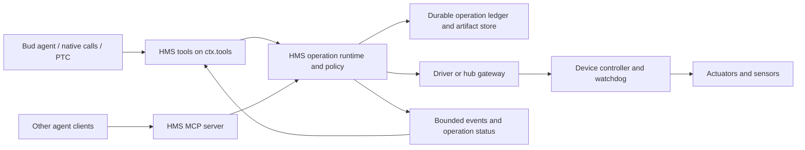

# Bud Meta Harness integration design

Status: the [current isolated native integration run](../integration/harness/multi-adapter/README.md) at Bud Meta Harness `a16267881e98cdac5e1edd7ab6ff5d1dae0a8ff2` passes all sixteen existing flows against the multi-adapter-capable HMS runtime, separately verified by 315 Python tests. Four experimental packages expose HMS through actual native/PTC/Loader/AgentLoop and built SDK/profile paths. The thirty-eight inherited overlay inputs remain unchanged; one copied compact test repairs its gated invoke assertion to allow the operation's current `accepted` or `dispatching` state. The original test is preserved. Focused lint and all three aggregate checks ran again. Seven prior artifact-build stages are reused because the added test is outside emitted artifact inputs. All 14,406 existing built files match before/after; these are run-stability hashes, not hashes recorded at the original build time. Harness flows remain single-route scenarios; mixed-route coexistence is covered separately by the Python/CLI suite and independent probes.

The baseline preserves two failed runs: a read-only observer lock race was repaired; an intermittent `DEVICE_UNAVAILABLE` refusal remains unexplained. Passing later runs do not establish reliable availability under every host scheduling condition. The adjacent live checkout is unmodified and has advanced beyond the tested commit. These results do not establish release readiness, physical operation or production persistence.

The [earlier 1f0762af overlay and receipts](../integration/harness/README.md) remain historical evidence. The new SDK tests cover settled-work replay/mismatch, normal reopen and actual Session history visibility. They do not establish interrupted active-work recovery or a model's reasoning from history. Work-item deduplication and framework cancellation do not replace HMS operation identity or stop an accepted hardware operation. The fourteen-test portion inherited from [335a82eb](../integration/harness/revalidation-335a82eb/verification.json) uses the SQLite simulator. A separate [compact C integration lane](../integration/harness/compact-endpoint/verification.json) at pin `335a82eb…` added two tests, subsequently revalidated at `a1626788…`: three scenarios through real Node PTC, and three native-tool scenarios with host SIGKILL after endpoint acceptance but before receipt delivery. Independently decoded frames show exactly one OP per request and recovery by QUERY with the same operation identity and digest. This is endpoint acknowledgment loss; outer hctl admission-reply loss and in-flight framework cancellation remain separate unfinished tests.

The earlier source review remains separate. All 22 retained source files were byte-identical to the original audit at `655d7cec797c45f317ac623eca5319b50383b434`. The [original evidence manifest](../research/harness/manifest.json) and [current review](../research/harness/current-review/README.md) record comparisons, additional source snapshots, exact hashes and reading coverage. The remaining architecture below is a target design unless identified as part of the implemented local overlay.

The checkout advanced from `d338750966ab11c0bb149e3b4914e2851f63e84f` during the source review. Original tool/PTC/MCP/job/stream/delivery and credential/identity/package sources remained unchanged. The integration subsequently revalidated applicable instructions before changing its isolated worktree. Recheck live source and instructions before applying the overlay to a different revision.

## Decision

Hardware authority and durable operation state belong in the HMS runtime with a driver boundary. The native overlay connects it to Bud Meta Harness through the existing tool service; the [local MCP projection](mcp-integration.md) serves other local agent clients. Agent inference stays outside the servo loop, and filesystem permissions do not replace installation-specific equipment authority.

The native plugin receives local execution attribution, including the owning Session and exact call id, and can map those to durable HMS operation identities. This is not caller authentication: `AgentRegistry.withInitiator` explicitly states that the presence of an Agent proves neither liveness nor authorization. The HMS transport must authenticate the caller independently. MCP remains useful as an interoperability projection, but generic MCP cancellation, progress, and reconnection do not themselves establish physical execution guarantees.

## Existing APIs that support this design

The following paths resolve against the adjacent Bud Meta Harness repository. The manifest contains independent snapshots so future repository changes need not silently change this evidence.

| Capability | Existing source and signature | Integration consequence |
|---|---|---|
| Typed model-facing tools | [`tools/src/schema.ts`](../../Bud-Meta-Harness/packages/core/tools/src/schema.ts), `defineTool(options)`; [`tools/src/index.ts`](../../Bud-Meta-Harness/packages/core/tools/src/index.ts), `register(definition: ToolDefinition): () => void` | Return a canonical JSON value with a declared output schema and render it separately. Registration is already effect scoped. |
| Execution identity | `ToolRunContext` in `tools/src/index.ts`: `callId`, `rootCallId`, optional `agent`, required `signal`, `deferContext()` | Bind authority to the actual caller. Preserve the sub-call id in PTC; the outer root id alone is insufficient to distinguish commands. |
| Host policy | `tools/pre-execute`, `tools/execute`, `tools/post-execute`; `guard(guard: ToolGuard): () => void` | The guard is synchronous and monotonic. Use it for local vetoes; perform asynchronous authorization and interlock verification in the HMS runtime as well. A denied call cannot become allowed via a later guard. |
| Deferred exposure | `ctx.intercept('tools', { exposure: 'deferred' })`; `activate(name): () => void`; `deferredSchemas(scope?)` | Keep specialized capabilities out of prompts until needed. Activation is scoped to the agent and takes effect in the next request. |
| Search | [`extensions/tool-search/src/tool.ts`](../../Bud-Meta-Harness/packages/extensions/tool-search/src/tool.ts) | `tool_search` searches visible and deferred tools and activates matches. It is not a scalable physical-device inventory database. |
| Programmatic composition | [`ptc-runtime/src/types.ts`](../../Bud-Meta-Harness/packages/ptc-runtime/ptc-runtime/src/types.ts), `PtcRunRequest`, `PtcBindingNamespace` | Existing PTC can compose all registered HMS tools, including parallel independent work. Retained PTC state is not durable; program abortion does not settle physical side effects. |
| External bridge | [`mcp-client/src/definition.ts`](../../Bud-Meta-Harness/packages/mcp/mcp-client/src/definition.ts), `connect(config): McpSession`; `callTool(rawName,args,{signal,onProgress})` | Stdio and Streamable HTTP are already supported. Connections belong to the caller's scope and reconnect. Require an HMS operation handle rather than holding an MCP call open for an entire experiment. |
| Native use of an MCP-shaped provider | [`mcp-client/src/tools.ts`](../../Bud-Meta-Harness/packages/mcp/mcp-client/src/tools.ts), `createMcpToolDefinition(ctx, options)` | Optional reusable bridge for canonical MCP output and durable images. Its callback receives exact `ToolExecution`. Caller owns registration, cancellation deadlines, and teardown. |
| Long-running job UI | [`jobs/src/index.ts`](../../Bud-Meta-Harness/packages/jobs/jobs/src/index.ts), `start(spec): JobId`, `get`, `wait`, `kill`, `events.subscribe` | Jobs are a process-local controller/view for the durable HMS operation. Use `owner: exec.agent.session.id`, not an Agent object. The cookbook currently contains an older owner example; the actual `JobSpec` type wins. |
| Streaming | [`streams/src/service.ts`](../../Bud-Meta-Harness/packages/work/streams/src/service.ts), `registerHandler`, `attach`, `requestDetach` | Telemetry, video and control track kinds already exist. This is a live transport vocabulary, with transport-owned backpressure, not a hard-real-time control guarantee. |
| Durable event delivery | [`session-delivery/src/index.ts`](../../Bud-Meta-Harness/packages/work/session-delivery/src/index.ts), `deliverOnce(agent,delivery,signal)` | Deliver selected operation milestones to model context with stable event keys. Commit the HMS notification cursor only after durable delivery acknowledges it. |
| Session truth | [`docs/architecture.md`](../../Bud-Meta-Harness/docs/architecture.md) | Every model-visible observation must be reconstructable from the Session log. Unlogged live telemetry cannot silently affect model context. |

## Package responsibilities

The implemented overlay supplies the first four service-definition/provider/tool/profile packages below, following the repository's capability-seam rule and `@budmh/experimental-` naming policy. Jobs, streams and custom UI remain proposals. The current provider delegates local transport to the checked Python SDK; it does not implement remote credential authentication or per-agent delegation.

| Proposed directory under `packages/experimental/` | Package | Owns |
|---|---|---|
| `hardware` | `@budmh/experimental-hardware` | Branded ids, request/spec resolution, typed abstract `ctx.hardware` service and domain results |
| `hardware-hms` | `@budmh/experimental-hardware-hms` | HMS client, authenticated transport and caller attribution, operation recovery, schema/version checks and bounded event consumption |
| `tool-hardware` | `@budmh/experimental-tool-hardware` | Search, describe, observe, submit, status, events and cancel tools with canonical output and renderers |
| `hardware-profile` | `@budmh/experimental-hardware-profile` | Explicit opt-in composition patch and dependencies on the definition, provider and tools |
| `hardware-jobs` | `@budmh/experimental-hardware-jobs` | Optional process-local job projection and cancellation request forwarding |
| `hardware-streams` | `@budmh/experimental-hardware-streams` | Optional bounded live telemetry/video and logged summaries |
| `client-ui-hardware` | `@budmh/experimental-client-ui-hardware` | Optional browser cards derived from persisted facts, localization and artifact navigation |

The independent HMS runtime owns the registry, authorization, operation ledger, leases, drivers and observation archives. The Harness packages own model orchestration and presentation. Follow the existing `experimental/agent-team-profile` patch/manifest pattern and `experimental/tool-worktree/tests/loader-composition.spec.ts` Loader test pattern. Release packages must not acquire runtime dependencies on these experimental packages. An optional UI package uses separate `.` and `./client` entries, `budmh.client.platform: 'web'`, and the shared Client bundler; promotion would place it at `packages/client/ui-hardware` as `@budmh/client-ui-hardware`, not `@budmh/ui-hardware`.

The runtime may be colocated on a GB10 hub, a Linux device, or a separate service. Tiny devices need a controller/gateway profile; the harness need not run on an Arduino. Application launch remains a named `budmh` profile or patch. An HMS daemon is a separate hardware service, not a replacement Harness launcher.

## Model-facing interface

The current overlay exposes nine direct names matching the checked local API: `hardware_discover`, `hardware_describe`, `hardware_observe`, `hardware_namespace`, `hardware_prepare`, `hardware_invoke`, `hardware_operation`, `hardware_events` and `hardware_cancel`. It generates closed method-specific output shapes for native/PTC consumers from the retained API schema, while the Python client enforces the full bounds and semantics. The broader search/submit/status names and capabilities below remain proposals.

Expose a small eager tool set and searchable capability descriptions. For high-use procedures, optionally project a version-pinned deferred typed tool, but retain one shared runtime admission path.

| Proposed tool | Essential request | Essential response |
|---|---|---|
| `hardware_search` | Text/capability/site filters, page size, opaque cursor | Authorized bounded matches, manifest revision, continuation cursor, truncation state |
| `hardware_describe` | Device id, optional known revision | Procedures, state schema, units, bounds, conflicts, timing class, calibration and connection status |
| `hardware_observe` | Device id, state fields, maximum acceptable age | Values with source timestamps, receipt timestamps, uncertainty/quality, revision and freshness |
| `hardware_submit` | Server-issued replay namespace, explicit operation key, device/action revision, endpoint/control/binding/calibration generations, arguments, timing and required effects | Durable operation id, accepted/rejected state, invocation identity and status lookup |
| `hardware_status` | Operation id or caller-scoped idempotency key | Execution state, knowledge of effects, stop state, last evidence and recovery actions |
| `hardware_events` | Operation id, cursor, bounded wait/size | Ordered event page, sequence/gap indicator, next cursor |
| `hardware_cancel` | Operation id, reason | Cancellation requested/acknowledged, current stop evidence; never a fabricated stopped claim |

Use `hardware_submit` for scheduled or long-duration work and bounded `hardware_events`/`hardware_status` waits for collection. A separate `hardware_execute_plan` can submit a validated finite local program; PTC can compose plans and calls, but it is not the local program's execution clock.

The names above are intentionally separate from concrete protocol method names. An adapter must map them explicitly and test the mapping. Do not infer a device's authorization, identity, or raw wire method by parsing a display label.

## Runtime invocation and recovery

The following is the fuller target recovery design. The implemented same-UID profile uses explicit caller-retained replay keys and immutable envelopes, permits authenticated non-agent local calls, and keeps Session/call IDs as Harness attribution. It does not yet store per-Session authority or a Session-to-operation recovery index in HMS.

1. Authenticate the transport caller, then bind the provider-supplied Session and exact call id for attribution and derive the allowed device scope. Never accept a model-supplied principal as authoritative. Refuse mutation when no Agent/caller binding is available unless a separately authenticated non-agent caller path is configured.
2. Resolve a request to an immutable spec: exact device and procedure revisions, units, authority scope, deadline, firmware/calibration references, declared conflicts, and loss-of-contact behavior. Validate dynamic arguments at the runtime boundary, even when the tool's outer schema was validated.
3. Authorize result access and resolve `(principal, deployment, server-issued replay namespace epoch, caller operation key)` before fresh actuation admission. An identical immutable intent returns the existing operation; a changed digest conflicts. Namespace expiry/floor rules prevent forgotten keys from becoming new operations. A new model tool call must not automatically mean a new physical retry. The [host contract](../spec/08-host-contract.md) pins the envelope/digest; the isolated native/PTC tests now exercise same-key replay against it.
4. Validate authority, the exact pinned binding and appropriately fresh measured preconditions. Atomically reserve all resources/fences and persist the operation intent, digest, replay mapping and dispatch ownership eligibility. Store Session id and exact tool call id as authenticated provenance outside immutable physical intent. Recheck at actuation; an earlier approval or observation does not freeze the plant. Endpoint/exclusive-gateway fencing remains essential even when the database transaction succeeds.
5. Persist the dispatch transition before transmission. If transmission or reply fails after dispatch may have occurred, preserve an uncertain physical outcome. Query the device's operation receipt/state. Do not retry an unobservable non-idempotent effect merely because the network call timed out.
6. Return the operation handle promptly. If caller cancellation races acceptance, recover through the caller-scoped key or Session/call mapping. The tool pipeline may replace a successful return with an aborted result; the ledger must remain queryable despite that.
7. Subsequent observations and completions update the ledger with evidence. Distinguish runtime request acceptance, controller execution, and measured postconditions. Software success is not always measured physical success.
8. On agent/provider teardown, stop admitting new calls and release client resources. The runtime executes the declared owner-loss policy for operations. Only transfer ownership through an explicit authorized transition. A session fork copies history, not leases or the right to cancel the parent's experiment.

A stable explicit idempotency key is needed for semantic retries spanning different model calls. A mapping from Session plus exact call id handles transport retries of one invocation. Store both. HMS status can list unresolved operations for the authorized Session after a crash; the model must be able to reconcile effects even if its original `tool/result` never committed.

### Authentication and credentials

For a credential-authenticated HMS transport, configuration carries a `credentialRef('HMS_TOKEN')`; the Host provider resolves `ctx.credentials.resolve(ref)` for each operation and fails if absent. It must not cache the secret across operations. When the credential service is deliberately optional, the existing `readCredentialValue(ctx.get('credentials'), launchEnvironmentOf(ctx), ref)` helper preserves the documented launch-environment fallback. Stateful grants use `credentialKey(owner, deploymentId)`, `readRecord` and serialized `modifyRecord` refresh; the owning provider validates its grant payload. `ctx.authorization.registerFlow` can acquire a credential interactively, but does not authorize hardware actions. The anonymous user id is a telemetry identifier and must not substitute for an HMS credential.

A Linux Unix-domain-socket deployment may authenticate a local process through `SO_PEERCRED` and enforce a UID/device/action policy. This authenticates a Unix user, not a Harness Session: every process under that UID shares that authority and can supply the same Session/call labels. Restrict the socket directory and socket access and validate peer credentials on every connection; do not claim Session isolation from socket permissions. Session-specific authorization requires separately issued, restricted delegation accepted and enforced by HMS. Model-accessible same-UID shell execution can reach the same socket or credentials, so a native tool wrapper alone cannot impose stronger per-agent privileges. That stronger isolation remains a separate deployment capability.

The first provider needs bounded registry search/description and observation, replay-namespace issuance, submit, operation/key lookup, events, cancellation, and explicit reconciliation of an interrupted submission. Bind the authenticated principal outside model JSON. Preserve the full immutable invocation envelope and return durable operation ids with independent execution/effect/stop evidence. A transport must document its framing, size/deadline limits and error mapping; a standalone CLI or journal API does not establish the wire protocol by itself.

## Cancellation and error model

Existing ToolRuntime cancellation is cooperative and quiescent for work the tool owns. [`timeout-policy/src/index.ts`](../../Bud-Meta-Harness/packages/guard/timeout-policy/src/index.ts) awaits the wrapped call and can replace its result with `TOOL_TIMEOUT`; it cannot prove a disconnected motor stopped. A background operation therefore needs its own runtime lifetime and cleanup policy. The short submission RPC owns only transmission, acceptance/reconciliation, and its local client resources. Once accepted, operation cancellation is a separate protocol action.

Model physical outcomes in canonical JSON, not only exceptions. A successfully queried uncertain operation is a successful query with `effectKnowledge: 'unknown'`, not a failed query that discards the handle. Suggested orthogonal fields are `executionState`, `effectKnowledge`, `stopState`, `errorCode`, `observedAt`, and `evidenceRefs`. Keep `stopState: 'requested'` separate from `'confirmed'`. Use `'not-dispatched'` only when dispatch is demonstrably excluded.

Examples of domain codes are `STALE_STATE`, `REVISION_MISMATCH`, `LEASE_LOST`, `INTERLOCK_OPEN`, `CALIBRATION_REQUIRED`, `CAPACITY`, `OUTCOME_UNKNOWN`, and `STOP_UNCONFIRMED`. Names are proposed, not existing Harness codes. Infrastructure throws still use the repository's structured Harness error conventions. The native PTC exception interface does not expose internal structured error codes, so automation decisions needing these codes must receive them in validated domain results.

Never implement automatic mutation retries in a generic `tools/execute` wrapper. The runtime can retry only when it can establish no dispatch occurred, reconcile a durable receipt, or safely repeat the effect under its declared idempotency semantics. A camera read can also consume state or trigger illumination, so classify concurrency by actual semantics rather than naming conventions.

For hazardous channels, interlocks, travel limits and watchdog behavior remain local to the controller. A host guard adds defense but cannot replace them. The shipped Harness permission posture is permissive; hardware authorization must remain enforced even under host `danger-full-access`.

## Jobs and streams

`ctx.jobs.start` requires a controller for the owner and synchronously returns an id. Its `JobHooks.cancel` is synchronous and idempotent; arrange for it to enqueue a runtime cancellation request, and settle `done` only when this producer's own resources are released and the outcome is reported. If physical stopping remains unknown, retain that fact in the HMS ledger and the job's bounded result. `producerReported` is explicitly not proof of resource release. Do not use `JobOutcome.status: 'killed'` alone as evidence of a stopped device.

The durable HMS operation id and ephemeral job id are distinct. Restarting the Harness may reconstruct a monitoring job for the same operation without resubmitting the operation. Critical background work needs an explicit policy for agent disposal: cancel, finish a bounded safe procedure, or hand over to an authorized operator/runtime owner. The default must be chosen per device/procedure, not assumed universally to mean power off.

Live stream frames are lossy across crashes. Telemetry and control `rateHz` fields are descriptive parameters, not scheduler guarantees. Preserve full experimental acquisition in the runtime's artifact store; use `ctx.streams` for live display and bounded summaries. Every model-visible image or summary must enter durable tool results, attachments or logged deliveries. Coalesce frequent sensor events and retain source sequence numbers and gaps. A low-latency model does not make Node's event loop a deterministic servo scheduler.

For a milestone notification, use namespace `hardware` with a key such as `operationId:eventSequence`, and a declared `MessageSourceMap` kind. `deliverOnce` requires persistent Session storage, a registered delivery projection and a live writer lease. Its guarantee concerns durable message delivery; it does not turn the physical action into an exactly-once action. Handle discarded/lost deliveries explicitly and do not silently resurrect canceled user work.

## Registry scale and schema evolution

Use the HMS registry for device inventory, topology, admission and capability search, with authorization before results leave it. Avoid registering each pin, property and device instance as a permanent model tool. The existing deferred tool catalogue materializes schemas and is appropriate for a bounded tool family, not proof that millions of devices fit in memory or model context.

Search returns compact authorized summaries; describe retrieves a bounded exact manifest. Schema hashes and revisions travel with submitted plans. A manifest change invalidates stale plans explicitly. Fetch and validate a replacement generation before replacing the visible one. Note that the existing MCP sync implementation preserves old definitions on fetch failure, but a conflict during its registration swap removes the previous set and rolls back the new set to none. Do not describe that as retaining the old generation in every failure case.

A connected tool can remain visible while its device is offline; admission must still check availability. Treat device/vendor descriptions as untrusted data, bounded and attributed. They must never grant permissions or become instructions to reveal credentials. Runtime credentials belong to the credential/provider seam and must not enter replacement arguments, Session logs or model-readable manifests.

## Integration verification still required

The overlay's focused tests now execute three synthetic scenarios through actual native tools, an effectful prepare/invoke/replay/status sequence through the real Node PTC runtime, and a keyless AgentLoop tool turn. A serialized Session capture reconstructs the same model-visible history. This proves the tested composition's reconstruction, not a production persistence plugin's crash recovery. Custom PTC logging plugins may replace full content with previews/locators and need separate verification.

Review found that late Harness cancellation can replace a successful body value with a framework `ABORTED` result. The tool boundary now preserves explicit unconfirmed-outcome guidance for that case and distinguishes `ABORTED_BEFORE_DISPATCH`. Deterministic tests exercise the real registry with a mocked drained provider; transport loss after actual runtime admission remains a separate missing end-to-end test. The original operation request remains the replay identity; framework cancellation is never interpreted as physical rollback.

Owned package declarations, lint and translation pairing pass. After repairing dependencies in independent worktree-owned storage, all seven full artifact-build stages and all three aggregate build checks pass. Initial missing-link failures remain retained as superseded diagnostics. Release acceptance and the shipped-profile Session corpus remain separate gates. The overlay has not been installed in the live checkout, published, admitted to the shipped-profile recorded-session corpus or physically commissioned. The existing MCP tool-definition and execution-signal tests remain useful templates for broader interoperability work; the separate [local MCP projection](mcp-integration.md) now has modern wire and legacy SDK tests.

The current review additionally read the full worktree Loader-composition test and PTC lifecycle tests, and inspected the PTC binding implementation and metadata/replay/parallel-call tests with exact ranges in its manifest. `tools/src/ptc.ts` assigns each inner call its own `<parent>:ptc:<n>` id, forwards the parent Agent and root id, runs the normal tool scheduler, returns canonical values to the program and logs rendered content plus metadata. Binding failures expose only the error message to the program; domain codes needed by PTC therefore belong in canonical result values. Native and PTC integration tests must independently assert HMS ledger effects and Session replay, including multiple inner calls under one outer call and abort after acceptance. A fake PTC runtime test is useful unit coverage; the assembled scenario must also exercise the real PTC runtime through an explicit supported profile patch.

The retained local suites establish the specific simulator compositions above. The broader integration matrix still requires these checks, including expansion of already covered cases:

- Native and PTC discovery → describe → observe → submit → events → status against one simulator; verify structured values, persisted result metadata, and session replay.
- One runtime operation for duplicate same-key submissions; changed-payload rejection; ambiguous acceptance recovery after lost reply or agent cancellation.
- Two agents contending for one knob, stale lease epochs, lost hub contact, stale state, changed calibration, manual override, runtime restart and firmware reboot.
- Abort before dispatch versus abort after dispatch; cancellation requested without confirmation; no blind retry of a relative move or liquid dispense.
- Deferred tool activation, unauthorized inventory filtering, device retirement during discovery, schema revision change and MCP reconnect without resubmission.
- Bounded telemetry/event queues with visible gaps; artifact integrity; logged model-visible observations; completion delivery crash/retry; forked Session ownership.
- Controller-side hardware-in-the-loop watchdog and interlock tests on actual supported devices, with measured latency and resource usage. Simulator checks cannot establish physical stopping distance or timing.
- Repository-required keyless Session snapshots, focused package tests, typecheck/build checks, documentation sync and UI replay tests for shipped visible behavior. Follow local AGENTS and package instructions at implementation time.

The next physical integration milestone is an instrumented microcontroller/microscope controller through the same runtime API already exercised by both local simulators, using a supported Bud profile in native and PTC modes. Further adapters extend the same semantics. That milestone is evidence for a narrow supported profile, not universality.
