# Recorded PAT catalog over an authority-owned evidence vault

This isolated profile connects original-run evidence to catalog promotion and
deterministic application admission. Its implemented qualification domain is
finite synthetic GPIO/PWM. Device I/O, driver lifecycle and intelligence-hub
providers remain part of the broader required system; this candidate does not
implement those physical providers or natural-language synthesis.

The user describes desired behavior once. The intended system then routes an
observed context to an applicable installed PAT, or requests agent reasoning for
a new or unsupported situation. That routing requires a third outcome:
**known evidence unavailable**. Missing evidence, a changed driver, stale device
bindings or interrupted qualification cannot safely be treated as novelty.

```mermaid
flowchart LR
    Original[Original qualification run] --> Import[Authority import intent]
    Import --> Vault[Immutable evidence vault]
    Vault --> Publication[Authority publication receipt]
    Publication --> Prepare[Validate and prepare original evidence]
    Prepare --> Catalog[Explicit PAT catalog]
    Request[Structured context and request] --> Inventory[Complete relevant authorized inventory]
    Catalog --> Inventory
    Inventory --> Held[One bounded held evidence view]
    Held --> Check[Current applicability and final commit checks]
    Check --> Instance[Durable PAT instance and procedure]
    Instance --> Runtime[Deterministic execution]
    Request --> Replay[Original request key lookup]
    Replay --> Instance
```

## Boundaries

| Boundary | Required behavior |
|---|---|
| Preparation | Validate original authority, reservation, supervisor association, published vault manifest and complete reducer output outside the admission transaction. |
| Catalog receipt | Preserve original invocation separately from current applicability; record vault, manifest, publication, consumer and host identities. |
| Promotion | Require current configuration, original source binding, driver and installation identities, calibration, control generation and endpoint session. |
| New execution | Collect every statically relevant, authorized active PAT before acquiring one complete evidence view. Missing members refuse selection. |
| Business commit | Recheck held ownership/lifetime, exact control projection, current applicability, catalog inventory and registry revision before committing admission. |
| Historical replay | Authenticate the original request key and retrieve its original operation without new preparation, a new vault view or another qualification worker. |

The bridge uses an explicit bounded cache: at most four prepared original runs
and 64 MiB of logical charge. The vault independently enforces its own limits.
Capacity refusal does not authorize partial selection. Cache population is an
installed-service operation, not a caller-supplied program, callback or path.

Only bounded reads from the main authority database and checks of the held
in-memory view occur in admission and commit callbacks. Source hashing, vault SQL,
supervisor access and semantic reduction happen outside that transaction. The
execution lock precedes the short Journal transactions; the cache mutex is never
held across a context-manager yield. Existing single-snapshot, vault, authority
consumer and Journal code is inherited unchanged.

The final synchronous check is immediately before SQLite COMMIT. It is not a
hard real-time deadline across a potentially blocking commit. A later exception
may occur after admission committed, so the original request key must reconcile
that state. The implementation does not infer rollback from a lost reply.

## Scope of device, driver and hub control

The system design treats pins, buses, sensors, actuators, driver services and the
intelligence host as managed resources with explicit capabilities, dependencies
and ownership. A reusable PAT must pin the capabilities and conditions it needs.
Changing a driver or restarting a hub can invalidate applicability even when the
natural-language objective remains the same. Installed local controllers provide
the timing and failure behavior required by their device profile.

This catalog profile currently supports a single finite I/O role and its existing
trusted configuration. Supporting driver replacement, hub compute allocation,
multidevice applications and persistent Arduino controllers requires additional
providers, qualification policies and admission contracts. A control-test fixture
does not qualify those domains or establish successful learning.

## Verification records

Source copies, exact method selections, harness inputs and failed attempts are
retained separately. The first aggregate control attempt was killed before final
receipts. Two smaller attempts passed their tests but failed the older native
origin auditor. The corrected auditor checks the exact sealed native image.
A later complete-inventory control reached the expected refusal, then failed
while emitting a tuple in a JSON receipt; the fresh source copy uses arrays.

The control fixtures explicitly substitute the semantic inspection oracle and
start no qualification worker. The separate full integration selection requires
one original thirty-case worker, the real reducer, vault publication, catalog
activation, one completed simulated application and original-key history after
configuration drift and cold vault/bridge reconstruction. Final result receipts,
not this design document, determine whether each selection passed.
