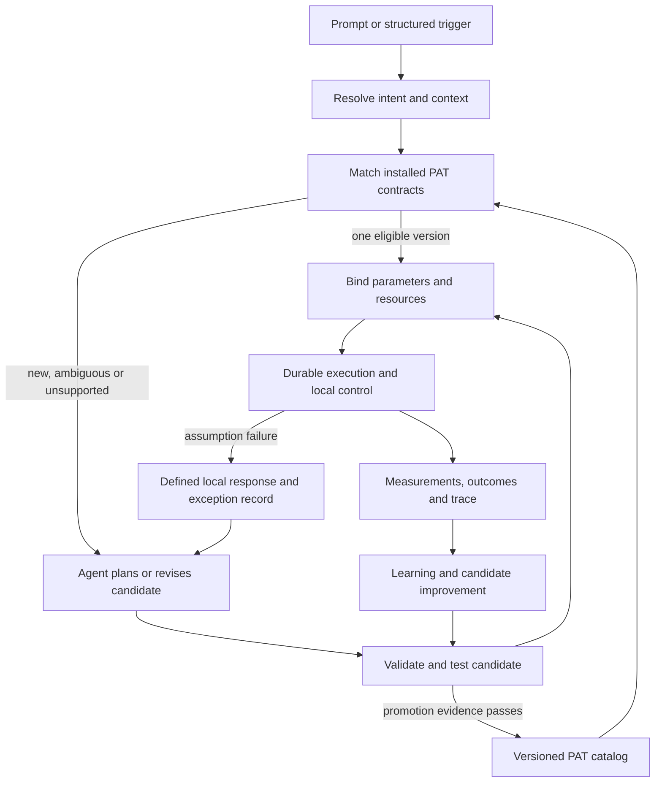

# Natural-language applications and Programs as Tools

The [main-runtime foundation integration](../artifacts/implementation/runtime-pat-foundation/README.md)
now passes all 861 tests. It brings the verified commit boundary, compiler identity
and static resource-validation changes into the public runtime's host libraries.
The actual prompt-to-PAT service still needs its explicit qualification/vault
mount and enforceable storage capacity; natural-language synthesis, learning and
persistent Arduino installation remain unfinished.

The [authority-vault catalog](../artifacts/implementation/pat-vault-catalog/README.md)
now passes 19 controls and the complete original thirty-case qualification,
vault publication, catalog promotion, one completed simulated PAT application and
cold original-key replay. Selection holds evidence for every relevant authorized
candidate through admission commit. Missing evidence refuses fresh reuse without
being classified as a new scenario. Prompt synthesis, learning and persistent
Arduino applications remain unfinished. Earlier implementation notes below
describe each stage at its recorded point in time.

The [vault batch candidate](../artifacts/implementation/pat-vault-batch/README.md)
passes 60 controls and can hold all requested evidence manifests together under
one bounded lease. Missing evidence refuses the complete view, providing the
component needed to avoid false novelty or unique selection. The distinct PAT
catalog profile still needs to assemble the relevant candidate inventory and
connect the view to applicability, promotion and admission. Learning is unfinished.

The [business commit candidate](../artifacts/implementation/pat-business-precommit/README.md)
now passes 51 controls, including actual vault-lease expiry after admission writes
and original-key replay after a lost commit reply. It provides the final check
needed for evidence-backed PAT admission. The new vault catalog mount still needs
to use the bounded view for every relevant candidate; this change
does not itself promote a PAT or complete prompt learning.

The latest [canonicalization candidate](../artifacts/implementation/pat-integer-canonical/README.md)
passes the complete thirty-case simulated worker and actual authority-vault import,
including warm and cold original-key replay after configuration drift. Exact
evidence and source associations are verified. The independent vault still needs
its explicit catalog/admission profile wired to the new business-precommit evidence check;
this import alone does not promote or run a PAT or complete the learning loop.

The preceding [native process diagnostic](../artifacts/verification/pat-native-worker-accounting/README.md)
passes 21 pure controls with unchanged project code, but its complete qualification
still reaches the original deadline after twenty-nine manifests. Import and
promotion remain unavailable. Missing qualification evidence cannot count as a
new scenario or authorize another physical effect. The intended loop still uses
deterministic eligible PATs for known contexts and escalates unsupported contexts
to the agent; synthesis, learning and persistent endpoint installation remain open.

The [isolated supervisor now uses the native scanner](../artifacts/implementation/pat-native-supervisor/README.md)
through a verified sealed image. Its complete worker still reaches the original
deadline, leaving fifteen case manifests and no import. Partial evidence remains
unavailable for promotion; it does not become novelty, successful learning or a
qualified PAT. The public service and full prompt-to-PAT loop remain unfinished.

The latest [in-process host binding](../artifacts/verification/pat-native-retention-binding/README.md)
passes 43 production-build controls, 20 instrumented controls and three syscall
scopes. Its explicit audit, signal and descriptor contracts prepare the next
supervisor integration. Full worker qualification, public promotion and the
natural-language learning loop remain unfinished.

The isolated [native host scan prototype](../artifacts/verification/pat-native-retention-prototype/README.md)
now supplies a measured performance candidate with 20 passing differential controls
and five syscall scopes. Binding and actual-worker integration remain required;
it does not yet make qualification, promotion or learning available.

The new [whole-worker diagnostic](../artifacts/verification/pat-worker-accounting/README.md)
passes 15 observer controls and measures parent/child CPU use with unchanged
project code. Its actual scope still times out before import, leaving 25 case
manifests and interrupted effects unknown. These observations neither qualify a
PAT nor establish novelty, promotion or learned behavior.

The preceding [topology/proof-build candidate](../artifacts/implementation/pat-io-proof-batch/README.md)
passes 63 pure controls and reduces repeated static validation, but its complete
actual worker still reaches the original deadline before import. Its retained state
is verified; no new PAT qualification, promotion or learned behavior follows from
that failed scope. Whole-worker resource diagnosis and the full learning loop remain
unfinished.

Status: required architecture, 2026-11-08. A [typed compiler and trusted local
promotion catalog](pat-foundation.md), with [deterministic structured routing and
durable instances](pat-execution.md), are experimental host libraries. Prompt
synthesis, learning, persistent applications and MCU program installation are
not implemented yet. This
extends the user's ten-part objective: applications should start from a prompt,
select instructions from context, learn from execution and become deterministic
Programs as Tools (PATs). The [bound procedure implementation](bounded-procedures.md)
is an execution component of that design, not a claim that the whole loop exists.

The latest isolated [recorded I/O catalog integration](../artifacts/implementation/pat-io-definition-build/README.md)
completes the 30-case simulated worker, original evidence import, promotion, one
PAT application and original-key replay. [Protected control storage](control-storage.md)
is the next service boundary: learning/evidence workloads must not consume the
capacity owed to already admitted operations. Its new separation/publication
profile now has an [independent immutable-vault candidate](../artifacts/implementation/pat-evidence-vault/README.md).
An [authority-owned import/publication candidate](../artifacts/implementation/pat-vault-authority/README.md)
now connects durable original intents and held-snapshot publication. All
[25 selected current-production controls](../artifacts/verification/pat-vault-authority-controls/README.md)
pass in separate scopes. Actual-run import through this profile, catalog integration
and backed capacity remain unfinished; storing or publishing bytes alone does not
qualify a learned PAT.
The [fresh actual qualification trial](../artifacts/implementation/pat-vault-original-run/README.md)
hit its original worker deadline before import. Its incomplete evidence remains
unavailable for promotion; it does not become a novel-context success.

The [simulation qualification components](pat-simulation-qualification.md) now
execute finite fan trials in fresh isolated SQLite state and gate catalog reuse
through an optional retained-evidence verifier and an integrated evidence store.
The memo library is integrated; durable attempts and the installed public
service are still being connected. The current
fan policy does not qualify persistent Arduino control or real device effects.

The [shared-board I/O simulation](io-simulation.md) now connects finite GPIO/PWM
capabilities to the existing public tools and bounded procedures. Its results
separate activation from completed cycles, and repeated request keys preserve
operation identity. The current fan-only qualification policy does not qualify
these I/O programs. Prompt interpretation, persistent control applications and
learning/promotion across I/O or hub capabilities remain separate unfinished work.

The [finite I/O qualification design](../artifacts/verification/io-pat-qualification-design/DESIGN.md)
identifies concrete prerequisites: explicit fixed-schema unit metadata, a trusted
I/O binding inventory, whole-domain timing checks, and an independent oracle for
activation versus cycle completion. The existing fan resolver and reducer cannot
be reused unchanged. Its acceptance checklist is planned only; it does not add
I/O qualification, persistent controllers or prompt learning.

A separate [fixed-unit compiler stage](../artifacts/implementation/pat-fixed-schema-units/results/pure34-01/README.md)
now passes 34 pure tests: 20 existing compiler methods and 14 new unit-metadata
methods. An explicit profile lets trusted numeric schemas carry units such as
`ms`, `Hz` and `permille` without adding wire arguments or inferring conversions.
Exact parameter semantics and full declared-domain checks remain mandatory.
This change is not integrated into the live runtime. That fixed-unit stage did not include the I/O qualification
worker or independent outcome oracle; later implementations and their acceptance
limits are recorded below. At that stage,
the compiler's own selected dependency identity also has the
[documented coverage gap](../artifacts/implementation/pat-fixed-schema-units/supplements/01/ERRATUM.md).

The separate [trusted I/O resolver candidate](../artifacts/implementation/pat-io-binding-resolver/implementation02/README.md)
has reviewed source. Its [first 29-test run](../artifacts/implementation/pat-io-binding-resolver/results/resolver29-01/index.json)
has 28 passes and one fixture failure. It selects installed GPIO/PWM
bindings inside an existing authority transaction, preserving aliases, exact
unit metadata and permission checks. Missing evidence for an authorized
candidate refuses selection rather than making a different candidate appear
unique. The failed purity test reads its own program fixture inside a filesystem
veto before invoking the resolver. A two-line fixture-order correction is followed
by a [passing focused purity check](../artifacts/implementation/pat-io-binding-resolver/results/focused-purity-01/README.md):
the resolver returns three assignments under the original SQL/file/clock/provider
guards, with unchanged transaction and business state. These are successful
in-process assertions, not separately retained raw SQL traces. The other 28 passes
remain part of the earlier failed run; no single clean 29-test rerun is claimed.
Both attempts retain stable 155 copied inputs and 159 external pins, with 33
logical state snapshots in the first and one in the follow-up. No provider tick
or qualification trial ran. The
[source review](../artifacts/verification/pat-io-binding-resolver-review/implementation02/review.json)
resolves input-bounding and test-state-retention findings; execution acceptance
and integration remain separate.

The [timing and outcome handoff](../artifacts/implementation/pat-io-timing-oracle-design/README.md)
now specifies the next two components against 19 pinned source files. Its
whole-domain timing rule accounts for early child admission, waiting leases,
exclusive deadlines and sequential completion under an explicit virtual-clock
policy. The proposed reducer checks raw owners, fences, receipt versions,
counters and replay rows to distinguish activation from a completed cycle.
This is a source-only design, with no new execution or qualification result.

Its separate [timing and case-planning implementation](../artifacts/implementation/pat-io-timing/results/attempt02-passed65/README.md)
now passes 65 pure checks: 31 new methods plus the existing 34 compiler/unit
methods. The [first run](../artifacts/implementation/pat-io-timing/results/attempt01-failed65/README.md)
had 64 passes and one fixture failure: enum equality was rejected by the parser
before the intended empty-domain check. A test-only correction now checks both
refusal branches; production code is unchanged between runs. Trusted setup reads
the installation/source pins; subsequent planning passes file/clock/database/
provider vetoes. Its explicit virtual-time rule can conservatively refuse
correlated parameter ranges. These checks execute only static planning;
the candidate is not integrated into the live runtime.

The separate [I/O phase engine](../artifacts/implementation/pat-io-trial-engine/results/attempt01-passed20/README.md)
now passes twenty integration tests against actual private runtime, compiler,
resolver, procedure and board state. It preserves immutable requests, drains
same-time work, advances to explicit future events and retains raw typed evidence.
Tests distinguish activation from completion, preserve unresolved claims after
receipt loss and refuse stale-session work after owner reopen. All nineteen
engine states, 38 databases and 2,619 records are retained; the final serialized
tables match the closed databases under a separate read-only comparison.
This is a worker component. Matrix/fault orchestration, independent outcome
reduction and public qualification remain unfinished; all qualification flags
stay false. It does not implement prompt learning or a persistent Arduino loop.

Its separate [transcript reader](../artifacts/implementation/pat-io-transcript/results/attempt01-passed39/README.md)
passes 39 pure tests over all nineteen original outputs and rehashed mutations.
It checks complete typed tables, pages, references, phase ordering, clocks and
reopen identities without calling the worker or provider. This establishes the
captured structure, not that an effect succeeded: the missing-receipt trial still
reports unresolved work. Independent outcome semantics and matrix-level
qualification remain required before automatic PAT promotion.

The next [board-history component](../artifacts/implementation/pat-io-board-history/results/attempt01-passed74/README.md)
passes 74 combined checks: 35 semantic methods and the 39 reader methods. It derives
GPIO/PWM model states, ownership, counters and receipt transitions independently
of provider validators. Eighteen coherent original histories pass and the missing
receipt history refuses. Rehashed semantic mutations must pass structural checks
before their semantic rejection. Provider completion can precede authority
settlement; a producer's parent-status claim cannot create a completed cycle.
Complete authority and PAT-to-intent semantics, fault composition and qualification
remain unfinished, so this component cannot promote a PAT.

The subsequent [operation-history component](../artifacts/implementation/pat-io-operation-history/results/attempt01-passed112/README.md)
passes 112 combined checks, including 38 new authority-history methods. It derives
operation state and resource ownership from events, checks replay/reserved keys
against the captured plan, and requires a release event before clearing claims.
Across nineteen original trials it accounts for 32 admissions and 156 events,
preserving the one unresolved operation and claim when a current receipt is lost.
This supports the validation needed before reusing a learned PAT. Parent control
flow, independent correspondence between PAT parameters and emitted instructions,
configuration attestation and complete qualification remain unfinished; automatic
PAT promotion is still disabled in these components.

The next [procedure-history component](../artifacts/implementation/pat-io-procedure-history/results/attempt01-passed146/README.md)
passes 146 combined tests. It verifies parent advancement, cancellation, restart,
resume and exact status projections against independently checked child histories.
Completion requires a settled successful prefix, including released claims.
Parent withdrawal cannot stand in for proof that dispatched work stopped. The
nineteen original trials retain eighteen parents and 105 events; missing receipt
evidence still leaves unresolved work. The next semantic gap is independent
correspondence between PAT parameters and emitted instructions. Complete
configuration/failure-cause attestation and matrix qualification also remain
necessary before automatic promotion.

The [PAT-correspondence checker](../artifacts/implementation/pat-io-correspondence/results/attempt01-passed41/README.md)
now passes 41 focused tests: 37 new methods plus the four retained-history checks.
It independently derives instructions from the intended finite PAT and tagged
inputs, rejecting coherent histories that used different arguments, literals,
step identities/counts or timings. The nineteen original trials contain eighteen
successful lowerings with 35 child requests and one correct numeric-type refusal.
Plan, binding and environment hashes are recomputed; historical compiler-label
consistency does not attest the current implementation. This closes that finite
correspondence gap. Complete current configuration/authorization attestation,
timing-policy composition, required fault coverage and qualification are still
needed before automatic PAT promotion.

The [configuration-capture candidate](../artifacts/implementation/pat-io-configuration-capture/results/attempt01-passed32/README.md)
passes 32 original host tests. It retains the installed types, device bindings,
permissions, sessions, observations and resolver configuration beside each
execution checkpoint under the same locks. Permission withdrawal before parent
acceptance and after child admission prevents device activation in these tested
cases. Execution and configuration evidence share the original bounds, including
the full sixteen-step case. Root checks the captured final tables against closed
databases. This supplies the missing evidence for future independent authorization
checks; capture alone does not qualify a candidate or permit automatic promotion.

The [independent configuration-history checker](../artifacts/implementation/pat-io-configuration-history/results/attempt02-passed87/README.md)
now passes 87 pure tests. It checks those snapshots against trusted installation
and permission-change plans, so captured grants cannot authorize themselves.
Types, bindings, resource dependencies, resolver registration and dynamic session
history must agree. New namespace, parent, child-admission and dispatch decisions
are checked, including both retained permission refusals. This closes the tested
configuration/permission-history gap for the immutable finite I/O profile.
Current-source attestation, active revocation, full fault/timing composition and
qualification remain required before automatic PAT promotion.

The [active permission-withdrawal trials](../artifacts/implementation/pat-io-active-revocation/results/attempt01-passed38/README.md)
pass 38 original host tests, including six new cases. Revocation during an active
GPIO/PWM operation returns modeled outputs to idle and prevents remaining PAT
steps. Withdrawal at the modeled due time prevents completion; withdrawal after
a committed completion preserves that historical result. Lost replies reconcile
the existing receipt before releasing authority claims, without another activation.
Read permission remains available for status. Independent checking of these
active-revocation causes is still required; this capture does not qualify a PAT
for promotion or establish physical stopping behavior.

The [independent authorized-history composition](../artifacts/implementation/pat-io-authorized-history/results/attempt01-passed103/README.md)
passes 103 pure tests. It now joins the trusted permission schedule with PAT
requests, board receipts/output states, authority events and parent history for
the six active-withdrawal captures. Four stops derive from permission loss; prior
cancellation and already completed cycles retain their original causes/results.
Lost replies do not authorize another activation or early claim release. Existing
GPIO/PWM/reopen/sixteen-step histories also compose. This closes the tested
active-withdrawal cause gap. Pending-unknown recovery, full read withdrawal,
current-source attestation, complete timing/fault coverage and qualification
remain required before automatic promotion.

The [pending-output recovery trials](../artifacts/implementation/pat-io-pending-recovery/results/attempt01-passed46/README.md)
pass 46 original host tests, adding eight cases with trusted fault schedules.
A lost activation reply can leave the output active. A failed stop preserves
ownership and claims; a committed stop with a lost authority reply preserves idle
evidence while claims remain held. Later recovery reconciles the existing operation
without another activation or remaining PAT step. Prior parent cancellation does
not relabel the child's recovery-stop cause. The eight cases finish with eight
canceled activations and no completed cycles. Independent checking of these fault
schedules and recovery causes remains required before this becomes qualification
evidence for automatic PAT reuse.

The subsequent [independent recovery-history composition](../artifacts/implementation/pat-io-recovery-history/results/attempts01-02/README.md)
passes 136 distinct pure tests in two disjoint runs, preserving all 103 prior
methods and adding 33 recovery methods. It checks the trusted schedules and
complete histories of all eight captured recoveries. Failed stops preserve
active output and ownership; failed reconciliation preserves terminal proof and
unsettled claims. An observed unfailed recovery must settle the original operation.
An event-valid but stalled history is rejected, as are invented faults, early
claim release and false completion. This supplies a tested recovery component
for future PAT qualification. Current-source attestation, the wider fault/timing
matrix, intermediate sampling, aggregate enforcement and public promotion remain
unfinished; full qualification flags stay false.

The [independent observation-history component](../artifacts/implementation/pat-io-observation-history/results/attempt01/README.md)
passes 27 new pure tests. It checks 1,288 produced samples across all 26 configured
fixtures, including legitimate cached values that lag an activation because
sampling occurs before the phase acts. Monotone undercounts, invented refreshes
and samples claiming a future activation refuse even when the prior history
checker accepts them. Full composition additionally checks authority and parent
history, preserving two existing pre-effect permission-refusal limitations.
This improves the evidence available to the learning/promotion loop; simulated
activation counts do not establish physical measurements or task success.
Current-source attestation, the remaining refusal causes, wider fault/timing
coverage, aggregate enforcement and public PAT qualification remain unfinished.

The subsequent [permission-refusal composition](../artifacts/implementation/pat-io-refusal-history/results/attempts03-05/README.md)
joins those two negative cases with the full configuration, PAT correspondence,
board, operation, parent and sample checks. All 128 selected methods pass across
separate 72-, 27- and 29-method invocations on one frozen source. The original
56-method timeout and a parent-launch setup failure remain retained. Causes are
derived from trusted grants, timing, ownership and prior state; a captured error
string or an event-valid stalled history cannot stand in for the required
refusal. Parent denial creates no work, and child denial does not invent parent
completion. Standalone readers retain their strict behavior. This extends the
tested simulation evidence for promotion; current-source attestation, the wider
fault/timing matrix, aggregate enforcement and public PAT qualification remain
unfinished.

The [independent static-policy and trial-outcome component](../artifacts/implementation/pat-io-outcome-history/results/attempt01/README.md)
passes 24 pure tests. It reconstructs the whole declared timing contract before
applicability, then evaluates the PAT's completion objective after all history
checks. Four of the 26 retained histories satisfy completion, sixteen fail it and
six remain unfinished. A valid cancellation or permission refusal does not become
task success, and an idle board with an unstarted parent remains incomplete. A
forged static schedule accepted by the prior history composition now refuses.
Current-source attestation, the complete bounded matrix and expected fault
responses, aggregate enforcement and public promotion remain unfinished; the
[remaining-work audit](../artifacts/implementation/pat-io-outcome-history/NEXT-QUALIFICATION.md)
connects those gaps to concrete engine and service changes.

The [combined qualification planner](../artifacts/implementation/pat-io-combined-matrix/results/attempt01/README.md)
passes 61 pure tests, including 31 inherited domain/timing methods. It preserves
candidate parameter cases and accounts for 25 fixed fault/resource challenges,
explicit auxiliary actors, replay and same-key conflict checks under the original
global limits. A constant candidate fits the planned case count; the ordinary
duration-parameter example requires 37 cases and refuses the 32-case ceiling.
No required cases are dropped. Executing and independently verifying this matrix,
enforcing actual group output/time/storage budgets and addressing the parameterized
capacity limitation remain required before qualification or promotion.

The [recorded replay/conflict extension](../artifacts/implementation/pat-io-conflict-history/results/attempt02/README.md)
passes 52 distinct methods across two successful bounded invocations. Its nine
new runtime cases preserve the original command identities, reject a changed
request under the same key and add no effects when replaying. An independent
checker verifies the request, authority, unchanged state and complete supported
histories. This is one worker extension; the full matrix and learning/promotion
service remain unfinished. The initial combined test attempt failed its 16 MiB
retention limit and remains preserved; verification was split with unchanged
source and limits, not by changing qualification-group budgets.

The [forward-time challenge worker and checker](../artifacts/implementation/pat-io-timing-challenges/results/attempts03-05/README.md)
pass 94 selected methods across three bounded invocations: 17 new methods and
77 unchanged configuration/refusal regressions. Sixteen actual GPIO/PWM trials
check eight exact schedules, including start/lease expiry, completion deadlines
and late parent reporting. The checker distinguishes a correct stop/refusal from
a satisfied completion objective, and historical completion from timely reporting.
Initial expiry-checker failures remain retained; runtime behavior was unchanged.
The complete candidate matrix, aggregate enforcement and promotion service remain
unfinished. These tests do not authorize reuse outside the tested context.

## Desired interaction

The [clock-fault capture extension](../artifacts/implementation/pat-io-clock-challenges/results/attempts01-02/README.md)
now passes 50 selected methods across two bounded runs. Six GPIO/PWM cases retain
in-call guard delay, separate wall/monotonic failures, sticky mapping invalidation
and recovery under a new epoch without replacing the original request. The pure
capture reader checks structure and the exact control schedule. The subsequent
[independent semantic composition](../artifacts/implementation/pat-io-clock-history/results/README.md)
passes 201 distinct checks across six bounded runs. It derives the six expected
fault responses from configuration, ownership, effects, events and observations,
including atomic no-start claim release and recovery without later steps. These
results still cannot qualify a PAT: full candidate matrix execution, current
attestation, aggregate enforcement, prompt learning and persistent deployment
remain unfinished.

The [shared-resource extension](../artifacts/implementation/pat-io-resource-challenge/results/attempt01-passed72/README.md)
passes 72 selected tests. Four fixed actors share one board and authority: GPIO,
PWM on the same pad, an alias on another route and an independent pad. Captures
show exclusion, independent progress and replay without extra activations. A
separate GPIO contention probe is declared before execution and budgeted even
though refusal is expected. This corrects the earlier plan, where replaying the
completed GPIO request could not test a new conflict. Independent request/schedule
checking exists. The subsequent [semantic composition](../artifacts/implementation/pat-io-resource-semantics/results/README.md)
passes 152 selected tests and independently validates the complete histories of
both fixed resource trials: configuration, permission, ownership, effects, events,
samples and exact replies. Full candidate matrix qualification, current attestation,
aggregate enforcement and automatic PAT promotion remain unfinished.

The [authority/binding capture extension](../artifacts/implementation/pat-io-authority-challenges/results/attempt01-passed76/README.md)
passes 76 selected tests. Six GPIO/PWM cases cover invalidation before dispatch,
invalidation while pending and removal of all grants. Pending work settles after
reopen while original compiled requests stay unchanged. With all grants removed,
public reads, parent replay and new namespace requests remain denied after
recovery. Current binding resolution is explicitly unavailable; historical
requests never stand in for a valid current binding. Internal trial observations
are labeled separately from public reads. Complete independent semantics for these
new captures, full qualification and automatic PAT promotion remain unfinished.

The [complete authority-history checker](../artifacts/implementation/pat-io-authority-semantics/results/README.md)
now passes 181 selected tests and independently validates those six retained
histories. It derives authority changes, effects, ownership, samples and replies;
invalidated bindings keep historical samples while fresh control is refused.
Recovery never restores withdrawn public permissions. These fixed challenges are
now checked, while current-candidate matrix execution, aggregate enforcement,
attestation, public qualification and automatic PAT promotion remain unfinished.

The [fixed lifecycle captures](../artifacts/implementation/pat-io-lifecycle-challenges/results/README.md)
now pass 21 methods spanning ten additional cases on GPIO and PWM: cancellation,
restart, reply loss and retained-read invocation withdrawal. Requests remain
immutable across restart, and correct fault handling is distinguished from
completion of the requested PAT. Exact request/schedule and targeted runtime
checks pass; full independent outcome composition and current-candidate group
qualification remain unfinished.

The [complete lifecycle-history checker](../artifacts/implementation/pat-io-lifecycle-semantics/results/README.md)
passes 58 pure methods and independently validates all twenty of those captures.
It distinguishes correct fault response from completion of the entire PAT, retains
claims through uncertain effects and verifies historical reconciliation without
rebinding. All named fixed challenges now have staged capture/outcome
components; current-candidate group qualification, aggregate enforcement,
attestation and automatic learning/promotion remain unfinished.

The [compiler identity correction](../artifacts/implementation/pat-compiler-identity/results/README.md)
passes 83 pure checks. It includes both previously omitted validation dependencies
and detects selected source/package changes during trusted worker setup, while
keeping pure lowering free of filesystem reads. The supported seven-package
identity does not itself attest the deployment or qualify a current I/O group.
Exact group execution, aggregate quotas and automatic promotion remain unfinished.

The [historical group reader](../artifacts/implementation/pat-io-group-history/results/README.md)
first independently checked a retained complete GPIO group. Its fresh deadline
failures and the later [page-encoding failures](../artifacts/implementation/pat-io-page-encoding/results/README.md)
remain preserved, including unresolved state.

The current [snapshot-reuse stage](../artifacts/implementation/pat-io-snapshot-reuse/results/README.md)
passes 132 distinct checks and completes fresh GPIO and PWM capture **and
independent inspection**. Each representative single-step constant candidate
has 30 cases, including all 25 fixed challenges. Separate pre-run setup, expected
outcomes, exact archive closure and operation/tick/record/byte accounting match.
The reader runs without file/SQL/clock access; forged archive variants refuse.
Pure snapshot reuse retains scalar distinctions, detached results and all
graph/generation/source/authority checks. Original execution limits remain.

This supplies complete current synthetic group evidence for those candidates.
Trusted process/run association, hard aggregate storage enforcement and public
qualification remain required before automatic PAT promotion. The result does
not establish deployment attestation, physical behavior, persistent controllers
or learned handling of arbitrary applications.

The [pre-run I/O bundle](../artifacts/implementation/pat-io-run-bundle/results/README.md)
adds 149 passing pure checks around exact multi-document input association.
The builder retains original authority, candidate, bindings, implementation and
all expected cases under a bounded manifest. Parsing requires an independently
retained digest and logical run/configuration context; fresh verification rebuilds
the setup against installed source identities. GPIO and PWM reconstruction pass.
Rehashed false setup cannot pass the fresh check. This supports the next durable
supervisor integration; it does not yet provide trusted service/process attestation,
enforced aggregate storage, public promotion or the synthesis/learning loop.

The [I/O supervisor stage](../artifacts/implementation/pat-io-supervision/results/README.md)
now passes 160 pure checks and one real owned GPIO group with independent
inspection of all 30 cases. It retains the complete input bundle before launch,
reconstructs it in the fixed worker image, and binds the result to the generated
attempt. Exact replay survives reopening; changed same-key requests refuse.
This establishes the tested synthetic process path. Supervised PWM and failure
recovery, trusted fixed service configuration, enforced aggregate storage and
public promotion remain before this can serve the learning/reuse loop.

An operator says, for example, “Use this Arduino to keep the enclosure between
the selected temperature limits and report when cooling is ineffective.” The
agent discovers the installed temperature input, fan output, wiring assignment,
units, operating limits and observations. It produces a concrete application,
tests its assumptions and starts the admitted version. The user does not write
an application-specific Arduino sketch. Missing hardware capabilities, ambiguous
wiring or unspecified limits become explicit planning inputs.

A reusable endpoint executor and device drivers must already exist or be
installed through a supported commissioning process. The same executor can
accept many applications expressed as instructions and bounded control programs.
A new electrical peripheral may require a new driver; a new application composed
from installed capabilities should not require a firmware rebuild. A small MCU
can run the executor while the model runs on a hub. A capable endpoint can host
both, with the same separation of planning and execution.

Many Arduino applications are persistent rules or feedback controllers. Model
them as a standing application deployment with explicit triggers and lifecycle,
not as an endlessly replayed one-shot operation. Each event-driven activation
needs a durable trigger identity and bounded effects; input epochs and sequence
numbers make duplicate events and stream gaps visible. Local control loops and
their lease/renewal policy must operate without repeated planning inference.
Manual override, suspension, restart and unmet conditions belong to that
deployment's contract. The current finite sequence profile does not implement
this persistent event/controller layer.

The application is a persistent intent with observable success conditions, not
just the text of its initial prompt. Changed user requirements create a new intent
revision. Reusing a PAT does not reuse an old execution's operation keys, deadline,
lease, endpoint session or sensor readings.

## Execution path

The fast path does not call a language model to choose each instruction. A PAT
may still use a pinned perception or numerical model when the application needs
it; “no planning inference” and “no model execution at all” are different modes.
Both must be measurable. Repeated structured triggers can use a deterministic
router. Arbitrarily worded new prompts generally need semantic interpretation;
the system must not claim zero model calls merely because it retrieved stored
code after an LLM interpreted the request.

## PAT artifact and instance

A proposed `hms.pat/0.1` artifact has an immutable digest, version and named input
schema. It contains capability requirements, typed parameter substitution,
preconditions, control flow, output/evidence contracts, execution placement and
bounded resource/effect budgets. It records exact dependency versions, tested
environment classes, promotion evidence and an applicability predicate. Data
and material references retain identity, units, frames and provenance.

The reusable artifact is separate from a bound execution instance. Binding
selects commissioned devices and drivers, verifies the capability contracts and
calibration, chooses fresh timing and replay identities, and records the exact PAT
digest and arguments. An exact retry of that instance keeps all its identities;
a deliberate later run creates a new instance. A PAT must never copy a successful
run's replay key or quietly substitute a new key after an unknown outcome.

The existing ordered procedure profile contains fully bound immutable child
invocations. It can be a first lowering target for straight-line PATs. It does
not yet represent reusable parameters, predicates, conditional branches, loops,
stream processing or local feedback controllers. Those are required extensions,
with explicit target feature negotiation. Unsupported instructions must be
reported during lowering rather than silently dropped or emulated with different
timing semantics.

For a tiny MCU, use a verified compact instruction representation over installed
primitives. Specify instruction counts, memory allocation, numeric behavior,
maximum iterations, cumulative travel/energy/exposure and the permitted local
response when a condition cannot be met. Timing-sensitive loops run in the
endpoint or native controller. A hub can compose acquisition, analysis and device
actions; it need not stream each PWM edge or motor step from an LLM.

## Learning and promotion

Learning begins with a complete trace: proposed action, admitted intent, actual
operation state, measurements, state assumptions, overrides, unresolved effects
and task-level outcome. A successful API return or a model's self-evaluation is
not sufficient evidence of the requested outcome. Failed and refused trials stay
in the dataset, including situations in which the candidate should have declined
to act. Memory retrieval and parameter fitting are both forms of learning here;
weight updates are optional and separately versioned.

The lifecycle is `candidate → evaluated → eligible → active → suspended/retired`.
Promotion uses a deployment policy with objective evidence gates. Within an
already delegated envelope it may be automatic; the architecture does not require
a person to approve every routine invocation. Novel physical authority or a new
driver/installation follows that deployment's commissioning policy. No universal
number of successful runs establishes eligibility for every application.

Required promotion evidence includes:

- Contract and dependency checks, typed inputs, finite control flow and resource
  bounds, including negative and boundary inputs.
- Scenario tests covering the declared context envelope, sensor faults, manual
  overrides, unavailable resources, interruption and unknown outcomes.
- Outcome measurements tied to the requested task, with uncertainty and the
  distinction between simulation and physical evidence preserved.
- A comparison against retained failures and rejected applicability examples, so
  a broader input envelope is not inferred from a narrow success trace.
- An immutable executable artifact and an evaluation record that pins all tested
  dependencies. A change creates a new candidate; active code is not silently
  rewritten during execution.

The router first applies deterministic eligibility checks: capability/driver
versions, current authority, resource state, valid observations and the declared
input domain. Similarity retrieval may shortlist PATs, but does not establish
eligibility. An ambiguous match, unknown input category, changed calibration,
out-of-domain sensor state or unmet outcome can trigger agent involvement.
Ordinary resource contention and transient transport failures follow declared
deterministic handling; not every exception needs another model call.

A cold qualification memo or unavailable evidence is an availability failure,
not a newly learned scenario. Restore and validate the retained evidence outside
the admission transaction, then retry the exact request within its original
bounds. Do not drop the unavailable candidate to make another PAT appear unique,
or ask the agent to generate replacement actions while the prior outcome is
unresolved.

A stopped or uncertain execution is reconciled before the agent proposes a new
physical attempt. The local response must work while the model is unavailable.
An agent's revised program becomes a new version with an explicit transition
policy for any active instance.

## Examples and measurable acceptance

| Application | Learned candidate | Deterministic reuse | Reason to involve the agent |
|---|---|---|---|
| Arduino enclosure control | Select temperature sensor and fan; derive bounded hysteresis configuration | Local sensor validity checks and hysteresis controller; periodic outcome reporting | New enclosure/fan, invalid sensor behavior or cooling outside the tested range |
| Microscope acquisition | Select focus/scan/acquisition primitives and exposure settings | Calibrated finite scan with exact sample identity and image lineage | New specimen class, failed focus metric, changed objective or calibration |
| Inspection cell | Compose fixture check, acquisition, pinned analysis and disposition | Run a versioned recipe for an identified part and tooling configuration | New part/defect category, tooling mismatch or ambiguous result |
| Hub data pipeline | Configure capture, bounded buffering, analysis and artifact storage | Route known streams and schedule admitted compute jobs | New input encoding/model, exhausted resource envelope or changed service dependency |

Acceptance requires running each eligible repeated scenario without planning
model calls, while deliberately novel or invalid scenarios take the declared
exception path. Record task success, false reuse, unnecessary escalation, model
calls, execution cost, latency distribution, resource use and effect uncertainty.
Crash tests must preserve the PAT version, executed prefix and operation identity.
Run the same contracts across supported MCU and hub profiles, reporting explicit
unsupported capabilities and actual target limits.

The [SayCan and Code as Policies full review](planning-and-grounding.md) supports
skill grounding and program composition. Voyager's authors describe an executable
skill library improved through environmental feedback; that demonstration is in
Minecraft, and does not itself establish deterministic zero-inference routing or
physical-device qualification ([official project](https://voyager.minedojo.org/),
[paper](https://arxiv.org/abs/2305.16291)). The new
[reading receipt](../research/planning/pat-learning/reading.json) covers the full
arXiv v2 paper and thirteen selected complete repository files; publisher-final
access remains a recorded gap. The [critique](../research/planning/pat-learning/notes/critique.md)
traces continued model/embedding calls and concrete program-bound and promotion
limitations. It does not claim a complete repository audit. Firmata's retained
[scheduler protocol](../research/protocols/repos/firmata-protocol/scheduler.md)
shows an existing message-programming mechanism; HMS additionally needs durable
identity, bounded effects and explicit evidence semantics.

The subsequent [I/O recovery stage](../artifacts/implementation/pat-io-supervision-recovery/results/README.md)
passes **178 of 180 distinct methods** on unchanged production code. Its 171
control checks and separate worker/owner-loss cases retain exact inputs and outcomes
without relaunching old attempts or signaling stored PIDs. The lowered record cutoff
delivers a failed group with one accepted operation and one claim; it cannot promote
a PAT. Completed owner-loss groups are independently inspected while their recovered
archives retain unknown exit/effect status.

The current PWM and archive-commit nominal tests hit the original 60 s deadline.
Their partial databases, an interrupted transaction journal, negative archives and
all audit refusals are preserved. No state is repaired and no ceiling is widened.
The next step profiles these failures before claiming complete supervised PWM or
archive-commit success. Trusted service configuration, hard aggregate quotas,
public qualification, prompt learning, persistent applications and real device,
driver and hub providers remain unfinished.

The [supervised I/O profiles](../artifacts/implementation/pat-io-supervision-profile/results/README.md)
separate parent collection/reduction cost from worker execution. The instrumented
parent test completes and independently checks all30PWMcases; the separate worker
profile reaches the original deadline with10manifests and an incomplete next state.
Repeated canonical serialization, runtime reconstruction and installation validation
are measured optimization targets. The original uninstrumented PWM and archive-commit
failures remain preserved and unresolved. No production optimization, quota change,
validation bypass or physical qualification is claimed. The next candidate is bounded
reuse of pure installation normalization, with current source checks and strict
input/dependency invalidation, before uninstrumented regression testing.

The [bounded installation normalization reuse stage](../artifacts/implementation/pat-io-installation-reuse/results/README.md)
passes **194 of 194 distinct methods**: unchanged 171 control checks, 14 new
pure memo tests and the same nine separate process cases. The fresh uninstrumented PWM and archive-commit nominal tests both pass.
The only production delta reuses immutable static installation results for exact
bounded inputs. Current source checks still run on every call; no live authority,
binding, generation, clock, effect or receipt is cached. The original semantic
validation body and all supervisor/worker bytes remain unchanged.

Historical failures remain preserved. Current cases ran once, so these results do
not establish repeated reliability or a controlled speedup. No deadline/effect/storage
ceiling changed. Public qualification, actual aggregate quotas, trusted service
mounting, PAT learning, persistent applications and physical device/driver/hub
providers remain incomplete; the full goal stays active.

The [trusted I/O service configuration stage](../artifacts/implementation/pat-io-service-config/results/README.md)
passes **216 of 216 distinct methods**. It adds a closed configuration-to-run
path: explicit policy, installation, artifact assignments, challenge bindings and
limits are joined to source-derived pins and fresh trusted descriptor snapshots.
Historical parsing requires external pin, run ID and request digest without
replanning. The configured original worker completes all 30 GPIO cases, with independent outcome inspection and exact replay before and after reopen.

The service module is now pinned in the supervisor identity and code image; the
worker and all other inherited production behavior remain unchanged. No bound was
widened. The configuration API itself opens no SQL and starts no worker. Durable
authority-owned configuration, resolver-based descriptor acquisition, serialized
evidence import, aggregate storage enforcement and public mounting remain pending.
PAT learning, persistent applications and actual device/driver/hub providers remain
required; the full goal stays active.

The [authority-owned I/O configuration stage](../artifacts/implementation/pat-io-service-authority/results/README.md)
passes **249 of 249 distinct methods** on its corrected source. It adds durable
administrator-owned configuration history, authority-bound service pins, exact
mutation replay and revision conflicts inside the existing Journal. Fresh run
preparation obtains the complete actual installed descriptor inventory and refuses
configuration or session changes during planning. One full worker group starts
from a committed configuration after Runtime reopen; independent checks join its
record, registry bindings/sessions and run inputs. The source authority has zero
device effects while the isolated 30-case worker group retains its own outcomes.

The initial 32-method attempt failed before configuration commit because SQLite
rows were compared directly with dictionaries. Its raw state remains retained;
the bounded-row conversion correction passes the same unchanged tests. Inherited
controls and process recovery checks also pass, with no widened limits. This is
an isolated host-library result, not public mounting or physical qualification.
[Run reservation and serialized evidence import](../artifacts/implementation/pat-io-service-authority/NEXT.md),
configuration-aware promotion, aggregate storage enforcement, prompt learning,
persistent Arduino applications and real device/driver/hub providers remain.
The full goal stays active.

The [durable I/O run reservation stage](../artifacts/implementation/pat-io-service-runs/results/README.md)
passes **276 of 279 distinct methods**. All 267 control methods pass,
including 29 new reservation controls. The new reserved-worker method reaches
its unchanged 60-second deadline in both ordinary and passive diagnostic
attempts; its later configuration/session-change replay assertions are
unreached. Two inherited owner-loss methods also fail: one lacks a complete
return after a recorded supervisor deadline; the other returns a failed group
at its own wall-time limit. All selected methods were executed and all failures
remain retained.

The authority atomically commits the original run intent, request, receipt and
complete input bundle. Exact replay retrieves those inputs across source,
configuration and session drift, subject to current authorization and retained
state integrity. Independent audits join both failed workers to the original
reservation and all 37 input documents each. Reservation is not proof of
execution. Passive CPU/pressure observations do not establish the cause of the
deadline or provide a deployment capacity guarantee.

The [next integration boundary](../artifacts/implementation/pat-io-service-runs/NEXT.md)
must pin a durable supervisor authority and retain the original attempt
association before launch. A replacement or missing supervisor store must not
cause an existing run to execute again. Deadline diagnosis, protected hub
compute/storage capacity, serialized evidence import, configuration-aware
promotion and public service mounting remain open. Prompt learning, persistent
Arduino controllers and real device/driver/hub providers remain required.
The full HMS goal is active.

The [canonical-document validation candidate](../artifacts/implementation/pat-io-document-validation/results/README.md)
passes **292 of 298 methods**, including all 286 controls. Its 19 new tests
check bounded exact-byte reuse while preserving current SQL reads, metadata
checks, dependency checks and durable publication. A 1,000-repeat observation
performs one full validation instead of 1,000; it establishes reduced validation
work in that fixture, without a deployment latency guarantee.

The reserved-worker scenario now completes all 30 cases and replays the original
attempt after configuration and session changes. Independent audits join its
reservation and all 37 input documents to the original request and worker.
6 other process methods retain failures, including original supervisor/group
deadlines and a retention scan that could not complete. Their
complete-group/later replay assertions are not claimed.
Every selected method ran once, with original bounds and all failed states
retained. This fresh result does not repair preceding failures.

The [next integration boundary](../artifacts/implementation/pat-io-document-validation/NEXT.md)
is durable supervisor-store identity and admission handoff. Protected control
capacity, serialized evidence import, configuration-aware promotion, public
mounting, prompt learning, persistent Arduino applications and actual
device/driver/hub providers remain open. The full HMS goal is active.

The [durable supervisor handoff candidate](../artifacts/implementation/pat-io-execution-handoff/results/README.md)
passes all **50 new control methods**. It pins an actual durable supervisor
authority and commits the original reservation/request/attempt association before
launch. Replay and recovery preserve that attempt; missing or replaced state does
not authorize a new execution. Five added history controls verify distinct runs,
reopening and retained forged receipt chains with unchanged production source.

Across 349 selected methods, 135 have complete passing receipts and 8
have complete failing receipts. The 206-method compatibility selection times out
at its original 180-second limit; 194 completed log checks are retained but do not
constitute a complete passing selection. The actual new handoff worker also
reaches its original deadline, before complete matrix inspection and later replay.
Its persisted association is verified; its aggregate effects remain unknown
because one retained state is incomplete. All failed states remain untouched.

The [next integration work](../artifacts/implementation/pat-io-execution-handoff/NEXT.md) is serialized finite-I/O
evidence import and configuration-aware PAT eligibility. This is an isolated
library candidate. Public mounting, protected control capacity, aggregate storage
enforcement, prompt learning, persistent Arduino applications and actual device,
driver and intelligence-hub providers remain required. The full HMS goal is active.

The [original-run evidence consumer](../artifacts/implementation/pat-io-evidence-import/README.md)
adds bounded archive reading, complete independent reduction and atomic Journal
publication tied to the original configuration, reservation, supervisor and
handoff. All **23 storage/reader controls pass**; positive storage fixtures
explicitly substitute worker and semantic success. Three pure-reducer methods
also report passing, including the unchanged historical **30-case** matrix.
Their scope retains a wrapper failure: its final count predicate expected one
test. The original status, exit code and receipts are preserved without rerun.

All253 inherited production/test inputs remain unchanged; the new consumer has
a separate identity. Historical lookup and explicit reinspection do not provide
fresh PAT eligibility. No actual bound worker runs in this stage, and real bound
import remains unverified. Previous handoff/worker failures remain retained.

[Next work](../artifacts/implementation/pat-io-evidence-import/NEXT.md) includes remaining importer
coverage, a real bound import and a versioned catalog invocation/environment
contract. Public mounting, protected capacity, aggregate storage enforcement,
prompt learning, persistent Arduino applications and actual device, driver and
intelligence-hub providers remain required. The full HMS goal is active.

The [real bound-worker import stage](../artifacts/implementation/pat-io-bound-import/README.md)
has a complete method receipt for the original **30-case** worker, independent
inspection, atomic evidence import and exact replay after configuration/session
drift. The source authority, supervisor, handoff and captured bytes are audited.
All **five new importer fixture controls pass**; all259 inherited files are unchanged.

The actual integration scope **fails retention**: its17,591,296-byte authority
database exceeds the unchanged16MiB file limit by814,080 bytes. The original
failure is retained, with a separate bounded-chunk forensic copy. One preparation
failure started no child/worker. No original scope is rerun or reclassified.

An exact-deduplication sizing model reconstructs every row unchanged and estimates
1,463,296 fewer allocated bytes after index overhead; it is not an implemented
store or passing retention result. [Next work](../artifacts/implementation/pat-io-bound-import/NEXT.md) is versioned compact evidence
storage, protected capacity and catalog eligibility. Prompt learning, persistent
Arduino applications, public tooling and actual device/driver/intelligence-hub
providers remain required. Physical qualification is unclaimed; the full goal is active.

The [compact evidence-store stage](../artifacts/implementation/pat-io-content-store/README.md)
passes all **19 new scopes**: 18 fixture controls and an actual bound-worker
integration with the complete **30-case** simulation, independent inspection,
original-run import and exact historical replay after configuration/session drift.
The authority database is **16,132,096 bytes**, leaving **645,120 bytes** under the
unchanged 16 MiB single-file limit. All 4,011 references remain, backed by 2,798
exact bodies; no evidence or cases were dropped. All 261 inherited project files,
the legacy consumer identity and the producer image remain unchanged.

The earlier retention failure remains immutable. The [next work](../artifacts/implementation/pat-io-content-store/NEXT.md)
is explicit catalog invocation, current-configuration eligibility, and protected
control capacity. Historical success does not authorize a changed device context;
unavailable evidence must not be treated as novelty. Natural-language learning,
persistent Arduino applications, public tooling and actual device, driver and
intelligence-hub providers remain required. Physical qualification is unclaimed;
the full goal is active.

The [catalog interface review](../artifacts/verification/pat-io-recorded-catalog-design/README.md) identifies the explicit invocation and applicability changes required next. The existing compiler intentionally excludes endpoint sessions from its static environment, and execution filters that environment before catalog eligibility. The new profile must preserve the static format and check current source context without turning unavailable evidence into novelty. This review adds no production behavior or test claim.

The subsequent [recorded catalog candidate](../artifacts/implementation/pat-io-recorded-catalog/README.md)
implements that separation and passes 19 fixture controls. A prepared original
evaluation is reusable only when current source configuration and binding/session
provenance match. New incomplete qualification coverage also inhibits fresh reuse;
an unavailable result must not implicitly invoke an agent as if it were novelty.
Historical receipts retain their original meaning after drift.

Actual end-to-end catalog qualification remains incomplete. The first process
scope completed all 30 worker cases, original import, promotion and one simulated
application, then failed an incorrect effect-counter assertion. The corrected
scope hit the original worker deadline before import. Neither reached the complete
configuration/session replay checks. [Next work](../artifacts/implementation/pat-io-recorded-catalog/NEXT.md)
retains these failures and requires diagnosis before public mounting. Prompt
synthesis, learned PAT promotion and persistent Arduino applications remain open.

The later [definition-build refactor and full integration](../artifacts/implementation/pat-io-definition-build/README.md)
passes 21 pure controls and the unchanged actual process test. It verifies the
complete 30-case original worker, evidence import, catalog promotion, one completed
simulated application, exact-key replay, refusal after configuration drift, and
cold historical replay after session reopening. The refactor removes duplicate
pure static-proof construction within a call; it adds no cross-call authority cache.
The earlier failures remain historical failures. Public mounting, protected control
capacity and the natural-language learning loop remain [next work](../artifacts/implementation/pat-io-definition-build/NEXT.md).
