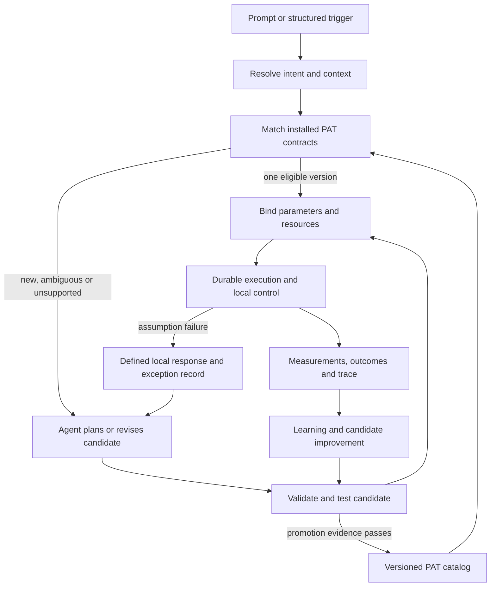

# Natural-language applications and Programs as Tools

Status: required architecture, 2026-11-07. A [typed compiler and trusted local
promotion catalog](pat-foundation.md), with [deterministic structured routing and
durable instances](pat-execution.md), are experimental host libraries. Prompt
synthesis, learning, persistent applications and MCU program installation are
not implemented yet. This
extends the user's ten-part objective: applications should start from a prompt,
select instructions from context, learn from execution and become deterministic
Programs as Tools (PATs). The [bound procedure implementation](bounded-procedures.md)
is an execution component of that design, not a claim that the whole loop exists.

The [simulation qualification components](pat-simulation-qualification.md) now
execute finite fan trials in fresh isolated SQLite state and gate catalog reuse
through an optional retained-evidence verifier and an integrated evidence store.
The memo library is integrated; durable attempts and the installed public
service are still being connected. The current
fan policy does not qualify persistent Arduino control or real device effects.

The [shared-board I/O simulation](io-simulation.md) now connects finite GPIO/PWM
capabilities to the existing public tools and bounded procedures. Its results
separate activation from completed cycles, and repeated request keys preserve
operation identity. The current fan-only qualification policy does not qualify
these I/O programs. Prompt interpretation, persistent control applications and
learning/promotion across I/O or hub capabilities remain separate unfinished work.

The [finite I/O qualification design](../artifacts/verification/io-pat-qualification-design/DESIGN.md)
identifies concrete prerequisites: explicit fixed-schema unit metadata, a trusted
I/O binding inventory, whole-domain timing checks, and an independent oracle for
activation versus cycle completion. The existing fan resolver and reducer cannot
be reused unchanged. Its acceptance checklist is planned only; it does not add
I/O qualification, persistent controllers or prompt learning.

A separate [fixed-unit compiler stage](../artifacts/implementation/pat-fixed-schema-units/results/pure34-01/README.md)
now passes 34 pure tests: 20 existing compiler methods and 14 new unit-metadata
methods. An explicit profile lets trusted numeric schemas carry units such as
`ms`, `Hz` and `permille` without adding wire arguments or inferring conversions.
Exact parameter semantics and full declared-domain checks remain mandatory.
This change is not integrated into the live runtime. The complete I/O qualification
worker and independent outcome oracle still need implementation;
the compiler's own selected dependency identity also has the
[documented coverage gap](../artifacts/implementation/pat-fixed-schema-units/supplements/01/ERRATUM.md).

The separate [trusted I/O resolver candidate](../artifacts/implementation/pat-io-binding-resolver/implementation02/README.md)
has reviewed source. Its [first 29-test run](../artifacts/implementation/pat-io-binding-resolver/results/resolver29-01/index.json)
has 28 passes and one fixture failure. It selects installed GPIO/PWM
bindings inside an existing authority transaction, preserving aliases, exact
unit metadata and permission checks. Missing evidence for an authorized
candidate refuses selection rather than making a different candidate appear
unique. The failed purity test reads its own program fixture inside a filesystem
veto before invoking the resolver. A two-line fixture-order correction is followed
by a [passing focused purity check](../artifacts/implementation/pat-io-binding-resolver/results/focused-purity-01/README.md):
the resolver returns three assignments under the original SQL/file/clock/provider
guards, with unchanged transaction and business state. These are successful
in-process assertions, not separately retained raw SQL traces. The other 28 passes
remain part of the earlier failed run; no single clean 29-test rerun is claimed.
Both attempts retain stable 155 copied inputs and 159 external pins, with 33
logical state snapshots in the first and one in the follow-up. No provider tick
or qualification trial ran. The
[source review](../artifacts/verification/pat-io-binding-resolver-review/implementation02/review.json)
resolves input-bounding and test-state-retention findings; execution acceptance
and integration remain separate.

The [timing and outcome handoff](../artifacts/implementation/pat-io-timing-oracle-design/README.md)
now specifies the next two components against 19 pinned source files. Its
whole-domain timing rule accounts for early child admission, waiting leases,
exclusive deadlines and sequential completion under an explicit virtual-clock
policy. The proposed reducer checks raw owners, fences, receipt versions,
counters and replay rows to distinguish activation from a completed cycle.
This is a source-only design, with no new execution or qualification result.

Its separate [timing and case-planning implementation](../artifacts/implementation/pat-io-timing/results/attempt02-passed65/README.md)
now passes 65 pure checks: 31 new methods plus the existing 34 compiler/unit
methods. The [first run](../artifacts/implementation/pat-io-timing/results/attempt01-failed65/README.md)
had 64 passes and one fixture failure: enum equality was rejected by the parser
before the intended empty-domain check. A test-only correction now checks both
refusal branches; production code is unchanged between runs. Trusted setup reads
the installation/source pins; subsequent planning passes file/clock/database/
provider vetoes. Its explicit virtual-time rule can conservatively refuse
correlated parameter ranges. These checks execute only static planning;
the candidate is not integrated into the live runtime.

The separate [I/O phase engine](../artifacts/implementation/pat-io-trial-engine/results/attempt01-passed20/README.md)
now passes twenty integration tests against actual private runtime, compiler,
resolver, procedure and board state. It preserves immutable requests, drains
same-time work, advances to explicit future events and retains raw typed evidence.
Tests distinguish activation from completion, preserve unresolved claims after
receipt loss and refuse stale-session work after owner reopen. All nineteen
engine states, 38 databases and 2,619 records are retained; the final serialized
tables match the closed databases under a separate read-only comparison.
This is a worker component. Matrix/fault orchestration, independent outcome
reduction and public qualification remain unfinished; all qualification flags
stay false. It does not implement prompt learning or a persistent Arduino loop.

Its separate [transcript reader](../artifacts/implementation/pat-io-transcript/results/attempt01-passed39/README.md)
passes 39 pure tests over all nineteen original outputs and rehashed mutations.
It checks complete typed tables, pages, references, phase ordering, clocks and
reopen identities without calling the worker or provider. This establishes the
captured structure, not that an effect succeeded: the missing-receipt trial still
reports unresolved work. Independent outcome semantics and matrix-level
qualification remain required before automatic PAT promotion.

The next [board-history component](../artifacts/implementation/pat-io-board-history/results/attempt01-passed74/README.md)
passes 74 combined checks: 35 semantic methods and the 39 reader methods. It derives
GPIO/PWM model states, ownership, counters and receipt transitions independently
of provider validators. Eighteen coherent original histories pass and the missing
receipt history refuses. Rehashed semantic mutations must pass structural checks
before their semantic rejection. Provider completion can precede authority
settlement; a producer's parent-status claim cannot create a completed cycle.
Complete authority and PAT-to-intent semantics, fault composition and qualification
remain unfinished, so this component cannot promote a PAT.

The subsequent [operation-history component](../artifacts/implementation/pat-io-operation-history/results/attempt01-passed112/README.md)
passes 112 combined checks, including 38 new authority-history methods. It derives
operation state and resource ownership from events, checks replay/reserved keys
against the captured plan, and requires a release event before clearing claims.
Across nineteen original trials it accounts for 32 admissions and 156 events,
preserving the one unresolved operation and claim when a current receipt is lost.
This supports the validation needed before reusing a learned PAT. Parent control
flow, independent correspondence between PAT parameters and emitted instructions,
configuration attestation and complete qualification remain unfinished; automatic
PAT promotion is still disabled in these components.

The next [procedure-history component](../artifacts/implementation/pat-io-procedure-history/results/attempt01-passed146/README.md)
passes 146 combined tests. It verifies parent advancement, cancellation, restart,
resume and exact status projections against independently checked child histories.
Completion requires a settled successful prefix, including released claims.
Parent withdrawal cannot stand in for proof that dispatched work stopped. The
nineteen original trials retain eighteen parents and 105 events; missing receipt
evidence still leaves unresolved work. The next semantic gap is independent
correspondence between PAT parameters and emitted instructions. Complete
configuration/failure-cause attestation and matrix qualification also remain
necessary before automatic promotion.

The [PAT-correspondence checker](../artifacts/implementation/pat-io-correspondence/results/attempt01-passed41/README.md)
now passes 41 focused tests: 37 new methods plus the four retained-history checks.
It independently derives instructions from the intended finite PAT and tagged
inputs, rejecting coherent histories that used different arguments, literals,
step identities/counts or timings. The nineteen original trials contain eighteen
successful lowerings with 35 child requests and one correct numeric-type refusal.
Plan, binding and environment hashes are recomputed; historical compiler-label
consistency does not attest the current implementation. This closes that finite
correspondence gap. Complete current configuration/authorization attestation,
timing-policy composition, required fault coverage and qualification are still
needed before automatic PAT promotion.

The [configuration-capture candidate](../artifacts/implementation/pat-io-configuration-capture/results/attempt01-passed32/README.md)
passes 32 original host tests. It retains the installed types, device bindings,
permissions, sessions, observations and resolver configuration beside each
execution checkpoint under the same locks. Permission withdrawal before parent
acceptance and after child admission prevents device activation in these tested
cases. Execution and configuration evidence share the original bounds, including
the full sixteen-step case. Root checks the captured final tables against closed
databases. This supplies the missing evidence for future independent authorization
checks; capture alone does not qualify a candidate or permit automatic promotion.

The [independent configuration-history checker](../artifacts/implementation/pat-io-configuration-history/results/attempt02-passed87/README.md)
now passes 87 pure tests. It checks those snapshots against trusted installation
and permission-change plans, so captured grants cannot authorize themselves.
Types, bindings, resource dependencies, resolver registration and dynamic session
history must agree. New namespace, parent, child-admission and dispatch decisions
are checked, including both retained permission refusals. This closes the tested
configuration/permission-history gap for the immutable finite I/O profile.
Current-source attestation, active revocation, full fault/timing composition and
qualification remain required before automatic PAT promotion.

The [active permission-withdrawal trials](../artifacts/implementation/pat-io-active-revocation/results/attempt01-passed38/README.md)
pass 38 original host tests, including six new cases. Revocation during an active
GPIO/PWM operation returns modeled outputs to idle and prevents remaining PAT
steps. Withdrawal at the modeled due time prevents completion; withdrawal after
a committed completion preserves that historical result. Lost replies reconcile
the existing receipt before releasing authority claims, without another activation.
Read permission remains available for status. Independent checking of these
active-revocation causes is still required; this capture does not qualify a PAT
for promotion or establish physical stopping behavior.

The [independent authorized-history composition](../artifacts/implementation/pat-io-authorized-history/results/attempt01-passed103/README.md)
passes 103 pure tests. It now joins the trusted permission schedule with PAT
requests, board receipts/output states, authority events and parent history for
the six active-withdrawal captures. Four stops derive from permission loss; prior
cancellation and already completed cycles retain their original causes/results.
Lost replies do not authorize another activation or early claim release. Existing
GPIO/PWM/reopen/sixteen-step histories also compose. This closes the tested
active-withdrawal cause gap. Pending-unknown recovery, full read withdrawal,
current-source attestation, complete timing/fault coverage and qualification
remain required before automatic promotion.

The [pending-output recovery trials](../artifacts/implementation/pat-io-pending-recovery/results/attempt01-passed46/README.md)
pass 46 original host tests, adding eight cases with trusted fault schedules.
A lost activation reply can leave the output active. A failed stop preserves
ownership and claims; a committed stop with a lost authority reply preserves idle
evidence while claims remain held. Later recovery reconciles the existing operation
without another activation or remaining PAT step. Prior parent cancellation does
not relabel the child's recovery-stop cause. The eight cases finish with eight
canceled activations and no completed cycles. Independent checking of these fault
schedules and recovery causes remains required before this becomes qualification
evidence for automatic PAT reuse.

The subsequent [independent recovery-history composition](../artifacts/implementation/pat-io-recovery-history/results/attempts01-02/README.md)
passes 136 distinct pure tests in two disjoint runs, preserving all 103 prior
methods and adding 33 recovery methods. It checks the trusted schedules and
complete histories of all eight captured recoveries. Failed stops preserve
active output and ownership; failed reconciliation preserves terminal proof and
unsettled claims. An observed unfailed recovery must settle the original operation.
An event-valid but stalled history is rejected, as are invented faults, early
claim release and false completion. This supplies a tested recovery component
for future PAT qualification. Current-source attestation, the wider fault/timing
matrix, intermediate sampling, aggregate enforcement and public promotion remain
unfinished; full qualification flags stay false.

The [independent observation-history component](../artifacts/implementation/pat-io-observation-history/results/attempt01/README.md)
passes 27 new pure tests. It checks 1,288 produced samples across all 26 configured
fixtures, including legitimate cached values that lag an activation because
sampling occurs before the phase acts. Monotone undercounts, invented refreshes
and samples claiming a future activation refuse even when the prior history
checker accepts them. Full composition additionally checks authority and parent
history, preserving two existing pre-effect permission-refusal limitations.
This improves the evidence available to the learning/promotion loop; simulated
activation counts do not establish physical measurements or task success.
Current-source attestation, the remaining refusal causes, wider fault/timing
coverage, aggregate enforcement and public PAT qualification remain unfinished.

The subsequent [permission-refusal composition](../artifacts/implementation/pat-io-refusal-history/results/attempts03-05/README.md)
joins those two negative cases with the full configuration, PAT correspondence,
board, operation, parent and sample checks. All 128 selected methods pass across
separate 72-, 27- and 29-method invocations on one frozen source. The original
56-method timeout and a parent-launch setup failure remain retained. Causes are
derived from trusted grants, timing, ownership and prior state; a captured error
string or an event-valid stalled history cannot stand in for the required
refusal. Parent denial creates no work, and child denial does not invent parent
completion. Standalone readers retain their strict behavior. This extends the
tested simulation evidence for promotion; current-source attestation, the wider
fault/timing matrix, aggregate enforcement and public PAT qualification remain
unfinished.

The [independent static-policy and trial-outcome component](../artifacts/implementation/pat-io-outcome-history/results/attempt01/README.md)
passes 24 pure tests. It reconstructs the whole declared timing contract before
applicability, then evaluates the PAT's completion objective after all history
checks. Four of the 26 retained histories satisfy completion, sixteen fail it and
six remain unfinished. A valid cancellation or permission refusal does not become
task success, and an idle board with an unstarted parent remains incomplete. A
forged static schedule accepted by the prior history composition now refuses.
Current-source attestation, the complete bounded matrix and expected fault
responses, aggregate enforcement and public promotion remain unfinished; the
[remaining-work audit](../artifacts/implementation/pat-io-outcome-history/NEXT-QUALIFICATION.md)
connects those gaps to concrete engine and service changes.

The [combined qualification planner](../artifacts/implementation/pat-io-combined-matrix/results/attempt01/README.md)
passes 61 pure tests, including 31 inherited domain/timing methods. It preserves
candidate parameter cases and accounts for 25 fixed fault/resource challenges,
explicit auxiliary actors, replay and same-key conflict checks under the original
global limits. A constant candidate fits the planned case count; the ordinary
duration-parameter example requires 37 cases and refuses the 32-case ceiling.
No required cases are dropped. Executing and independently verifying this matrix,
enforcing actual group output/time/storage budgets and addressing the parameterized
capacity limitation remain required before qualification or promotion.

## Desired interaction

An operator says, for example, “Use this Arduino to keep the enclosure between
the selected temperature limits and report when cooling is ineffective.” The
agent discovers the installed temperature input, fan output, wiring assignment,
units, operating limits and observations. It produces a concrete application,
tests its assumptions and starts the admitted version. The user does not write
an application-specific Arduino sketch. Missing hardware capabilities, ambiguous
wiring or unspecified limits become explicit planning inputs.

A reusable endpoint executor and device drivers must already exist or be
installed through a supported commissioning process. The same executor can
accept many applications expressed as instructions and bounded control programs.
A new electrical peripheral may require a new driver; a new application composed
from installed capabilities should not require a firmware rebuild. A small MCU
can run the executor while the model runs on a hub. A capable endpoint can host
both, with the same separation of planning and execution.

Many Arduino applications are persistent rules or feedback controllers. Model
them as a standing application deployment with explicit triggers and lifecycle,
not as an endlessly replayed one-shot operation. Each event-driven activation
needs a durable trigger identity and bounded effects; input epochs and sequence
numbers make duplicate events and stream gaps visible. Local control loops and
their lease/renewal policy must operate without repeated planning inference.
Manual override, suspension, restart and unmet conditions belong to that
deployment's contract. The current finite sequence profile does not implement
this persistent event/controller layer.

The application is a persistent intent with observable success conditions, not
just the text of its initial prompt. Changed user requirements create a new intent
revision. Reusing a PAT does not reuse an old execution's operation keys, deadline,
lease, endpoint session or sensor readings.

## Execution path

The fast path does not call a language model to choose each instruction. A PAT
may still use a pinned perception or numerical model when the application needs
it; “no planning inference” and “no model execution at all” are different modes.
Both must be measurable. Repeated structured triggers can use a deterministic
router. Arbitrarily worded new prompts generally need semantic interpretation;
the system must not claim zero model calls merely because it retrieved stored
code after an LLM interpreted the request.

## PAT artifact and instance

A proposed `hms.pat/0.1` artifact has an immutable digest, version and named input
schema. It contains capability requirements, typed parameter substitution,
preconditions, control flow, output/evidence contracts, execution placement and
bounded resource/effect budgets. It records exact dependency versions, tested
environment classes, promotion evidence and an applicability predicate. Data
and material references retain identity, units, frames and provenance.

The reusable artifact is separate from a bound execution instance. Binding
selects commissioned devices and drivers, verifies the capability contracts and
calibration, chooses fresh timing and replay identities, and records the exact PAT
digest and arguments. An exact retry of that instance keeps all its identities;
a deliberate later run creates a new instance. A PAT must never copy a successful
run's replay key or quietly substitute a new key after an unknown outcome.

The existing ordered procedure profile contains fully bound immutable child
invocations. It can be a first lowering target for straight-line PATs. It does
not yet represent reusable parameters, predicates, conditional branches, loops,
stream processing or local feedback controllers. Those are required extensions,
with explicit target feature negotiation. Unsupported instructions must be
reported during lowering rather than silently dropped or emulated with different
timing semantics.

For a tiny MCU, use a verified compact instruction representation over installed
primitives. Specify instruction counts, memory allocation, numeric behavior,
maximum iterations, cumulative travel/energy/exposure and the permitted local
response when a condition cannot be met. Timing-sensitive loops run in the
endpoint or native controller. A hub can compose acquisition, analysis and device
actions; it need not stream each PWM edge or motor step from an LLM.

## Learning and promotion

Learning begins with a complete trace: proposed action, admitted intent, actual
operation state, measurements, state assumptions, overrides, unresolved effects
and task-level outcome. A successful API return or a model's self-evaluation is
not sufficient evidence of the requested outcome. Failed and refused trials stay
in the dataset, including situations in which the candidate should have declined
to act. Memory retrieval and parameter fitting are both forms of learning here;
weight updates are optional and separately versioned.

The lifecycle is `candidate → evaluated → eligible → active → suspended/retired`.
Promotion uses a deployment policy with objective evidence gates. Within an
already delegated envelope it may be automatic; the architecture does not require
a person to approve every routine invocation. Novel physical authority or a new
driver/installation follows that deployment's commissioning policy. No universal
number of successful runs establishes eligibility for every application.

Required promotion evidence includes:

- Contract and dependency checks, typed inputs, finite control flow and resource
  bounds, including negative and boundary inputs.
- Scenario tests covering the declared context envelope, sensor faults, manual
  overrides, unavailable resources, interruption and unknown outcomes.
- Outcome measurements tied to the requested task, with uncertainty and the
  distinction between simulation and physical evidence preserved.
- A comparison against retained failures and rejected applicability examples, so
  a broader input envelope is not inferred from a narrow success trace.
- An immutable executable artifact and an evaluation record that pins all tested
  dependencies. A change creates a new candidate; active code is not silently
  rewritten during execution.

The router first applies deterministic eligibility checks: capability/driver
versions, current authority, resource state, valid observations and the declared
input domain. Similarity retrieval may shortlist PATs, but does not establish
eligibility. An ambiguous match, unknown input category, changed calibration,
out-of-domain sensor state or unmet outcome can trigger agent involvement.
Ordinary resource contention and transient transport failures follow declared
deterministic handling; not every exception needs another model call.

A cold qualification memo or unavailable evidence is an availability failure,
not a newly learned scenario. Restore and validate the retained evidence outside
the admission transaction, then retry the exact request within its original
bounds. Do not drop the unavailable candidate to make another PAT appear unique,
or ask the agent to generate replacement actions while the prior outcome is
unresolved.

A stopped or uncertain execution is reconciled before the agent proposes a new
physical attempt. The local response must work while the model is unavailable.
An agent's revised program becomes a new version with an explicit transition
policy for any active instance.

## Examples and measurable acceptance

| Application | Learned candidate | Deterministic reuse | Reason to involve the agent |
|---|---|---|---|
| Arduino enclosure control | Select temperature sensor and fan; derive bounded hysteresis configuration | Local sensor validity checks and hysteresis controller; periodic outcome reporting | New enclosure/fan, invalid sensor behavior or cooling outside the tested range |
| Microscope acquisition | Select focus/scan/acquisition primitives and exposure settings | Calibrated finite scan with exact sample identity and image lineage | New specimen class, failed focus metric, changed objective or calibration |
| Inspection cell | Compose fixture check, acquisition, pinned analysis and disposition | Run a versioned recipe for an identified part and tooling configuration | New part/defect category, tooling mismatch or ambiguous result |
| Hub data pipeline | Configure capture, bounded buffering, analysis and artifact storage | Route known streams and schedule admitted compute jobs | New input encoding/model, exhausted resource envelope or changed service dependency |

Acceptance requires running each eligible repeated scenario without planning
model calls, while deliberately novel or invalid scenarios take the declared
exception path. Record task success, false reuse, unnecessary escalation, model
calls, execution cost, latency distribution, resource use and effect uncertainty.
Crash tests must preserve the PAT version, executed prefix and operation identity.
Run the same contracts across supported MCU and hub profiles, reporting explicit
unsupported capabilities and actual target limits.

The [SayCan and Code as Policies full review](planning-and-grounding.md) supports
skill grounding and program composition. Voyager's authors describe an executable
skill library improved through environmental feedback; that demonstration is in
Minecraft, and does not itself establish deterministic zero-inference routing or
physical-device qualification ([official project](https://voyager.minedojo.org/),
[paper](https://arxiv.org/abs/2305.16291)). The new
[reading receipt](../research/planning/pat-learning/reading.json) covers the full
arXiv v2 paper and thirteen selected complete repository files; publisher-final
access remains a recorded gap. The [critique](../research/planning/pat-learning/notes/critique.md)
traces continued model/embedding calls and concrete program-bound and promotion
limitations. It does not claim a complete repository audit. Firmata's retained
[scheduler protocol](../research/protocols/repos/firmata-protocol/scheduler.md)
shows an existing message-programming mechanism; HMS additionally needs durable
identity, bounded effects and explicit evidence semantics.

