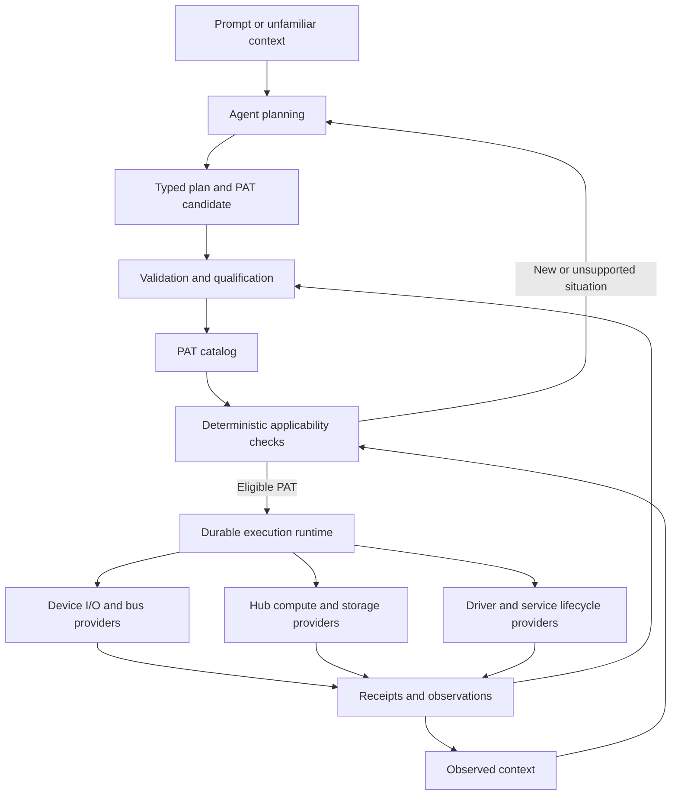

# Device I/O, drivers and intelligence-hub control

The [isolated native supervisor integration](../artifacts/implementation/pat-native-supervisor/README.md)
passes its loader and authority-boundary controls, but the complete worker still
times out before evidence import. Its sealed code image and retained state are
verified. This does not qualify device, driver or hub providers or complete PAT
promotion; those required capabilities remain unfinished.

Device channels, bus controllers, driver services and the intelligence host are
all first-class managed resources. A prompted application can span them through
typed capabilities and shared ownership. Its PAT dependencies include provider
versions, configuration and hub/device sessions, so a service restart or driver
change triggers applicability revalidation. Local deterministic control must
continue within its qualified policy when the intelligence service is unavailable.

The latest [native host binding](../artifacts/verification/pat-native-retention-binding/README.md)
passes 43 production-build controls, 20 instrumented controls and three syscall
scopes. This advances host qualification infrastructure; actual device I/O,
driver lifecycle and hub providers remain unfinished.

The new [native host scan prototype](../artifacts/verification/pat-native-retention-prototype/README.md)
passes 20 differential controls and five syscall scopes with lower measured scan
CPU cost. It remains isolated; this host optimization does not add a device,
driver or hub provider or establish complete PAT qualification.

The new [whole-worker diagnostic](../artifacts/verification/pat-worker-accounting/README.md)
measures substantial parent and child CPU use while preserving the complete
original scope and every project file. Its 15 observer controls pass; the actual
worker still reaches its deadline before import. Resource observations support
the next performance investigation, not a claim of qualified hub or I/O control.

The preceding [topology/proof-build candidate](../artifacts/implementation/pat-io-proof-batch/README.md)
passes 63 pure controls while preserving per-instance proofs and live runtime
checks. Its original 30-case integration still times out before import, with
interrupted effects unknown. Retained evidence integrity is verified; actual
device/driver/hub providers and persistent control remain required.

Status: required architecture with topology, persistent resource admission and an explicit
shared-board I/O simulation profile, 2026-11-08. Most domain bindings remain proposed.
The current executable adapters remain SQLite and native-C simulations; actual GPIO, buses, operating-system drivers and GB10 management
are not implemented by this document.

The user's scope includes control of device I/O and drivers, and of whichever
device hosts intelligence. The registry must describe the whole operating graph:
site, hub, compute service, adapter, bus, controller, peripheral, input/output
channel and physical capability. A hub is both an execution host and a managed
resource. Hosting the agent does not grant that agent unrestricted host control.

[Control-storage isolation](control-storage.md) is a concrete requirement for this
graph: evidence and learning workloads must not consume capacity owed to admitted
device, driver or hub operations. Five bounded SQLite experiments and a retained
allocation audit inform the proposed profile; production separation and backed
capacity enforcement remain unfinished.

An [independent vault candidate](../artifacts/implementation/pat-evidence-vault/README.md)
now retains exact immutable evidence under its own page cap. An
[authority-publication candidate](../artifacts/implementation/pat-vault-authority/README.md)
adds actual authority installation, original import intent and held-snapshot
publication. All [25 selected current-production controls](../artifacts/verification/pat-vault-authority-controls/README.md)
pass in separate scopes; actual-run and catalog integration remain incomplete.
The full integration must preserve control completion, explicit
quiescence and recovery when the evidence store is full or unavailable.
The [fresh actual trial](../artifacts/implementation/pat-vault-original-run/README.md)
stopped at its original worker deadline during the final shared-resource challenge.
No evidence import or publication followed; partial worker outcomes remain unknown.

The required flow connects learning and deterministic execution to all three
control domains. Qualification, provider mounting and physical support have the
implementation limits recorded below.

Each PAT declares its resource use and dependencies across these domains.
Driver or hub changes can invalidate applicability. The agent handles novelty;
installed deterministic controllers and local failure responses continue under
their qualified device-specific limits.

## Resource and capability domains

| Domain | Representative observations | Representative operations | Essential binding facts |
|---|---|---|---|
| Digital/analog I/O | Pin state, ADC sample, continuity/error state | Configure direction, bounded digital output, PWM/setpoint, timed capture | Electrical mode/range, pin multiplexing, ownership, sampling/actuation timing |
| Device buses | Device identity, health, errors, queue state | Addressed transaction, configure bus, recover/reinitialize | Bus controller, device address, framing, bandwidth, arbitration and shared dependencies |
| Sensors and actuators | Measured position, temperature, images, force, status | Acquisition, bounded motion, valve/fan/light control | Units, frames, calibration, limits, evidence and local failure response |
| Drivers and adapters | Installed version, supported features, state, diagnostics | Install verified artifact, configure, start, drain, restart, replace, remove | Artifact digest, compatible firmware/OS/ABI, configuration revision and affected resources |
| CPU/GPU/accelerators | Utilization, memory pressure, job progress, temperature | Admit compute job, allocate bounded capacity, select supported model/runtime, cancel/reconcile job | Actual hardware/software profile, quotas, deadlines, dependency and result provenance |
| Storage and data | Capacity, integrity, artifact/stream inventory | Allocate/write/read artifact, retain/export/delete under policy | Ownership, quota, integrity, retention, atomic publication and data lineage |
| Network and service I/O | Link/service health, queue/drop counters | Configure permitted interface/service, route stream, enforce bandwidth | Endpoint identity, permissions, dependency paths and disconnect consequences |
| Hub lifecycle | Boot/session identity, installed services, power/thermal state | Managed service changes, shutdown/reboot/update when supported | Active dependent work, recovery policy, local fallback and new session/generation |

Names above are semantic categories, not promises that every board or operating
system implements every operation. Providers advertise concrete supported
capabilities. A GB10-class hub, another GPU system, an SBC and an on-device AI
processor can all implement different subsets behind the same lifecycle model.
The [GB10 evidence review](gb10-deployment-evidence.md) records actual source
constraints separately from this hardware-neutral design.

## I/O contracts and ownership

I/O configuration is an effectful operation. A pin cannot independently belong to
a GPIO writer and an active PWM or SPI peripheral. Bus transactions and device
actions need an ownership graph that resolves aliasing: two capabilities that
touch the same pin, timer, bus address or DMA channel must share the appropriate
resource claim. Aliases must not permit a raw bus write to bypass the resource
claimed by a higher-level motor or camera capability.

Distinguish desired output, controller-reported output and measured physical
state. Reading back an output register does not establish that a motor moved or
that an electrical output reached its load. Observation records include source,
acquisition clock/epoch, age bounds, uncertainty, sequence and continuity gaps.
Raw access, when supported, is a separately scoped capability with a concrete
resource/effect envelope and the same durable operation rules.

Long-running data acquisition needs a stream contract: format, rate and burst
bounds, buffer ownership, backpressure/drop policy, sequence gaps and retained
artifact references. The command plane controls acquisition and lifecycle; the
data plane moves images, samples and tensors through an appropriate transport.
A transport completion is not an acquisition-quality claim or physical outcome.

## Driver and hub lifecycle

A driver change may invalidate every dependent capability. Before a permitted
change, compute the affected dependency set, prevent incompatible new admission,
and apply the declared drain/stop policy to existing operations. Unknown physical
outcomes remain unresolved; a restarted process does not clear them. Installation
and configuration produce a new generation and compatibility record. Existing
PATs must be rechecked against it before reuse.

Driver lifecycle commands require their own authority, distinct from permission
to invoke an ordinary device action. The runtime resolves requested changes into
concrete verified artifacts and configuration. Host package managers, service
managers or driver APIs are implementation providers. Their stdout or exit code
must be mapped into the specific lifecycle and recovery contract.

The intelligence hub's own dependencies need explicit treatment. Restarting its
network or inference service can remove the actor waiting for the reply. Record
the admitted operation durably, expose reconciliation after reconnect, and retain
endpoint autonomy and local response behavior for the outage. A hub reboot gets
a new session; it does not imply that remote devices stopped or forgot commands.

Compute placement is selected from declared capabilities and budgets. A PAT can
run deterministic orchestration on a hub, a local control loop on an MCU, and a
pinned perception stage on an accelerator. CPU/GPU memory and I/O queues are
admitted resources, while watchdog and stop servicing need qualified capacity
independent of model load. GPU availability alone says nothing about supported
driver APIs, real-time scheduling or memory-allocation paths.

## Prompted applications and authority

The user supplies behavior, such as “monitor this sensor, drive this output
within these limits, and ask for a new strategy when the observed response falls
outside the supported range.” Installed endpoint firmware supplies the device
execution primitives; the user need not author an Arduino sketch. The agent
selects typed capabilities and proposes a bounded controller or PAT with explicit
input domains, state transitions, resource claims, stop conditions and evidence
requirements. Unsupported wiring, drivers or physical behavior must be resolved
before that application can run.

Experience can propose a new PAT or applicability rule. Repetition alone cannot
authorize promotion: validation must cover the declared domain and failure
behavior, and a versioned record must retain the supporting evidence. During
ordinary operation, a deterministic router checks current observations, freshness,
permissions, dependencies and resource availability. It invokes an eligible PAT
without model inference. Ambiguity, unsupported context or failed postconditions
produce a structured escalation; local qualified stop/fallback behavior remains
available while the agent is absent or deciding.

Device actions, driver administration and hub administration share the durable
operation lifecycle but have distinct permission scopes. A PAT that reads a sensor
or drives PWM does not thereby gain authority to replace a driver, change the
hub's network, install a model or reboot its host. A permitted administrative
operation names the verified artifact/configuration and affected dependencies;
the same registry makes its new generation visible to application applicability
checks. Any cross-domain sequence must preserve completed and unknown partial
effects, since these systems do not share one physical rollback transaction.

Determinism describes program selection and control flow for declared inputs.
Sensor values, inference outputs and physical responses still need observations
and bounded acceptance rules. The hub can host both inference and deterministic
execution, while the endpoint retains commissioned timing and outage behavior.
This application contract is proposed; persistent installation, learning and
physical providers remain implementation work.

## One application across the graph

For microscope inspection, a PAT can reserve a stage and camera, configure
acquisition, move through a finite scan, publish images, run a pinned hub analysis
job and return measurements tied to sample and calibration identities. Changing
the camera driver or hub inference runtime produces a dependency change visible
to the same PAT catalog. A camera stream gap or inconclusive analysis affects
the result and continuation policy instead of silently becoming a successful scan.

For an Arduino application, the agent maps the user's intent to installed I/O and
control capabilities, then lowers an eligible [PAT](prompt-to-pat.md) to endpoint
instructions and hub jobs. Wiring, modes, output budgets and resource conflicts
become concrete binding data. Repeated operation uses the admitted deterministic
program; novel conditions produce structured context for the agent.

## Implementation and acceptance work

The [first resource-slice design](../artifacts/verification/io-driver-hub-resource-design/DESIGN.md)
now specifies closed topology, electrical, alias, consumer and generation
documents. Its proposed initial original synthetic provider has finite GPIO
pulses, PWM bursts and driver/service generation changes. Typed footprints make
GPIO and PWM on the same pad share a claim; structural containment alone never
locks a whole hub. A lifecycle change reserves the affected consumer atoms and
refuses while they are busy. It retains those claims until receipt reconciliation
and binding publication finish. That lifecycle path has isolated execution
evidence recorded below. The finite GPIO/PWM slice is now mounted separately as an explicit
simulation profile; neither establishes real I/O control.

The integrated `hms/resource_topology.py` library now validates the closed graphs
and derives binding proofs and lifecycle claim sets. Its
[21-test integration proof](../artifacts/verification/resource-topology-integration/index.json)
covers shared GPIO/PWM pads, dependencies, bounded parsing and generation changes.
The [design addendum](../artifacts/implementation/resource-topology/DESIGN-ADDENDUM.md)
clarifies a lifecycle requirement: when a dependency change rebinds an instance,
the change reserves the resources of all that instance's actions, including
sibling actions that do not directly use the changed dependency. Independent
instances remain unaffected.

The integrated [resource-admission library](../artifacts/verification/resource-admission-live-integration/README.md)
passes 32 focused tests using the original Journal and Registry. It persists
managed route/instance requirements, verifies proof and generation history on
admission and dispatch recheck, and publishes quiescent configuration changes
atomically. Shared GPIO/PWM/raw-timer claims conflict across routes; unrelated
pads can progress. A resource-aware storage profile makes the original older
Registry refuse the database. Metadata and record sizes are checked before host
fetches, inventories are exact and bounded, and original binding scalar-type
refusals are preserved. The failed-before reproductions remain retained. This
library is now used by the explicitly selected I/O runtime profile. Its
administrator generation publication is still a quiescent configuration change,
not an admitted driver restart. Receipt-gated lifecycle settlement remains
separate work.

The [synthetic provider stage](../artifacts/implementation/io-synthetic-provider/README.md)
passes 24 tests on its own copied sources. GPIO pulses and PWM bursts share one
durable board state across routes, with canonical atom ownership, retained
activation/terminal receipts and conservative recovery. Its clock and electrical
state are simulated. A separate [current-baseline check](../artifacts/verification/io-provider-current-integration/index.json)
passes the same 24 tests with 146 stable copied inputs, including the new
admission library. Those two proofs describe their retained pre-mount sources.

The [live I/O profile](io-simulation.md) now exposes the provider through an
explicit runtime factory and daemon initialization/reopen flags. Discovery,
preparation, invocation, observation, cancellation and finite procedures use the
same CLI/UDS/MCP surface. One board arbitrates GPIO/PWM aliases across routes;
missing or changed board identity refuses instead of resetting effect history.
The installation pins the actual source and a generated example makes the
configuration reviewable without importing test fixtures.

Public results use a typed I/O profile separating activation, cycle completion
and historical idle state. A canceled pulse can retain `activationCommitted:true`
and `mayHaveActed:true`. The first public integration run exposed an incompatible
legacy result check and an invalid example topology profile; both were corrected
without relaxing the original simulator checks or request timing. The retained
[diagnosis](../artifacts/verification/io-response-contract-diagnosis/README.md)
records all four original rejected public results. This profile executes only
the original SQLite board model, with no physical driver or hub lifecycle changes.

The next [lifecycle settlement design](../artifacts/implementation/io-lifecycle-settlement-design/DESIGN.md)
keeps the complete affected claim set through receipt validation, generation and
binding publication, and terminal Journal settlement. It uses a separately
installed management capability and permits a later catalog revision only when
every affected dependency remains exact. Its [state-preservation amendment](../artifacts/implementation/io-lifecycle-settlement-design/AMENDMENT-01.md)
prevents historical settlement from reactivating a currently disabled device.
Its [binding-history amendment](../artifacts/implementation/io-lifecycle-settlement-design/AMENDMENT-02.md)
separates current generation support from exact historical receipt validation.
The [independent review](../artifacts/verification/io-lifecycle-settlement-review/review.json)
finds no remaining blocker in that amended design scope. Isolated implementation
source and execution acceptance remain separate from the mounted ordinary I/O
profile; the isolated results below record their actual scope.

The preliminary [draft01 source review](../artifacts/verification/io-lifecycle-preliminary-review/01/review.json)
found incorrect historical publication association, scalar/mapping type gaps and
a database lookup after the final timing check. The targeted
[draft02 review](../artifacts/verification/io-lifecycle-preliminary-review/02/review.json)
finds those source issues addressed while preserving binding and release
semantics through explicit transaction helpers. The later combined run below
passes all 30 lifecycle methods; additional boundaries and public lifecycle
result support remain unfinished. These static reviews are not lifecycle
qualification.

The separate [harness review](../artifacts/verification/io-lifecycle-source-preparation-review/FINDINGS.md)
found gaps in child ownership, failure retention, import provenance and result
gating before any lifecycle tests ran. Frozen snapshots preserve those findings
and subsequent corrections. The [snapshot05 review](../artifacts/verification/io-lifecycle-harness-remediation-review/05/review.json)
finds the narrow harness corrections addressed in source, including bytecode-cache
handling and raw-state retention after a close failure. All lifecycle effect
source remains unchanged from snapshot03. The first 13 controlled harness probes
subsequently exposed a missing installed IDNA dependency pin, with four assertion
failures retained separately. After adding that explicit dependency pin, the
[corrected 13-probe attempt](../artifacts/verification/io-lifecycle-harness-probes/results/corrected-attempt01/index.json)
passes with 194 copied and 159 selected external inputs unchanged. All 12 owned
children were reaped; the
[independent review](../artifacts/verification/io-lifecycle-harness-probes-review/results-corrected-attempt01/review.json)
confirms that the negative probes now isolate their intended causes. This is
harness evidence. The subsequent single
[admission smoke](../artifacts/verification/io-lifecycle-harness-probes-review/smoke06-attempt01/review.json)
fails during setup because its temporary path has a group-writable workspace
ancestor. The runtime refuses before constructing Journal or board storage;
the test body does not run. The corrected harness uses a verified private
directory under `/tmp`; the
[single admission test then passes](../artifacts/verification/io-lifecycle-admission-smoke/attempt02-corrected/index.json)
with all 156 copied and 159 selected external inputs stable. The retained logical
databases show one accepted operation with five claims, revision 1, and no
dispatch or generation receipt. Administrative publication is refused while
those claims are held. The next
[old-source regression attempt](../artifacts/verification/io-lifecycle-regression-composition/results/attempt01-old-two/index.json)
reproduces the reviewed publication-validation and final-deadline defects in two
current test methods over explicitly composed earlier source. It retains three
assertion failures, one error and both modeled generation effects. That failed
comparison is not lifecycle qualification. The
[matching corrected-source attempt](../artifacts/verification/io-lifecycle-regression-composition/results/attempt02-current-two/index.json)
passes both methods. The expired-start case records no generation change,
settles with `publication:null`, and releases claims after its no-effect receipt.
Altered publication metadata is rejected while exact original replay succeeds.
The subsequent
[44-method run](../artifacts/verification/io-lifecycle-regression-composition/source01/attempts/attempt03-lifecycle30-api14/result.json)
passes 29 lifecycle and all 14 ordinary I/O API methods, with one test error:
the runtime correctly rejects a boolean revision as `ARGUMENT_SCHEMA_MISMATCH`,
but the test expects a different exception class. The later permission checks
in that method are unreached. The retained failure is followed by a
[passing corrected method](../artifacts/verification/io-lifecycle-exception-correction/results/attempt01-focused/index.json).
It checks the exact refusal code, verifies zero admitted operations/claims, and
then reaches the original permission test: ordinary GPIO grants do not authorize
management. Production source is unchanged. The subsequent
[combined 160-method run](../artifacts/verification/io-lifecycle-shared-regression-results/attempt01-failed/index.json)
has 159 passes and one failure: an inherited AST assertion still expects the
original binding body in a wrapper that now delegates to a transaction helper.
All 30 lifecycle, 14 I/O API, 24 provider, 21 topology, 17 registry and 22 selected
Journal methods pass, as do 31 of 32 resource-admission methods. All 156 copied
inputs and 159 external pins remain stable. The two Journal subprocess tests
were explicitly excluded from this harness, which forbids child subprocesses.
Retained logical snapshots cover lifecycle and provider cases; the other modules
have logs and assertions but no added per-case database snapshots. The
[independent result review](../artifacts/verification/io-lifecycle-regression-composition-review/results-failed160/review.json)
preserves this failed result without treating it as a passing suite.
The [corrected structural check](../artifacts/verification/io-lifecycle-shared-regression-results/attempt02-structural-only/index.json)
then passes separately. It checks the complete administrative wrappers and
transaction guards, and compares the composed original body with exactly one
explicit deployment-parameter substitution. No clean 160-method rerun is claimed.

A separate [partial-setup finding](../artifacts/verification/io-lifecycle-cross-profile-review/source08/review.json)
is now [reproduced](../artifacts/verification/io-lifecycle-partial-setup-results/attempt02-reproduced/index.json):
after lifecycle enrollment but before its board exists, the staged ordinary I/O
runtime creates an ordinary board and marks its routes ready. The following
lifecycle reopen refuses with `IO_STORAGE_SHAPE`. The earlier
[fixture failure](../artifacts/verification/io-lifecycle-partial-setup-results/attempt01-fixture-failure/index.json)
stopped before this path because it compared raw and normalized configuration
digests; that failure remains retained separately.

The isolated source11 profile gate now
[passes the matching recovery test](../artifacts/implementation/io-lifecycle-settlement/review-inputs/11/attempts/attempt01-partial-setup-after/result.json).
It permits both ordinary startup profiles and rejects lifecycle-owned state with
`IO_REGISTRY_PROFILE` before ordinary catalog or board construction. Lifecycle
reopen then completes the initial board/history and all three routes become ready,
with no operation or effect. The separate
[five ordinary regressions](../artifacts/verification/io-lifecycle-partial-setup-results/attempt04-ordinary-five/index.json)
also pass, covering creation, reopen, changed bindings, revoked administrative
grants and refusal to reset missing or changed stores. Source and dependency
inputs stay unchanged in both attempts.
Three further [boundary tests pass](../artifacts/verification/io-lifecycle-boundary-results/attempt01-three-root-retention/README.md):
a direct driver change reserves every affected sibling action and replays without
a second effect/publication; an unused service changes its own generation while
preserving existing ordinary receipts and bindings; the literal revision ceiling
refuses before admission. These remain SQLite model checks. Capacity, exhaustion
after provider commit, additional provisioning cuts and repeated-generation
history still need acceptance evidence.
The [live-profile scope review](../artifacts/verification/io-lifecycle-cross-profile-review/live748-scope/review.json)
confirms that the live full748 Registry rejects the lifecycle profile outright;
this correction concerns the isolated stage. Refusal may follow Journal recovery
writes, so it does not imply byte-unchanged authority storage. Existing source
identities are not migrated or corrupted stores reset. Broader boundary
acceptance and public lifecycle results remain unfinished. The
[acceptance plan](../artifacts/implementation/io-lifecycle-settlement/review-inputs/05/ACCEPTANCE-PLAN.md)
records their order and limits.

Build domain schemas and explicit support matrices, then implement providers for
actual target/OS combinations. First tests must exercise pin/timer alias conflicts,
bus sharing, invalid electrical modes, stream overruns, driver replacement with
active operations, hub loss and restart, compute/memory pressure and cross-device
dependency recovery. Test unauthorized driver/host changes separately from
ordinary device permissions. Measure actual sampling, control and stop behavior
under combined CPU/GPU/network/storage load; passing a synthetic model cannot
replace those target measurements.

The existing registry, claims, historical binding routes and operation journal
are foundations. Physical driver providers, receipt-gated lifecycle settlement,
stream/data contracts, compute scheduling and self-management recovery remain
required work.

For deterministic PAT reuse, the [timing and outcome handoff](../artifacts/implementation/pat-io-timing-oracle-design/README.md)
specifies whole-domain duration/deadline/lease checks and independent evidence for
GPIO/PWM activation, completion and idle state. Driver and hub dependency changes
remain part of binding identity: past success does not qualify a procedure for a
changed driver, wiring assignment or compute context. This handoff is a source-only
design for the finite simulation slice; complete worker orchestration and the
independent reducer remain to be built.

The isolated [static timing and case planner](../artifacts/implementation/pat-io-timing/results/attempt02-passed65/README.md)
now passes 65 pure compiler/unit/I/O checks after a retained test-fixture failure
and correction. It validates whole declared ranges and early-admission leases,
and preserves exact GPIO/PWM semantics. This adds no driver/hub provider and
does not establish actual output-cycle completion; that still requires the
planned worker and independent evidence reducer.

The subsequent [I/O phase-engine component](../artifacts/implementation/pat-io-trial-engine/results/attempt01-passed20/README.md)
passes twenty private runtime integration tests, retaining activation/completion
history, ownership, fencing, replay identities and timed raw checkpoints. Reopening
the I/O owner rotates its session; accepted commands and unfinished suffixes
cannot silently reuse the old binding. Lost receipt evidence keeps the operation
unresolved and its claims held. All nineteen states and 38 databases are retained,
with final captured tables compared read-only to the closed stores. This supports
the finite GPIO/PWM qualification work; it adds no physical I/O, driver lifecycle
or hub compute provider, and makes no qualification-success claim.

The separate [I/O transcript reader](../artifacts/implementation/pat-io-transcript/results/attempt01-passed39/README.md)
passes 39 pure checks over all retained trial outputs and rehashed structural
mutations. It validates the typed evidence inventory, phase chronology and reopen
identity without consulting provider validators. Independent state, footprint,
ownership, receipt and event semantics remain required; structural acceptance
does not release unresolved claims or qualify a changed driver/hub environment.

The subsequent [board-history semantic checker](../artifacts/implementation/pat-io-board-history/results/attempt01-passed74/README.md)
passes 74 combined reader/semantic tests on retained original data. It independently
derives finite GPIO/PWM footprints and states, checks complete counters/owners/fences
and receipt histories, and preserves the gap between provider completion and
authority settlement. Eighteen coherent histories pass; missing receipt evidence
refuses. This adds no physical driver or hub provider. Full authority/lifecycle
semantics, qualified clocks, independent stopping and actual-device qualification
remain required.

The next [operation-history checker](../artifacts/implementation/pat-io-operation-history/results/attempt01-passed112/README.md)
passes 112 combined tests. It distinguishes authority admission from device
activation: even an unstarted canceled operation consumes a fence, while a
completed receipt does not release claims without a corresponding event. It checks
durable operation/replay/dispatch history and preserves unresolved ownership.
All nineteen retained authority histories account for 32 admissions and 156 events;
one operation and claim remain unresolved. These checks apply to the finite
synthetic GPIO/PWM profile. Parent/lifecycle semantics, configuration attestation,
physical providers, qualified clocks and hub compute control still require work.

The [procedure-history checker](../artifacts/implementation/pat-io-procedure-history/results/attempt01-passed146/README.md)
adds finite parent control-flow and status-projection checks, with 146 combined
tests passing. It checks resource release before prefix advancement, original
session identity for remaining work on resume, and cancellation delivery against
the child's pre-call state. It accounts for eighteen parent histories and 105
events without declaring unresolved work complete. This remains retained-data
validation for synthetic GPIO/PWM; physical stopping, driver/hub lifecycle,
complete configuration attestation and qualification are still separate work.

The [PAT-correspondence component](../artifacts/implementation/pat-io-correspondence/results/attempt01-passed41/README.md)
passes 41 focused tests and checks that the requested finite PAT actually produced
the retained GPIO/PWM instructions. It derives arguments and timing, joins the
original device session, recomputes plan/binding/environment metadata and checks
reopened environment sessions. Eighteen original lowerings contain 35 requests;
one numeric-type negative correctly refuses. Historical identity consistency
does not qualify a changed compiler, driver or hub. Current configuration and
authorization attestation, physical stopping and full qualification remain needed.

The [configuration-capture candidate](../artifacts/implementation/pat-io-configuration-capture/results/attempt01-passed32/README.md)
passes 32 original host tests. Fifteen registry tables and actual resolver
registration identity accompany execution checkpoints under the authority and
board locks. Types, bindings, permissions, resource requirements and session
history are retained so future checks can establish what authorized each action.
Tested permission withdrawal prevents activation both before parent acceptance
and after child admission. The full sixteen-step case fits the unchanged shared
evidence limits. Root compares 1,079 final snapshots against 62 closed copied
databases. This proves capture consistency; independent authorization attestation,
physical providers/stopping and driver/hub lifecycle qualification remain open.

The [independent configuration-history checker](../artifacts/implementation/pat-io-configuration-history/results/attempt02-passed87/README.md)
passes 87 pure tests. It checks device types, current/historical bindings, routes,
resource requirements, topology, driver/service dependency generations and
resolver configuration against trusted setup. A separate permission plan anchors
grant changes and new execution decisions; grants in the evidence cannot approve
themselves. Twelve retained trials account for 21 admissions, twenty dispatches
and the two explicit permission refusals. This is an immutable synthetic I/O
profile. Active revocation, lifecycle effects, current-source attestation,
physical stopping/providers and hub compute control still require implementation
and qualification.

The [active permission-withdrawal trials](../artifacts/implementation/pat-io-active-revocation/results/attempt01-passed38/README.md)
pass 38 original host tests. Six new cases capture invocation-permission loss
during GPIO/PWM operation, at modeled completion time, and after a committed
completion or cancellation. All claimed PWM resources return to modeled idle;
the remaining GPIO PAT step does not run. Two lost-reply cases preserve terminal
device receipts separately from unsettled authority claims, then reconcile the
same receipts without another activation. These retained states establish tested
simulation behavior. Independent stop-cause checking, physical stop mechanisms,
driver/hub lifecycle qualification and hub compute control remain open.

The [independent authorized-history composition](../artifacts/implementation/pat-io-authorized-history/results/attempt01-passed103/README.md)
passes 103 pure tests, including all configuration and board regressions. For
the six retained active-withdrawal cases, it derives the stop/completion cause
from trusted permissions, prior cancellation and timing, then independently checks
board resources/owners/counters, authority events/claims and parent results.
Historical completed receipts remain valid after permission loss. Rehashed false
stop/completion claims, hidden ownership and early claim release refuse. This
establishes composed history checking for the tested immutable simulation profile;
physical stopping/providers, driver/hub lifecycle effects, hub compute management,
the wider fault matrix and public qualification remain open.

The [pending-output recovery trials](../artifacts/implementation/pat-io-pending-recovery/results/attempt01-passed46/README.md)
pass 46 original host tests. Eight new GPIO/PWM cases distinguish active output
with an unknown authority result, a failed stop that retains ownership, and a
committed stop whose authority reconciliation reply is lost. Recovery uses the
original operation/receipt, restores all claimed modeled outputs and releases
claims after reconciliation. Invocation withdrawal and a prior parent cancellation
do not erase the activation or rewrite the recovery-stop cause. Trusted fault
schedules and raw state are retained for the independent checker, which still
requires this extension. Physical stopping, driver/hub lifecycle qualification,
hub compute control and full public qualification remain open.

The subsequent [independent recovery-history composition](../artifacts/implementation/pat-io-recovery-history/results/attempts01-02/README.md)
passes 136 distinct pure tests in two disjoint runs. It joins separately trusted
fault schedules with prior state, board receipts/resources, authority claims
and parent history for all eight retained recovery cases. A failed stop cannot
erase active output or ownership; a failed reconciliation cannot claim completed
authority settlement. A later unfailed recovery must settle the original receipt
and release claims. The checker rejects altered recovery causes, hidden effects,
early release and an event-valid but stalled unknown history. This extends the
immutable synthetic GPIO/PWM checker. Physical stop mechanisms, driver/hub
lifecycle effects, compute management, current-source attestation, the wider
fault matrix and full public qualification remain unfinished.

The [independent observation-history component](../artifacts/implementation/pat-io-observation-history/results/attempt01/README.md)
passes 27 new pure tests and checks 1,288 samples over 434 snapshots. It relates
each input to the independently validated board count at acquisition time, before
the phase's device effects. Cached samples may legitimately lag current state;
invented refreshes, undercounts and samples that anticipate an activation refuse.
These values remain synthetic activation counters, with no claim about measured
electrical output. Full composition preserves the two existing permission-refusal
cause gaps. Physical observation/stop providers, driver/hub lifecycle and compute
control, current-source attestation and full public qualification remain open.

The subsequent [permission-refusal composition](../artifacts/implementation/pat-io-refusal-history/results/attempts03-05/README.md)
closes the two tested pre-effect permission-cause gaps for the immutable
simulation profile. All 128 selected methods pass in three separate successful
invocations on the same source; the earlier timeout and setup failure remain
retained. It derives denial from trusted permission history and prior state,
then checks no dispatch or board effect, exact claim release, retained fences,
and the parent's actual phase. Forged reasons, invented effects and a stalled
accepted child refuse. The broader scope remains device I/O, driver management
and the intelligence hub under explicit resource and lifecycle contracts.
Physical providers/stopping, qualified driver/hub lifecycle effects, streams,
hub compute management and full public qualification remain unfinished.

The [independent trial-outcome component](../artifacts/implementation/pat-io-outcome-history/results/attempt01/README.md)
now passes 24 pure tests, joining independently derived whole-domain timing with
the complete retained history. It distinguishes completed cycles, cancellation
and unfinished work, and separately checks concrete child/parent timing. These
are scoped synthetic capability outcomes. The complete fault/resource matrix,
current-source attestation, physical providers, driver/hub lifecycle and compute
management still require implementation and qualification.

The [combined qualification planner](../artifacts/implementation/pat-io-combined-matrix/results/attempt01/README.md)
passes 61 pure tests. It makes resource challenges explicit: shared GPIO/PWM,
cross-route aliases, an independent pad, both primitive directions and exact
replay all have declared actor identities and consume global operation/tick
reservations. It also requires clock, binding and authority-change challenges.
These plans are not device effects or qualification evidence. Recorded worker
extensions, full execution/reduction, physical providers and hub management remain
unfinished.

The [versioned replay/conflict recorder and checker](../artifacts/implementation/pat-io-conflict-history/results/attempt02/README.md)
now verify original command identities across accepted, pending, completed,
canceled and reopened synthetic I/O histories. Nine replay/conflict probe pairs
produce no additional device activations or child operations. The checker also
requires unchanged configuration, ownership and event state; a refusal string
alone is insufficient. 52 distinct methods pass across two successful bounded
invocations. This does not supply full authority/clock/binding fault coverage,
physical drivers, hub lifecycle/compute control or PAT qualification.

The [forward-time challenge results](../artifacts/implementation/pat-io-timing-challenges/results/attempts03-05/README.md)
add 16 exact GPIO/PWM timing histories and 94 passing selected methods across
three bounded runs. Four start/lease-expiry histories have no driver handoff or
activation; four deadline histories stop an activated output without counting a
completed cycle. Late parent reporting preserves historical completion while
failing nominal timing. The independent checks derive these outcomes from the
recorded state and authority, including released claims and retained ownership
floors. This remains synthetic I/O evidence. Clock faults, binding changes,
shared-resource matrix execution, physical drivers and intelligence-hub lifecycle
and compute management still need implementation and qualification.

The [clock-fault capture results](../artifacts/implementation/pat-io-clock-challenges/results/attempts01-02/README.md)
add six GPIO/PWM histories with guard delay, wall regression and invalid clock
mapping; 50 selected methods pass across two bounded runs. A failed refresh
preserves pending output and ownership. Reopening the same state records a stop
under the new owner, retains authority claims until reconciliation, and prevents
the remaining PAT steps from being admitted. This establishes no physical or
autonomous stopping deadline. The later
[independent clock-history composition](../artifacts/implementation/pat-io-clock-history/results/README.md)
passes 201 distinct tests and verifies all six exact expected fault responses.
It checks effects, authority/parent history, retained ownership and cached
observations without executing I/O. Complete candidate matrix qualification,
actual drivers and hub lifecycle/compute management remain unfinished.

The [shared-resource capture stage](../artifacts/implementation/pat-io-resource-challenge/results/attempt01-passed72/README.md)
passes 72 selected tests. Two synthetic trials each complete four operations while
checking GPIO/PWM exclusion, cross-route aliases and independent-pad progress.
Replays add no activations; a historical GPIO idle result remains historical while
the alias owns the active pad. One shared authority and fence history cover both
routes. The final GPIO contention probe is a separately declared original request,
with its possible admission reserved inside the existing budget.

The capture and pure request/schedule reader support those explicit auxiliary
actors. The following [semantic composition](../artifacts/implementation/pat-io-resource-semantics/results/README.md)
passes 152 selected tests and independently validates both complete resource
histories. It derives authority and effects, verifies exact replay/historical
results, and requires progress and settlement. This remains a fixed synthetic
provider challenge. Full candidate qualification, physical I/O, OS driver control,
hub lifecycle and compute control remain required parts of the common resource model.

The [authority/binding capture extension](../artifacts/implementation/pat-io-authority-challenges/results/attempt01-passed76/README.md)
passes 76 selected tests across six synthetic GPIO/PWM cases. Binding invalidation
before dispatch prevents handoff. Pending invalidation or complete grant removal
still permits historical recovery to stop and settle retained work, while fresh
binding resolution remains unavailable. Public reads, exact parent replay and new
namespace issuance stay denied after full withdrawal and recovery. No rescue grant
or replacement request is introduced; internal observations are explicitly labeled.
The inactive-binding probe is an original predeclared request with its possible
admission reserved. Complete independent semantics for these captures and actual
driver/hub control remain unfinished.

The [complete authority-history composition](../artifacts/implementation/pat-io-authority-semantics/results/README.md)
passes 181 selected tests. It independently derives all six retained binding and
full-withdrawal responses, including historical stop/reconciliation, retained
claims until settlement, inactive cached samples, exact public denials and owner
parent withdrawal without restored permission. Full current-candidate qualification,
physical I/O, driver lifecycle and hub service/compute control remain unfinished.

The [fixed lifecycle capture stage](../artifacts/implementation/pat-io-lifecycle-challenges/results/README.md)
passes 21 methods, including twenty actual GPIO/PWM trials for cancellation,
restart, lost replies and invocation withdrawal with retained read authority.
Claims survive unknown effects until historical receipt reconciliation; stale
requests and unstarted suffixes are never rebound after restart. Actual captures
end with no unresolved operations or claims. The independent reader currently
checks exact requests/schedules and grant snapshots; complete semantic outcomes,
group qualification and actual driver/hub lifecycle execution remain pending.

The [complete lifecycle-history composition](../artifacts/implementation/pat-io-lifecycle-semantics/results/README.md)
passes 58 pure methods. It independently checks all twenty lifecycle captures,
including uncertain effects, retained claims, original requests across restart,
historical completion, permission changes and final settlement. All 292 paired
checkpoints and 720 produced samples are checked. Correct cancellation is
separate from completing a PAT. These are synthetic fixed-case results; current
candidate group qualification, aggregate quotas and actual device/driver/hub
management remain unfinished.

The [compiler identity correction](../artifacts/implementation/pat-compiler-identity/results/README.md)
passes 83 pure checks and closes the known two-dependency omission. Trusted worker
setup can now refuse changes to the selected seven-package compiler closure.
This is a prerequisite for reusable PAT evidence, not proof of current physical
driver, hub, operating-system or complete I/O qualification identity. Exact group
execution and aggregate enforcement remain required.

The current [snapshot-reuse stage](../artifacts/implementation/pat-io-snapshot-reuse/results/README.md)
passes 132 distinct methods, including complete fresh GPIO/PWM capture and
independent inspection. Each representative constant single-step candidate runs
30 cases, including all 25 fixed challenges and the shared pin/PWM/alias case.
Pre-run setup, exact responses and archive accounting match. Each group retains
26 states/52 databases; endpoint audits find no claims or owners. Earlier
[historical-reader](../artifacts/implementation/pat-io-group-history/results/README.md)
and [page-encoding](../artifacts/implementation/pat-io-page-encoding/results/README.md)
failures and their unresolved states remain preserved.

The bounded immutable snapshot cache preserves exact types, detachment and
validator identity while graph/generation/source checks and live authority reads
still run. No deadline, challenge or storage/effect ceiling changes. This proves
complete synthetic histories for the two tested candidates. Trusted process/run
association, actual aggregate quotas, public I/O qualification and real
device/driver/intelligence-hub lifecycle providers remain required.

The [bounded pre-run bundle](../artifacts/implementation/pat-io-run-bundle/results/README.md)
now passes 149 pure checks. It binds the original authority, installation,
descriptors, implementation and complete expected-case setup to a logical run
and configuration reference. The parser checks exact bounded carriers against
separately retained anchors; fresh validation reconstructs GPIO/PWM setup and
rechecks installed source identities. This is an isolated input contract for
upcoming supervision. It does not establish deployed authority, own a worker
process, enforce storage quotas or implement physical device/driver/hub control.

The subsequent [supervisor adaptation](../artifacts/implementation/pat-io-supervision/results/README.md)
passes 161 distinct checks, including a real owned worker that captures and
independently verifies all 30 GPIO cases. Pre-launch inputs, actual attempt
identity, the complete worker image and output hashes match. Replay before and
after supervisor reopen performs no new execution. Read-only audits find no
remaining claims or owners in the synthetic case states. This advances process
control for the finite I/O evaluator; physical providers, driver/hub lifecycle
execution, trusted service configuration, quotas and public qualification remain.

The subsequent [I/O recovery stage](../artifacts/implementation/pat-io-supervision-recovery/results/README.md)
passes **178 of 180 distinct methods** on unchanged production code. Its 171
control checks and separate worker/owner-loss cases retain exact inputs and outcomes
without relaunching old attempts or signaling stored PIDs. The lowered record cutoff
delivers a failed group with one accepted operation and one claim; it cannot promote
a PAT. Completed owner-loss groups are independently inspected while their recovered
archives retain unknown exit/effect status.

The current PWM and archive-commit nominal tests hit the original 60 s deadline.
Their partial databases, an interrupted transaction journal, negative archives and
all audit refusals are preserved. No state is repaired and no ceiling is widened.
The next step profiles these failures before claiming complete supervised PWM or
archive-commit success. Trusted service configuration, hard aggregate quotas,
public qualification, prompt learning, persistent applications and real device,
driver and hub providers remain unfinished.

The [supervised I/O profiles](../artifacts/implementation/pat-io-supervision-profile/results/README.md)
separate parent collection/reduction cost from worker execution. The instrumented
parent test completes and independently checks all30PWMcases; the separate worker
profile reaches the original deadline with10manifests and an incomplete next state.
Repeated canonical serialization, runtime reconstruction and installation validation
are measured optimization targets. The original uninstrumented PWM and archive-commit
failures remain preserved and unresolved. No production optimization, quota change,
validation bypass or physical qualification is claimed. The next candidate is bounded
reuse of pure installation normalization, with current source checks and strict
input/dependency invalidation, before uninstrumented regression testing.

The [bounded installation normalization reuse stage](../artifacts/implementation/pat-io-installation-reuse/results/README.md)
passes **194 of 194 distinct methods**: unchanged 171 control checks, 14 new
pure memo tests and the same nine separate process cases. The fresh uninstrumented PWM and archive-commit nominal tests both pass.
The only production delta reuses immutable static installation results for exact
bounded inputs. Current source checks still run on every call; no live authority,
binding, generation, clock, effect or receipt is cached. The original semantic
validation body and all supervisor/worker bytes remain unchanged.

Historical failures remain preserved. Current cases ran once, so these results do
not establish repeated reliability or a controlled speedup. No deadline/effect/storage
ceiling changed. Public qualification, actual aggregate quotas, trusted service
mounting, PAT learning, persistent applications and physical device/driver/hub
providers remain incomplete; the full goal stays active.

The [trusted I/O service configuration stage](../artifacts/implementation/pat-io-service-config/results/README.md)
passes **216 of 216 distinct methods**. It adds a closed configuration-to-run
path: explicit policy, installation, artifact assignments, challenge bindings and
limits are joined to source-derived pins and fresh trusted descriptor snapshots.
Historical parsing requires external pin, run ID and request digest without
replanning. The configured original worker completes all 30 GPIO cases, with independent outcome inspection and exact replay before and after reopen.

The service module is now pinned in the supervisor identity and code image; the
worker and all other inherited production behavior remain unchanged. No bound was
widened. The configuration API itself opens no SQL and starts no worker. Durable
authority-owned configuration, resolver-based descriptor acquisition, serialized
evidence import, aggregate storage enforcement and public mounting remain pending.
PAT learning, persistent applications and actual device/driver/hub providers remain
required; the full goal stays active.

The [authority-owned I/O configuration stage](../artifacts/implementation/pat-io-service-authority/results/README.md)
passes **249 of 249 distinct methods** on its corrected source. It adds durable
administrator-owned configuration history, authority-bound service pins, exact
mutation replay and revision conflicts inside the existing Journal. Fresh run
preparation obtains the complete actual installed descriptor inventory and refuses
configuration or session changes during planning. One full worker group starts
from a committed configuration after Runtime reopen; independent checks join its
record, registry bindings/sessions and run inputs. The source authority has zero
device effects while the isolated 30-case worker group retains its own outcomes.

The initial 32-method attempt failed before configuration commit because SQLite
rows were compared directly with dictionaries. Its raw state remains retained;
the bounded-row conversion correction passes the same unchanged tests. Inherited
controls and process recovery checks also pass, with no widened limits. This is
an isolated host-library result, not public mounting or physical qualification.
[Run reservation and serialized evidence import](../artifacts/implementation/pat-io-service-authority/NEXT.md),
configuration-aware promotion, aggregate storage enforcement, prompt learning,
persistent Arduino applications and real device/driver/hub providers remain.
The full goal stays active.

The [durable I/O run reservation stage](../artifacts/implementation/pat-io-service-runs/results/README.md)
passes **276 of 279 distinct methods**. All 267 control methods pass,
including 29 new reservation controls. The new reserved-worker method reaches
its unchanged 60-second deadline in both ordinary and passive diagnostic
attempts; its later configuration/session-change replay assertions are
unreached. Two inherited owner-loss methods also fail: one lacks a complete
return after a recorded supervisor deadline; the other returns a failed group
at its own wall-time limit. All selected methods were executed and all failures
remain retained.

The authority atomically commits the original run intent, request, receipt and
complete input bundle. Exact replay retrieves those inputs across source,
configuration and session drift, subject to current authorization and retained
state integrity. Independent audits join both failed workers to the original
reservation and all 37 input documents each. Reservation is not proof of
execution. Passive CPU/pressure observations do not establish the cause of the
deadline or provide a deployment capacity guarantee.

The [next integration boundary](../artifacts/implementation/pat-io-service-runs/NEXT.md)
must pin a durable supervisor authority and retain the original attempt
association before launch. A replacement or missing supervisor store must not
cause an existing run to execute again. Deadline diagnosis, protected hub
compute/storage capacity, serialized evidence import, configuration-aware
promotion and public service mounting remain open. Prompt learning, persistent
Arduino controllers and real device/driver/hub providers remain required.
The full HMS goal is active.

The [canonical-document validation candidate](../artifacts/implementation/pat-io-document-validation/results/README.md)
passes **292 of 298 methods**, including all 286 controls. Its 19 new tests
check bounded exact-byte reuse while preserving current SQL reads, metadata
checks, dependency checks and durable publication. A 1,000-repeat observation
performs one full validation instead of 1,000; it establishes reduced validation
work in that fixture, without a deployment latency guarantee.

The reserved-worker scenario now completes all 30 cases and replays the original
attempt after configuration and session changes. Independent audits join its
reservation and all 37 input documents to the original request and worker.
6 other process methods retain failures, including original supervisor/group
deadlines and a retention scan that could not complete. Their
complete-group/later replay assertions are not claimed.
Every selected method ran once, with original bounds and all failed states
retained. This fresh result does not repair preceding failures.

The [next integration boundary](../artifacts/implementation/pat-io-document-validation/NEXT.md)
is durable supervisor-store identity and admission handoff. Protected control
capacity, serialized evidence import, configuration-aware promotion, public
mounting, prompt learning, persistent Arduino applications and actual
device/driver/hub providers remain open. The full HMS goal is active.

The [durable supervisor handoff candidate](../artifacts/implementation/pat-io-execution-handoff/results/README.md)
passes all **50 new control methods**. It pins an actual durable supervisor
authority and commits the original reservation/request/attempt association before
launch. Replay and recovery preserve that attempt; missing or replaced state does
not authorize a new execution. Five added history controls verify distinct runs,
reopening and retained forged receipt chains with unchanged production source.

Across 349 selected methods, 135 have complete passing receipts and 8
have complete failing receipts. The 206-method compatibility selection times out
at its original 180-second limit; 194 completed log checks are retained but do not
constitute a complete passing selection. The actual new handoff worker also
reaches its original deadline, before complete matrix inspection and later replay.
Its persisted association is verified; its aggregate effects remain unknown
because one retained state is incomplete. All failed states remain untouched.

The [next integration work](../artifacts/implementation/pat-io-execution-handoff/NEXT.md) is serialized finite-I/O
evidence import and configuration-aware PAT eligibility. This is an isolated
library candidate. Public mounting, protected control capacity, aggregate storage
enforcement, prompt learning, persistent Arduino applications and actual device,
driver and intelligence-hub providers remain required. The full HMS goal is active.

The [original-run evidence consumer](../artifacts/implementation/pat-io-evidence-import/README.md)
adds bounded archive reading, complete independent reduction and atomic Journal
publication tied to the original configuration, reservation, supervisor and
handoff. All **23 storage/reader controls pass**; positive storage fixtures
explicitly substitute worker and semantic success. Three pure-reducer methods
also report passing, including the unchanged historical **30-case** matrix.
Their scope retains a wrapper failure: its final count predicate expected one
test. The original status, exit code and receipts are preserved without rerun.

All253 inherited production/test inputs remain unchanged; the new consumer has
a separate identity. Historical lookup and explicit reinspection do not provide
fresh PAT eligibility. No actual bound worker runs in this stage, and real bound
import remains unverified. Previous handoff/worker failures remain retained.

[Next work](../artifacts/implementation/pat-io-evidence-import/NEXT.md) includes remaining importer
coverage, a real bound import and a versioned catalog invocation/environment
contract. Public mounting, protected capacity, aggregate storage enforcement,
prompt learning, persistent Arduino applications and actual device, driver and
intelligence-hub providers remain required. The full HMS goal is active.

The [real bound-worker import stage](../artifacts/implementation/pat-io-bound-import/README.md)
has a complete method receipt for the original **30-case** worker, independent
inspection, atomic evidence import and exact replay after configuration/session
drift. The source authority, supervisor, handoff and captured bytes are audited.
All **five new importer fixture controls pass**; all259 inherited files are unchanged.

The actual integration scope **fails retention**: its17,591,296-byte authority
database exceeds the unchanged16MiB file limit by814,080 bytes. The original
failure is retained, with a separate bounded-chunk forensic copy. One preparation
failure started no child/worker. No original scope is rerun or reclassified.

An exact-deduplication sizing model reconstructs every row unchanged and estimates
1,463,296 fewer allocated bytes after index overhead; it is not an implemented
store or passing retention result. [Next work](../artifacts/implementation/pat-io-bound-import/NEXT.md) is versioned compact evidence
storage, protected capacity and catalog eligibility. Prompt learning, persistent
Arduino applications, public tooling and actual device/driver/intelligence-hub
providers remain required. Physical qualification is unclaimed; the full goal is active.

The [compact evidence-store stage](../artifacts/implementation/pat-io-content-store/README.md)
passes all **19 new scopes**: 18 fixture controls and an actual bound-worker
integration with the complete **30-case** simulation, independent inspection,
original-run import and exact historical replay after configuration/session drift.
The authority database is **16,132,096 bytes**, leaving **645,120 bytes** under the
unchanged 16 MiB single-file limit. All 4,011 references remain, backed by 2,798
exact bodies; no evidence or cases were dropped. All 261 inherited project files,
the legacy consumer identity and the producer image remain unchanged.

The earlier retention failure remains immutable. The [next work](../artifacts/implementation/pat-io-content-store/NEXT.md)
is explicit catalog invocation, current-configuration eligibility, and protected
control capacity. Historical success does not authorize a changed device context;
unavailable evidence must not be treated as novelty. Natural-language learning,
persistent Arduino applications, public tooling and actual device, driver and
intelligence-hub providers remain required. Physical qualification is unclaimed;
the full goal is active.

The [catalog interface review](../artifacts/verification/pat-io-recorded-catalog-design/README.md) identifies the explicit invocation and applicability changes required next. The existing compiler intentionally excludes endpoint sessions from its static environment, and execution filters that environment before catalog eligibility. The new profile must preserve the static format and check current source context without turning unavailable evidence into novelty. This review adds no production behavior or test claim.

The subsequent [recorded catalog candidate](../artifacts/implementation/pat-io-recorded-catalog/README.md)
adds explicit original invocation and current source applicability without changing
the static compiler environment. Its 19 fixture controls pass, including changed
configuration/binding, missing evidence, revoked authorization and source shadows.
The installed resolver and existing operation/provider guards retain their
separate responsibilities for provenance, live freshness and effects.

Both actual process scopes remain failed: one completed the complete worker and
one simulated PAT application before a test assertion failed; its corrected
successor exceeded the original worker deadline. Full replay qualification and
public mounting are unfinished. The unified device/driver/hub control requirement
remains broader than this candidate: actual driver lifecycle, hub compute/service
resources, persistent microcontroller execution and physical commissioning remain
required. [Next work](../artifacts/implementation/pat-io-recorded-catalog/NEXT.md)
preserves the distinction between unavailable evidence and a new scenario.

The later [definition-build refactor](../artifacts/implementation/pat-io-definition-build/README.md)
passes 21 pure controls and the complete actual 30-case catalog integration. It
derives a complete static resource proof once per instance within a pure definition
build, preserving public handler freshness and all current runtime checks. The
integration verifies one simulated application and original-key replay, changed
configuration refusal and cold historical replay across a session change.

The retained authority database leaves 577,536 bytes under its original file
ceiling. That headroom is not protected capacity for admitted control work.
[Next work](../artifacts/implementation/pat-io-definition-build/NEXT.md) addresses
that boundary before public mounting. Actual device/driver/hub providers and
physical qualification remain required; the original failed scopes remain intact.
