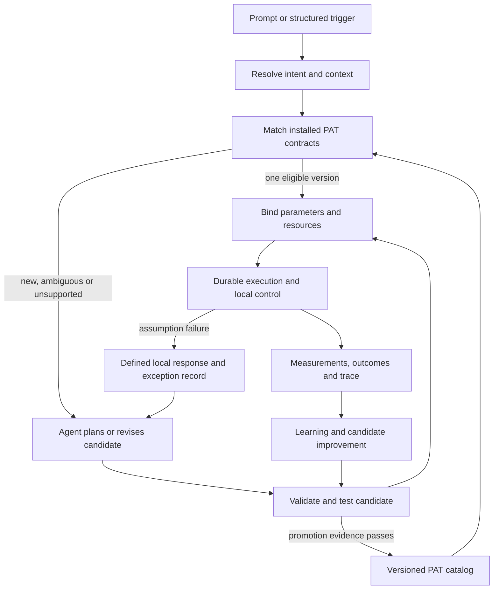

# Natural-language applications and Programs as Tools

Status: required architecture, 2026-11-07. A [typed compiler and trusted local
promotion catalog](pat-foundation.md), with [deterministic structured routing and
durable instances](pat-execution.md), are experimental host libraries. Prompt
synthesis, learning, persistent applications and MCU program installation are
not implemented yet. This
extends the user's ten-part objective: applications should start from a prompt,
select instructions from context, learn from execution and become deterministic
Programs as Tools (PATs). The [bound procedure implementation](bounded-procedures.md)
is an execution component of that design, not a claim that the whole loop exists.

## Desired interaction

An operator says, for example, “Use this Arduino to keep the enclosure between
the selected temperature limits and report when cooling is ineffective.” The
agent discovers the installed temperature input, fan output, wiring assignment,
units, operating limits and observations. It produces a concrete application,
tests its assumptions and starts the admitted version. The user does not write
an application-specific Arduino sketch. Missing hardware capabilities, ambiguous
wiring or unspecified limits become explicit planning inputs.

A reusable endpoint executor and device drivers must already exist or be
installed through a supported commissioning process. The same executor can
accept many applications expressed as instructions and bounded control programs.
A new electrical peripheral may require a new driver; a new application composed
from installed capabilities should not require a firmware rebuild. A small MCU
can run the executor while the model runs on a hub. A capable endpoint can host
both, with the same separation of planning and execution.

Many Arduino applications are persistent rules or feedback controllers. Model
them as a standing application deployment with explicit triggers and lifecycle,
not as an endlessly replayed one-shot operation. Each event-driven activation
needs a durable trigger identity and bounded effects; input epochs and sequence
numbers make duplicate events and stream gaps visible. Local control loops and
their lease/renewal policy must operate without repeated planning inference.
Manual override, suspension, restart and unmet conditions belong to that
deployment's contract. The current finite sequence profile does not implement
this persistent event/controller layer.

The application is a persistent intent with observable success conditions, not
just the text of its initial prompt. Changed user requirements create a new intent
revision. Reusing a PAT does not reuse an old execution's operation keys, deadline,
lease, endpoint session or sensor readings.

## Execution path

The fast path does not call a language model to choose each instruction. A PAT
may still use a pinned perception or numerical model when the application needs
it; “no planning inference” and “no model execution at all” are different modes.
Both must be measurable. Repeated structured triggers can use a deterministic
router. Arbitrarily worded new prompts generally need semantic interpretation;
the system must not claim zero model calls merely because it retrieved stored
code after an LLM interpreted the request.

## PAT artifact and instance

A proposed `hms.pat/0.1` artifact has an immutable digest, version and named input
schema. It contains capability requirements, typed parameter substitution,
preconditions, control flow, output/evidence contracts, execution placement and
bounded resource/effect budgets. It records exact dependency versions, tested
environment classes, promotion evidence and an applicability predicate. Data
and material references retain identity, units, frames and provenance.

The reusable artifact is separate from a bound execution instance. Binding
selects commissioned devices and drivers, verifies the capability contracts and
calibration, chooses fresh timing and replay identities, and records the exact PAT
digest and arguments. An exact retry of that instance keeps all its identities;
a deliberate later run creates a new instance. A PAT must never copy a successful
run's replay key or quietly substitute a new key after an unknown outcome.

The existing ordered procedure profile contains fully bound immutable child
invocations. It can be a first lowering target for straight-line PATs. It does
not yet represent reusable parameters, predicates, conditional branches, loops,
stream processing or local feedback controllers. Those are required extensions,
with explicit target feature negotiation. Unsupported instructions must be
reported during lowering rather than silently dropped or emulated with different
timing semantics.

For a tiny MCU, use a verified compact instruction representation over installed
primitives. Specify instruction counts, memory allocation, numeric behavior,
maximum iterations, cumulative travel/energy/exposure and the permitted local
response when a condition cannot be met. Timing-sensitive loops run in the
endpoint or native controller. A hub can compose acquisition, analysis and device
actions; it need not stream each PWM edge or motor step from an LLM.

## Learning and promotion

Learning begins with a complete trace: proposed action, admitted intent, actual
operation state, measurements, state assumptions, overrides, unresolved effects
and task-level outcome. A successful API return or a model's self-evaluation is
not sufficient evidence of the requested outcome. Failed and refused trials stay
in the dataset, including situations in which the candidate should have declined
to act. Memory retrieval and parameter fitting are both forms of learning here;
weight updates are optional and separately versioned.

The lifecycle is `candidate → evaluated → eligible → active → suspended/retired`.
Promotion uses a deployment policy with objective evidence gates. Within an
already delegated envelope it may be automatic; the architecture does not require
a person to approve every routine invocation. Novel physical authority or a new
driver/installation follows that deployment's commissioning policy. No universal
number of successful runs establishes eligibility for every application.

Required promotion evidence includes:

- Contract and dependency checks, typed inputs, finite control flow and resource
  bounds, including negative and boundary inputs.
- Scenario tests covering the declared context envelope, sensor faults, manual
  overrides, unavailable resources, interruption and unknown outcomes.
- Outcome measurements tied to the requested task, with uncertainty and the
  distinction between simulation and physical evidence preserved.
- A comparison against retained failures and rejected applicability examples, so
  a broader input envelope is not inferred from a narrow success trace.
- An immutable executable artifact and an evaluation record that pins all tested
  dependencies. A change creates a new candidate; active code is not silently
  rewritten during execution.

The router first applies deterministic eligibility checks: capability/driver
versions, current authority, resource state, valid observations and the declared
input domain. Similarity retrieval may shortlist PATs, but does not establish
eligibility. An ambiguous match, unknown input category, changed calibration,
out-of-domain sensor state or unmet outcome can trigger agent involvement.
Ordinary resource contention and transient transport failures follow declared
deterministic handling; not every exception needs another model call.

A stopped or uncertain execution is reconciled before the agent proposes a new
physical attempt. The local response must work while the model is unavailable.
An agent's revised program becomes a new version with an explicit transition
policy for any active instance.

## Examples and measurable acceptance

| Application | Learned candidate | Deterministic reuse | Reason to involve the agent |
|---|---|---|---|
| Arduino enclosure control | Select temperature sensor and fan; derive bounded hysteresis configuration | Local sensor validity checks and hysteresis controller; periodic outcome reporting | New enclosure/fan, invalid sensor behavior or cooling outside the tested range |
| Microscope acquisition | Select focus/scan/acquisition primitives and exposure settings | Calibrated finite scan with exact sample identity and image lineage | New specimen class, failed focus metric, changed objective or calibration |
| Inspection cell | Compose fixture check, acquisition, pinned analysis and disposition | Run a versioned recipe for an identified part and tooling configuration | New part/defect category, tooling mismatch or ambiguous result |
| Hub data pipeline | Configure capture, bounded buffering, analysis and artifact storage | Route known streams and schedule admitted compute jobs | New input encoding/model, exhausted resource envelope or changed service dependency |

Acceptance requires running each eligible repeated scenario without planning
model calls, while deliberately novel or invalid scenarios take the declared
exception path. Record task success, false reuse, unnecessary escalation, model
calls, execution cost, latency distribution, resource use and effect uncertainty.
Crash tests must preserve the PAT version, executed prefix and operation identity.
Run the same contracts across supported MCU and hub profiles, reporting explicit
unsupported capabilities and actual target limits.

The [SayCan and Code as Policies full review](planning-and-grounding.md) supports
skill grounding and program composition. Voyager's authors describe an executable
skill library improved through environmental feedback; that demonstration is in
Minecraft, and does not itself establish deterministic zero-inference routing or
physical-device qualification ([official project](https://voyager.minedojo.org/),
[paper](https://arxiv.org/abs/2305.16291)). The new
[reading receipt](../research/planning/pat-learning/reading.json) covers the full
arXiv v2 paper and thirteen selected complete repository files; publisher-final
access remains a recorded gap. The [critique](../research/planning/pat-learning/notes/critique.md)
traces continued model/embedding calls and concrete program-bound and promotion
limitations. It does not claim a complete repository audit. Firmata's retained
[scheduler protocol](../research/protocols/repos/firmata-protocol/scheduler.md)
shows an existing message-programming mechanism; HMS additionally needs durable
identity, bounded effects and explicit evidence semantics.

