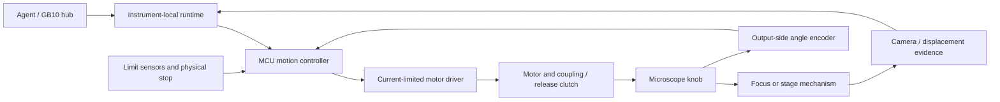

# Microscope knob retrofit: proposed engineering profile

Status: proposed design, not yet built or measured. No microscope make/model, knob geometry, torque, travel, objective clearance, motor, encoder, or electrical interface has been supplied. Values must be measured on the intended instrument before choosing components or enabling unattended motion.

## Evidence informing the design

The OpenFlexure autofocus study reports that reversal backlash can overwhelm the depth of field, that focus metrics depend on sample content, and that checking the acquired stack improves reliability. JPEG size can fail on sparse specimens; high-resolution pixel noise can mislead a local Laplacian metric. These results justify sample-aware focus validation, but their numerical performance must not be transferred to an unrelated knob retrofit. [Autofocus paper](https://arxiv.org/abs/2109.06842v2)

The current OpenFlexure code separates hardware coordinates from external coordinates and tracks backlash direction. Its Sangaboard adapter reads firmware version, polls motion completion, sends stop on cancellation and updates position afterward. A reported motor count remains distinct from an independent encoder measurement. The exact inspected files and commit are in the [repository manifest](../research/physical-ai/repos.json). [OpenFlexure server](https://gitlab.com/openflexure/openflexure-microscope-server)

Everything below is an HMS design proposal derived from those limitations and first-principles mechanical reasoning.

## Mechanical and electronic arrangement

Prefer a reversible clamp or belt/coupler fixture that leaves the instrument serviceable. Use a mechanically defined release or slip mechanism when appropriate to the load. Measure bracket compliance, axial/radial loads and slippage; do not transmit excessive side force through a precision knob shaft. A motor-side encoder can detect rotor motion while missing belt slip or coupling backlash, so locate output sensing on the knob or final driven member where feasible. Absolute knob angle still does not necessarily prove absolute objective height across multiple turns, gear ratios, and mechanical slip.

Coarse and fine knobs may be coupled or have different ratios. Treat them as competing resources until their mechanism is characterized. Do not allow two motors to fight through a shared transmission. Preserve manual access, detect manual intervention where possible, and invalidate inferred coordinates after clutch disengagement, power loss, mounting change, or unobserved manual movement.

Select a motor and ratio from measurements of breakaway torque, running torque, allowable knob torque, speed, inertia, and thermal duty cycle. A stepper's microstep command resolution is not position accuracy. Current sensing is a diagnostic signal, not a universal measurement of knob torque. Evaluate a closed-loop stepper or servo only after the required resolution, force limit and holding behavior are known.

The MCU should implement bounded moves, velocity/acceleration limits, queue limits, boot identity, watchdog, local limit checks, and stop behavior without depending on the hub. Use independent limit/stop circuitry when the hazard analysis requires it. Loss of power must not allow gravity or spring force to produce unsafe movement; holding or braking behavior is instrument-specific.

## Coordinate and calibration model

Expose separate quantities for motor counts, measured knob angle, and estimated/measured focus displacement. Each quantity has units, coordinate frame, timestamp, evidence kind, uncertainty or an explicit unknown uncertainty, and calibration revision. Never label a commanded step count as measured micrometres.

A calibration record binds instrument serial/identity, objective, mount revision, motor/driver/encoder versions, gear ratio, travel direction, zero reference, calibration procedure, measurement conditions, fit residuals, valid range, and acceptance result. It also identifies which observations establish the relation between angle and displacement. Local linear calibration may be insufficient across the full travel.

Commissioning sequence:

1. Measure geometry and establish a non-contact operating envelope with the instrument owner; identify how objective changes affect clearance.
2. Verify mounting, manual release and stop behavior with the motor uncoupled, then at a controlled low-energy setting.
3. Establish polarity and conversion through bounded test motion and independent observation; do not infer direction from wiring alone.
4. Characterize forward/reverse displacement, lost motion, backlash, repeatability, settling, slippage, and drift at representative positions and loads.
5. Measure stopping displacement and latency at each allowed speed; tighten software limits to include uncertainty and braking margin.
6. Validate focus metrics using representative sparse/dense and low-contrast samples; determine when focus must report indeterminate.
7. Test restart, disconnect, watchdog, manual override, blocked motion, and sensor failure; save the evidence and approved configuration.

For a simple constant-deceleration model, a lower-bound estimate of stopping distance is `v * reaction_delay + v² / (2a)`. Actual qualification must include controller scheduling, mechanical compliance, backlash and sensing error. The formula cannot justify a margin without measurements.

## Candidate capability set

These names describe proposed domain capabilities; the core protocol owns their lifecycle.

| Capability | Required inputs / preconditions | Result evidence |
|---|---|---|
| `axis.describe` | No motion | Supported modes, units, frames, travel/velocity bounds, sensing and stop capabilities |
| `axis.observe` | Identified device | Actual or estimated position, motion state, timestamp, uncertainty, boot/calibration revision |
| `axis.move` | Lease, calibrated frame, bounded target and speed, valid limits | Accepted operation ID followed by executed motion and final readback |
| `axis.jog` | Manual-control authority, short expiry, bounded speed | Latest-setpoint replacement and explicit deadman expiration |
| `axis.stop` | Accessible priority path | Stop requested, stop acknowledged, stationary/holding evidence or unknown result |
| `axis.reference` | Approved reference procedure and unobstructed envelope | New zero/reference revision; no movement beyond qualified limits |
| `focus.search` | Camera/axis reservation, sample/objective context, bounded z range, acquisition budget | Curve, frame IDs, selected position, confidence/quality status and reasons |
| `image.acquire` | Exposure/illumination bounds and stable focus requirement | Image artifact plus settings, pose evidence, timing and calibration references |
| `calibration.inspect` | No motion | Validity and failed conditions; recalibration is a separate authorized procedure |

`axis.stop` must not wait behind a long move in an ordinary work queue. Stop acknowledgment alone must not be equated with a physically stationary axis. Expose the difference between a normal stop, emergency stop, hold, and de-energize, according to what the device actually supports.

## Bounded autofocus procedure

Reserve the camera, focus axis, illumination and any coupled coarse/fine axis. Verify the objective and calibration revision, frame freshness, exposure settings and remaining clearance. Read actual state. Select a focus metric validated for the specimen and current optics. Reject a search range that cannot fit inside the physical envelope, including backlash take-up and braking margin.

Run an initial bounded sweep using instrument-local timing. Tag each frame with exposure time and associated position evidence; moving-image position interpolation must carry its uncertainty. Estimate a candidate peak and reject flat, multimodal, saturated, noisy, stale or boundary-truncated evidence. Approach from the characterized direction while preserving travel limits. Settle, acquire independent verification frames and, where needed, a small verification stack. Return success only when the configured acceptance criterion passes; retain measurements when the outcome is indeterminate.

A retry consumes the same finite travel, exposure, attempt and elapsed-time budget. Failure must not expand the search range indefinitely. Save raw curves and all accepted frames, not only a language-model statement that focus looks good. A VLM may select a region of interest or flag an anomaly, but cannot silently redefine the acceptance metric during a run.

## Fault and recovery requirements

| Fault | Immediate executor response | Recovery evidence |
|---|---|---|
| Hub/network loss | Finish only the declared bounded segment or enter configured hold/stop | Local operation journal, final state, expired lease |
| Camera stale/frozen | Stop focus search; preserve last valid evidence | Fresh timestamped images and camera health check |
| Encoder disagrees with commanded motion | Stop within local policy; invalidate position certainty | Mount/coupling inspection and recalibration |
| Stall/obstruction | Stop or hold per qualified controller policy; no blind retry | Physical clearance and mechanism check |
| Manual knob movement or clutch release | Revoke motion ownership; invalidate inferred transform | Re-reference/reconcile before autonomous motion |
| MCU reboot | Reject previous-epoch commands and pending assumptions | New boot ID, queue reconciliation, reference state |
| Focus metric fails | Report indeterminate; retain stack and curve | Alternate validated metric or operator intervention |
| Objective or specimen changed | Invalidate associated clearance/focus calibration | Matching configuration and new validation |
| Stop communication fails | Report unknown physical state; invoke available independent path | Independent stationary/holding observation |

## Acceptance work still required

Create a dimensional drawing and measured interface sheet before selecting a bill of materials. Build a simulated axis/camera pair with backlash, drift, stale frames, slip, and lost acknowledgments. Test nominal autofocus and rejection paths, then qualify the real assembly using the same evidence fields. Measure positioning error, repeatability, settling, focus success/failure by sample type, stop latency/distance, temperature and duty cycle. Report distributions and failures rather than only averages. This design is not a claim of microscope-specific performance or suitability for clinical diagnosis.
