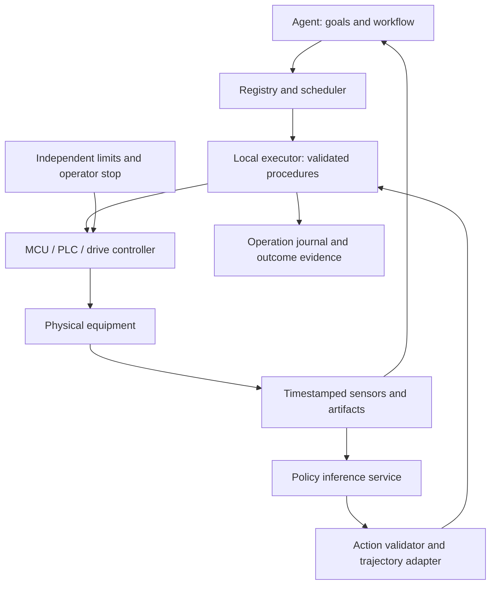

# Physical AI architecture research and HMS implications

Status: expanded research synthesis, 2026-11-06. This is a design analysis, not a hardware qualification report. Sources are archived in `research/physical-ai`; [the acquisition manifest](../research/physical-ai/manifest.json) and [later full-reading record](../research/physical-ai/reading-vla-full.json) distinguish acquisition, complete document reading and selected code inspection. No model weights, training datasets, or robot deployments were executed. The research is deliberately still open.

## Findings supported by the acquired sources

OpenFlexure demonstrates a useful separation between instrument-local hardware coordination and network clients. Its paper describes concurrent clients, asynchronous actions, hardware locks, discovery, and images stored locally with later retrieval. Its 2021 access-control limitations also illustrate that an interoperable API does not itself establish secure operation. The acquired PDF title differs from the arXiv landing-page title; the manifest records the version and both titles. [OpenFlexure software paper](https://arxiv.org/abs/2101.00933v3)

GR00T N1 combines a vision-language component with an action-generating diffusion transformer and embodiment-specific state/action mappings. The full v2 paper, appendices and numbered figures/tables have now been reviewed. Its benchmark scores include partial credit, fine-tuning can erase a learned skill, and two DexMimicGen result tables disagree. These limits belong with any claim based on the paper. This is evidence for a hierarchical learned controller, not a universal driver. [GR00T N1](https://arxiv.org/abs/2503.14734v2)

OpenVLA v3 has also been read in full, including appendices and all numbered figures/tables. Its quantization experiments show controller timing affecting task outcomes; those experiments use a narrower model variant than the headline fused-encoder model. HMS deployment evidence must bind model, precision, codecs, observations, controller mode and timing together. See the [critical review](../research/physical-ai/notes/vla-full-review.md) and [learned-control profile](learned-control-profile.md). [OpenVLA](https://arxiv.org/abs/2406.09246v3)

NVIDIA's N1.6 report describes relative action chunks, embodiment-dependent post-training, asynchronous chunking, and persistent difficulty with multi-task language following and out-of-distribution generalization. The report is historical; the acquired repository already identifies N1.7. Do not combine N1, N1.6, and current repository benchmark numbers as if they describe one system. [N1.6 research report](https://research.nvidia.com/labs/gear/gr00t-n1_6/)

The current GR00T policy guide and transport implementation expose modality configuration, checkpoint and embodiment selection, batch/time dimensions, action chunks, and a remote ZeroMQ policy service. An inference timeout is a client failure; it does not stop a robot. The service optionally authenticates with a token, and the inspected transport does not establish an encrypted hardware-control channel. Its action arrays require a deployment-specific controller and validation. [GR00T repository](https://github.com/NVIDIA/Isaac-GR00T)

DGX Spark's official hardware overview documents a GB10-based Arm/GPU system with 128 GB unified memory and network/USB connectivity. This makes it a candidate for shared inference, image analysis, planning, and registry hosting. Its advertised model-capacity and peak-compute figures are not a measurement of HMS latency, real-time guarantees, or compatibility with every CUDA/robotics package. [NVIDIA hardware overview](https://docs.nvidia.com/dgx/dgx-spark/hardware.html)

Isaac Lab supplies reusable environment, observation, action, reward, termination, and randomization infrastructure across documented simulation backends. Its current ecosystem page separates physics and rendering choices. Simulation support and sensor coverage vary by backend; a protocol should name the simulator and configuration used to generate evidence. [Isaac Lab ecosystem](https://isaac-sim.github.io/IsaacLab/main/source/isaaclab/ecosystem.html)

The inspected Gently documents distinguish samples, observations, acquisitions, and calibration from device-specific plans. Its stage implementation validates software motion limits and has a separate routine to write and verify controller limits, addressing control paths outside the agent. Those source inspections do not certify the deployed instrument. [Gently repository](https://github.com/gently-project/gently)

## Architecture space

The following classification is our design synthesis. Its rows are combinations rather than mutually exclusive product categories. A complete deployment is described by who plans, who executes, who observes, who arbitrates ownership, and who can stop motion.

| Architecture | Planner/model placement | Execution placement | Appropriate work | Failure behavior HMS must express |
|---|---|---|---|---|
| Fixed-function peripheral | None on device | Peripheral state machine, gateway driver | Relay, register sensor, DAC, simple motor driver | Gateway loss and power defaults; no assumed network identity on peripheral |
| Tiny MCU with bounded interpreter | Hub or host | MCU instruction table and timers | Arduino GPIO, timed sampling, stepper sequences | Reject oversized/unknown programs; local timeout and watchdog; reboot epoch |
| MCU with local inference | Small detector/policy on MCU | MCU controller | Event detection, anomaly classification, bounded adaptation | Model version and confidence separate from actuation permission |
| Embedded Linux appliance | Local agent or external agent | Local service plus MCU/FPGA | Microscope, appliance, bench instrument | Agent crash leaves executor and independent limits operational |
| Robot with onboard learned policy | Onboard GPU/SoC | Trajectory/whole-body controller plus drives | Manipulation, mobile robots | Observation age, action expiry, fallback trajectory, operator intervention |
| GB10 or other edge hub | Shared local LLM/VLM/policy | Device-local executors | Home, lab cluster, multiple cameras/instruments | Hub congestion cannot suspend device stop/watchdog; per-device reservations |
| Cloud-supervised edge | Cloud goal planner, local controller | Edge executor | Fleet coordination and remote experiments | WAN partition policy; bounded local continuation; no delayed stale actions |
| Industrial cell | Supervisor or MES agent | PLC/robot controller/drive | Guarded recipes, inspection, material handling | Cell state, interlocks and recovery take precedence over workflow retries |
| Legacy equipment bridge | Host agent | SDK/serial/COM/job-file/GUI adapter | Existing scientific or manufacturing assets | Report weak acknowledgment, observation gaps and possible unknown outcome |
| Federated facility | Multiple local agents | Independent facility executors | Cross-lab work, sample handoff, multi-robot work | Explicit transfer of custody and authority; avoid split-brain writers |
| Human-assisted automation | Agent plus operator | Manual action or supervised device | Loading samples, changing fixtures, ambiguous recovery | Typed human completion evidence and expiration; manual action changes state |
| Simulation / hardware-in-loop | Any | Simulator, emulator, or actual controller | Development, fault injection, policy evaluation | Mark evidence origin; prevent replay artifacts being accepted as live state |

The same device may participate in several rows. A microscope can use an MCU to generate steps, a Raspberry Pi to acquire images, a GB10 to compute focus or interpret samples, and a remote LLM to design an experiment. Only the placement changes; capability identifiers, ownership, timestamps, and failure semantics should remain consistent.

A chip without accessible I/O or modifiable firmware cannot be automated solely by declaring an HMS manifest. It needs a programmable electrical interface, a documented host API, or a physical retrofit. An unsupported physical capability must remain explicitly unavailable. Universality means representing diverse devices and adding faithful adapters, not promising that every device can perform every operation.

## Four interacting execution paths

1. Planning chooses goals and bounded procedures. It may take seconds or minutes and can tolerate variable LLM latency.
2. Supervisory execution manages resource reservations, preconditions, sequences, observation, and recovery. It remains available when the model is unavailable.
3. Control produces time-sensitive outputs at the device's required cadence. Its declared deadlines must be met by measured scheduling/controller behavior, not by a model's average inference time.
4. Data capture routes images and waveforms without forcing them through tool-result JSON or model context. It retains acquisition settings and state references alongside the data.

Safety enforcement cuts across these paths and must survive failure of the planner. A try/finally block is useful cleanup but does not run after every process, power, or hardware failure. Stop is also a physical procedure: an axis carrying a load may require controlled deceleration or holding torque rather than simply removing power.

## Protocol requirements derived from the architecture space

| Requirement | Why it is needed | Suggested representation |
|---|---|---|
| Observation validity | A correct value from the past can be unsafe now | Capture time, clock ID, uncertainty, max age, state revision, evidence source |
| Action frame and meaning | Equal-length arrays can mean incompatible motions | Units, coordinate frame, ordering, absolute/relative semantics, calibration reference |
| Policy binding | A model output is valid only for a known embodiment/configuration | Model digest, modality schema digest, normalization version, controller mode |
| Limited authority | Discovery is not permission to drive | Principal, scope, resource lease, fencing epoch, permitted envelope |
| Bounded execution | Looping or asynchronous control can outlive the caller | Deadline, maximum actions/travel/exposure, local watchdog, explicit disconnect behavior |
| Observable outcome | Driver acceptance does not prove physical success | Accepted/running/completed plus verified, failed, interrupted, or uncertain physical outcome |
| Human/manual coexistence | Manual knobs and vendor GUIs can change state | Manual-mode event, ownership revocation, recalibration requirements |
| Bulk data | Images and waveforms overwhelm tool text | Content-addressed artifacts, format, byte length, acquisition metadata, access policy |
| Distributed coordination | Network order is not physical synchronization | Trigger capability, clock error bounds, planned start, actual start, measured skew |
| Reset recovery | MCU boot can erase counters or continue queued motion | Boot ID, queue state, monotonic sequence domain, required re-homing/reconciliation |
| Versioned capability | Firmware/model upgrades can change physical meaning | Immutable manifest revision, negotiated protocol version, migration/commissioning evidence |

These are proposed HMS requirements, not claims that the reviewed projects already implement all of them.

## Timing and throughput

Budget a closed-loop decision as `sensor exposure + readout + preprocessing + queue + transfer + inference + validation + controller enqueue + actuator response`. Measure distributions and worst observed values under camera, storage, and multi-agent load. A fast kernel is only one term.

Action chunks amortize inference overhead but commit the robot to a longer open-loop interval. Record the observation timestamp on which each chunk depends, its valid-until time, first execution index, supersession rule, and executed prefix. New chunks must not replay actions already executed. Relative chunks require a well-defined reference state and composition rule.

Batching independent devices improves throughput only when the batching delay remains within each device's budget. Separate priority queues, bounded backpressure, admission control, and reserved compute for time-sensitive work are candidate mechanisms. Dropping an old preview frame can be appropriate; silently dropping a safety event, measurement required for scientific analysis, or execution acknowledgment is not.

Use local zero-copy or shared memory for high-rate data when processes share a host, with explicit buffer lifetime and ownership. Across hosts, carry the same data schema over a suitable stream. Do not expose shared mutable memory as a distributed consistency model. A GB10 hub can cache manifests and compile procedures while device execution remains independent of hub memory.

## Three scenarios

### Home IoT with an agent

A comfort task composes occupancy observations, temperature readings, and thermostat/setpoint capabilities. The hub selects a policy under user schedules and device limits; endpoints enforce their own bounds. The agent receives summarized changes, not every sensor packet. If an occupancy sensor goes stale, the declared conservative fallback applies. A network reconnect must reconcile actual thermostat state before replaying a desired-state update. Locks, gas valves, security systems, and high-power loads need distinct profiles; calling all of them Boolean switches hides their physical consequences.

### Scientific experiment automation

An experiment references sample identity, preparation, calibration, instrument capabilities, and an acquisition recipe. The executor reserves the focus axis and camera, verifies the sample/objective configuration, runs a bounded autofocus/acquisition procedure, and emits images with timing and settings. A VLM can propose a new region or classify quality; the executor validates the proposal against the remaining travel and exposure budget. An analysis result never silently replaces raw observations. Invalid focus, saturation, missing frames, or stage uncertainty produces a failed/partial result with retained evidence, not an automatically successful experiment.

### Manufacturing automation

An agent chooses an approved recipe and work order; a cell controller owns interlocked motion and process timing. The runtime requires fixture identity, tool calibration, material/batch identity, cell availability, and verified program revision. A vision model produces inspection evidence tied to the part and its imaging conditions. Communication failure after a robot pick creates an uncertain material location; recovery reconciles gripper and cell sensors before any retry. Coordinated controllers need declared synchronization capability rather than assuming simultaneous HTTP calls are simultaneous motion.

## Critique and next work

A universal tool surface is possible at the capability/lifecycle level. Universal physical semantics require domain profiles, units, evidence and state transitions. Free-form code is useful for composing primitives on a capable host; it cannot substitute for a qualified device driver, bounded controller, or clear action semantics. A registry should index deployable evidence and compatibility constraints, not just natural-language descriptions.

This pass does not exhaust physical AI. Extend the completed GR00T/OpenVLA reviews with SayCan, Code as Policies, RT-2, Open X-Embodiment, Diffusion Policy, π0/π0.5, asynchronous/real-time chunking, TinyML deployment literature, Micro-Manager, EPICS/Tango and further laboratory orchestration papers. The [laboratory workstream](../research/laboratory/notes/labop-bluesky-review.md) now covers LabOP, selected Bluesky docs/code and the full SiLA core/mapping review; other implementation paths remain open. Add agriculture, energy, building controls, field robotics, transport, underwater/space links, and medical-device constraints as distinct deployment analyses. Evaluate actual GB10 package compatibility and timing before choosing its deployment stack. No medical or industrial certification claim follows from this architecture.
