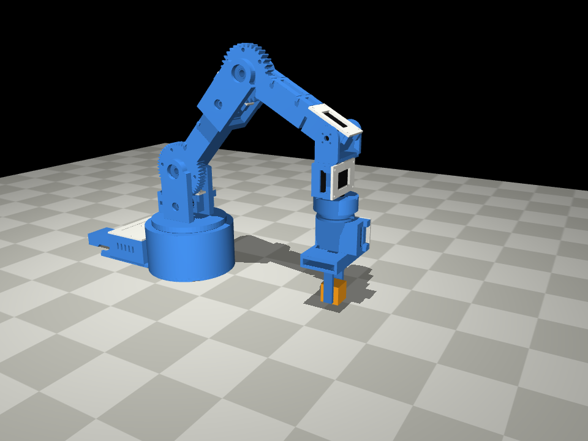

# BHMS Arm — universal actuator hardware

BHMS Arm is a 5-axis desktop arm built from Feetech STS3215 12 V serial
bus servos. It has a quick-change tool flange and four end effectors:

* parallel gripper
* compliant knob turner with an output encoder
* button presser with a force-sensing tip
* slider/rocker pusher

An RP2040 controller board drives the arm. A hardware E-stop cuts the
servo power with no firmware involvement. The arm is the physical
counterpart of the SimLab arm twin: `sim/bhms_arm.xml` is generated from
the same parameters and CAD solids that produce the printed parts.



**Status.** Design only (Task 13a). Nothing has been printed, assembled,
powered or certified, and no PCB has been manufactured.

* CAD, MJCF and PCBs are checked by tools: OpenCASCADE, trimesh, MuJoCo
  4.0.1, KiCad 10.0.6 `kicad-cli`, Freerouting 1.9.0 and the scripted
  checks in this tree. Results are in `docs/design.md` §10.
* Both PCBs are fully routed (the controller needed a scripted completion
  pass after the autorouter, `pcb/finish.py`) with 0 KiCad ERC/DRC errors.
  They have not been reviewed by a person: read `docs/design.md` §12 (O7)
  before ordering. `pcb/build.py fab` refuses to write Gerbers for any
  board that has known open routing (`pcb/<board>/known_open.json`) and
  writes `DO_NOT_FABRICATE.md` instead.
* The arm falls when the E-stop cuts power (no brake): `docs/design.md` §9.
* Firmware (Task 13b): `firmware/` (README.md). Its contract is `firmware/INTERFACE.md`.

| | |
|---|---|
| Reach (shoulder axis → flange) | 400 mm (180 + 140 + 80) |
| Rated load | 250 g carried object, tool excluded, 70 mm beyond the flange, plus the 159 g gripper. Static 2× margin against the enforced servo torque limits at every joint (shoulder 2.06× at its 78 % limit, elbow 3.62×, wrist 4.64×); machined steel shoulder pinion |
| Joints | yaw ±150°, shoulder −20…+95° (3:1), elbow −5…+125° (2:1), wrist pitch ±100°, wrist roll ±150°, plus coupled pitch limits (shoulder+elbow ≤ 175°, elbow+wrist ≤ 165°, sum of all three ≤ 183°; `firmware/INTERFACE.md` §3.2) |
| Tool flange | 3-lug bayonet locked by a +30° wrist roll; 6 pogo contacts: 12 V, GND, bus, AUX1, AUX2, tool ID |
| Controller | RP2040, 16 MB flash, USB-C, 12 V in with fuse/TVS/reverse protection, half-duplex servo bus, INA219 rail sensing, hardware E-stop loop, tool port, RGB LED, SWD |
| Cost (estimate) | see `bom/bom.csv` totals |

## Layout

```
params.py lives in cad/ — every dimension, ratio, limit, servo ID and tool ID
cad/            build123d part modules (cad/parts/*.py), build.py, mesh/clearance/torque checks
cad/out/        STL (committed, each < 2 MiB), STEP (manifest only), parts/assembly/check JSON
sim/            gen_mjcf.py -> bhms_arm*.xml, scene_pick.xml; test_arm.py; results/sim_results.json
pcb/            controller.py, tool_contact.py (circuits + placement), KiCad writers, router glue, DRC
pcb/<board>/    .kicad_sch/.kicad_pcb/.kicad_pro (KiCad 8 format), netlist, reports, fab/ (Gerber, drill, pos)
bom/            build_bom.py -> bom.csv
firmware/       RP2040 firmware: portable core, host simulator and tests, pico-sdk port; INTERFACE.md is the contract
docs/           design.md (requirements, torque budget, safety, decisions), assembly.md, img/
verify.sh       regenerate + verify everything
```

## Regenerate

The worker used for verification had build123d 0.13 / OCP 8.0.1 and
trimesh 5.2 in one venv, MuJoCo 4.0.1 in another, and KiCad 10.0.6
unpacked from the Ubuntu .debs:

```bash
CAD_PY=~/venvs/cad/bin/python SIM_PY=~/venvs/arm/bin/python \
FREEROUTING="xvfb-run -a java -jar freerouting-1.9.0.jar" ./verify.sh
```

With `FREEROUTING` unset (or `SKIP_ROUTE=1`) `verify.sh` imports the
committed Freerouting sessions (`pcb/*/*.ses`) instead of re-routing, which
reproduces the committed boards exactly. A missing `kicad-cli` fails the
run unless `ALLOW_NO_KICAD=1` is set; then the KiCad ERC/DRC/Gerber steps
are reported as SKIPPED in the summary. The interference check uses
`CLEARANCE_JOBS` worker processes (default 6) and takes about 10 minutes.

Each step is also a plain script: `cad/build.py`, `cad/check_meshes.py`,
`cad/check_clearance.py`, `cad/torque_budget.py`, `sim/gen_mjcf.py`,
`sim/test_arm.py`, `pcb/build.py {generate,route,check,fab}` and
`bom/build_bom.py`.

## Using the twin in SimLab

Load `sim/bhms_arm.xml`; it has the gripper. Variants `bhms_arm_<tool>.xml`
carry the other tools. Actuator, joint and sensor names match the
firmware's joint names (`base_yaw`, `shoulder_pitch`, …). Tool TCPs are the
`tcp` site. Keyframe `home` (yaw 0°, shoulder 30°, elbow 90°, wrist 45°, roll 0°) is the pose the
controller reaches after calibration and the rest pose for a normal stop; it satisfies
all joint and coupled limits.
