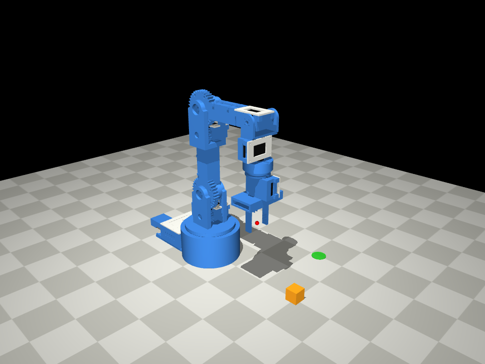

# BHMS Arm — design

Status: design complete, verified by tools and by scripts. **Not built,
not powered, not certified.** Every number below either comes from
`cad/params.py` or was measured by one of the scripts in this tree on the
generated outputs. Numbers marked *estimate* are not datasheet values.

## 1. Requirements and how they are met

| # | Requirement (Task 13a brief) | Design | Verified by |
|---|---|---|---|
| R1 | 5 revolute joints + tool flange | yaw, shoulder pitch, elbow pitch, wrist pitch, wrist roll; bayonet flange | MJCF loads (`sim/test_arm.py`) |
| R2 | STS3215-class servos, 12 V, magnetic encoder, current feedback | Feetech STS3215 12 V (C018, 1:345), 8 in total (5 arm + 3 tools) | BOM |
| R3 | Reach ≈ 400 mm | shoulder axis → flange face 400 mm (180 + 140 + 80) | `params.Arm.reach` |
| R4 | 250 g at full reach with a 2× margin | 250 g rated load (tool included) at 50 mm beyond the flange; shoulder and elbow 2:1 spur reductions | §4 torque table, MuJoCo gravity hold |
| R5 | Parametric CAD in build123d, STL + STEP, printer tolerances | 33 part modules, `cad/build.py`, `Printer` fits, tolerance coupon | trimesh: 33/33 watertight single bodies |
| R6 | Printed base clamp + cable routing | C-clamp on the base tongue; rear cable grooves + clips; service loops | CAD |
| R7 | MJCF from the same CAD (masses, inertias, limits, actuators) | `sim/gen_mjcf.py` reads `cad/out/assembly.json` | MuJoCo load + hold + pick |
| R8 | Quick-change flange: power, 2-wire bus, tool-ID resistor | 6 pogo contacts: 12 V, GND, BUS, AUX1, AUX2, TOOL_ID | CAD, PCB |
| R9 | Gripper, knob turner (compliant collet + AS5600), button presser (FSR tip), slider pusher | four tool modules sharing one plug and one contact PCB | CAD, mesh and interference checks |
| R10 | Controller: RP2040, 16 MB flash, 12 MHz, USB-C + ESD, 12 V with reverse/TVS/bulk, 5 V + 3.3 V, half-duplex bus buffer, E-stop high-side cut, INA219, tool connector, RGB LED, SWD, boot/reset | `pcb/controller.py` | kicad-cli ERC/DRC + scripted DRC (§10) |
| R11 | KiCad project generated by script, netlist, DRC, Gerbers | KiCad 8-format files written by `pcb/kicad_writer.py`, routed by Freerouting | §10 |
| R12 | Costed BOM with MPNs | `bom/bom.csv` | `bom/build_bom.py` |
| R13 | Docs with assembly steps | `docs/assembly.md` | — |

## 2. Overview

The design has four groups:

* **Base**:
  * A PETG plate carries the yaw servo in a cradle and a rear tongue for
    the table clamp.
  * A shell holds the 6806-2RS turntable bearing and a pod for the
    controller PCB. The PCB connectors line up with cut-outs in the pod's
    rear wall; both use `params.Controller`.
* **Turret and links**:
  * Shoulder and elbow are identical geared joints. A 17-tooth module-2
    pinion on the servo horn drives a 34-tooth gear printed into the next
    link's hub. The hub turns on an M8 shaft in two 608-2RS bearings.
  * The pinion has an outboard 624-2RS support against the mesh
    separating force.
  * The wrist pitch is direct drive. Its bracket rides on the servo horn
    on one side and on a 624-2RS idler on the other.
  * The roll servo sits on the bracket bridge.
* **Flange**:
  * A 3-lug bayonet socket on the roll horn.
  * Six spring contacts sit on a 12 mm radius at 60° spacing.
  * A stop pin sets the locked angle and an M5 ball plunger holds it.
* **Tools**:
  * Every tool starts with the same plug: a lip with entry notches, a keyed
    recess for the contact PCB, the stop-pin slot, a detent dimple, and a
    grooved, keyed collar for the tool rack.

## 3. Kinematics

Zero pose is the "candle": every link vertical. Pitch joints rotate about
+y; positive pitch tilts the link toward +x.

| Joint | Parent → child offset | Axis | Range (deg) | Ratio | Servo span |
|---|---|---|---|---|---|
| base_yaw | world → turret: z 70 mm | z | −150 … +150 | 1 | 300° |
| shoulder_pitch | turret → upper arm: z 80 mm (shoulder axis 150 mm above the table) | y | −75 … +95 | 2 | 340° |
| elbow_pitch | upper arm → forearm: z 180 mm | y | −5 … +125 | 2 | 260° |
| wrist_pitch | forearm → wrist: z 140 mm | y | −100 … +100 | 1 | 200° |
| wrist_roll | wrist → flange face: z 80 mm | z | −150 … +150 | 1 | 300° |

* **Absolute position at power-up.** Every geared joint keeps its servo
  span below 360°, so the servo's 12-bit single-turn encoder still gives
  an absolute joint angle at power-up. No homing switches are needed.
  This is why the reduction is 2:1 and not 3:1 (decision D3).
* **Elbow limit.** The +125° limit comes from the CAD interference check:
  at 135–140° the forearm touches the elbow servo lid.
* **Picking from the table.** The gripper points straight down at radii
  from about 150 mm to about 330 mm from the yaw axis. The near limit is
  set by the elbow range; the far limit by reach.
* **TCPs.** From the flange face: gripper 124.3 mm, knob turner 116.0 mm,
  button presser 136.2 mm (plunger extended), slider pusher 78.5 mm.

## 4. Torque budget (static worst case, 2× margin)

* **Method.** `cad/torque_budget.py` reads `cad/out/assembly.json`. Link
  masses and centres of mass come from the CAD solids (printed-part mass
  model, §5) plus purchased hardware (servos 55 g, bearings, shafts,
  harness).
* **Load case.** The arm is outstretched horizontally (shoulder 90°,
  elbow 0°, wrist 0°). The rated load of 250 g, tool included, acts
  50 mm beyond the flange. Including the tool follows the ISO 9283
  convention. The gripper tool weighs 160 g, which leaves 90 g for the
  grasped object.
* **Servo torque.** Servo torque = joint torque / (ratio × gear
  efficiency). Printed-spur efficiency is taken as 0.92.

| Joint | Static joint torque (N·m) | Ratio × η | Servo torque (N·m) | Required with 2× (N·m) | STS3215 stall (N·m) | Margin vs stall | Est. holding current (A) |
|---|---|---|---|---|---|---|---|
| shoulder_pitch | 2.32 | 2 × 0.92 | 1.26 | 2.52 | 2.94 | 2.33× | 1.31 |
| elbow_pitch | 1.03 | 2 × 0.92 | 0.56 | 1.12 | 2.94 | 5.27× | 0.66 |
| wrist_pitch | 0.38 | 1 × 1.00 | 0.38 | 0.76 | 2.94 | 7.70× | 0.50 |
| base_yaw, wrist_roll | 0 (no gravity load) | 1 | — | — | 2.94 | dynamic only | idle |

* **Cross-check against MuJoCo.** MuJoCo's gravity torques in the same
  pose are 2.39 / 1.09 / 0.45 N·m. They are slightly higher because the
  simulation test puts the extra payload at the gripper TCP, 124 mm out,
  not at 50 mm.
* **Direct-drive comparison.** Without the 2:1 reductions the shoulder
  would need 4.6 N·m with margin, and the elbow 2.1 N·m. A single
  STS3215 meets neither with a 2× margin.
* **Thermal limit.** The worst-case shoulder servo torque, 1.26 N·m, is
  above the STS3215's continuous rating, taken as 1/3 of stall
  (0.98 N·m, *estimate*). The arm can hold that pose but should not dwell
  in it; the firmware monitors servo temperature (INTERFACE.md §3.1).
* **Gear teeth.** Lewis bending stress at the 17-tooth pinion at full
  servo stall:
  * F = 2.94 / 0.017 = 173 N.
  * σ = F / (b m Y) = 173 / (14 × 2 × 0.30) ≈ 21 MPa.
  * PETG yields around 45–50 MPa, a factor of about 2.2. This is why the
    gears are PETG at 100 % infill.
* **Supply.** The worst-case holding current is about 2.8 A *estimate*;
  the PSU is rated 6 A and the fuse 5 A.

## 5. Mass model and print estimates

* **Mass model.** Each printed part has a solid shell of 1.2 mm (3
  perimeters) and 30 % infill inside it:
  m = ρ·(min(V, A·t) + 0.3·max(0, V − A·t)), with ρ(PLA) = 1.24,
  ρ(PETG) = 1.27, ρ(TPU) = 1.21 g/cm³. V and A are the exact B-rep volume
  and area from OpenCASCADE.
* **Inertia.** The uniform-density inertia tensor of each part, about its
  own centroid, is scaled to that mass. Hardware masses are added as
  uniform solids in place.
* **Accuracy.** Infill makes real inertia lower than modelled; the shell
  makes it higher. Expect ±15 %. Weigh the printed links and update
  `Printer.infill` if needed.
* **Totals.** Link masses: base 473 g, turret 212 g, upper arm 299 g,
  forearm 217 g, wrist 98 g, flange 29 g, gripper 160 g (fingers
  included), knob turner 242 g, button presser 134 g, slider pusher 43 g.
  One complete set of printed parts is about 1.6 kg of filament and about
  51 h of printing (*estimate*, 7 mm³/s average flow). Per-part figures
  are in `cad/out/parts.json`.

## 6. Mechanical details

* **Fits.**
  * Holes and pockets get `fit_clearance` = 0.2 mm radial.
  * Bearing seats use `press_fit` = −0.05 mm.
  * Sliding parts (racks, plunger) get 0.3 mm.
  * Print `tolerance_coupon.stl` first and tune these values.
* **Servo cradles.** One shared design.
  * The servo slides in sideways.
  * A 2 mm top wall under the horn takes axial load.
  * A lid (4 × M3 into heat-set inserts) closes the opening.
  * Mounting does not depend on the STS3215's own threads, so envelope
    errors are absorbed by the 0.2 mm clearance.
  * The envelope (45.2 × 24.7 × 35 mm) is from the datasheet. The spline
    position, horn diameter and horn bolt circle are *estimates*;
    measure a real servo before printing (`params.Servo`).
* **Geared joints.**
  * Module 2, 20° pressure angle, 14 mm face, 0.15 mm backlash
    allowance.
  * 17 teeth on the pinion avoids undercut.
  * Centre distance 51 mm.
  * The driven gear is printed integral with the link hub, so no torque
    passes through the M8 shaft. The shaft only carries the bearings.
* **Bayonet.**
  * Three 24° lugs at 90/210/330° in the socket mouth.
  * The tool lip has notches at the lug angle −30°. It enters, then a
    +30° roll puts the lugs over the lip.
  * The pogo springs (1 mm compression) preload the lip against the lugs,
    so the joint has no axial play.
  * The stop pin ends the rotation at 0°, and the ball plunger snaps into
    a dimple there.
  * The pads are placed so that the pins are between pads during entry and
    on the pads only when locked. Tool power is therefore never
    hot-plugged by the mechanism.
* **Tool rack.** Each tool hangs plug-up. The fork lip rides in the
  collar groove, and a key in the fork stops rotation. The wrist roll
  alone locks and unlocks the bayonet.
* **Cable routing.**
  * Inside the base, the cables run from the pod to a rear slot.
  * Between base and turret there is an external service loop (≥ 150 mm
    for ±150° of yaw), tied to the turret's rear post.
  * Along the links, the cables lie in rear grooves (10 × 7 mm) with snap
    clips every 40 mm.
  * The roll joint gets a ≥ 120 mm loop, anchored on the wrist bridge.
* **Interference.** `cad/check_clearance.py` places every part and servo
  envelope by forward kinematics. It intersects all cross-link pairs
  exactly in OpenCASCADE. There are 17 poses (zero, every joint at each
  limit, 6 working poses), each run with every tool state: 6 tool states
  across the 4 tools.

## 7. End effectors

| Tool | Actuation | Sensing | Mass |
|---|---|---|---|
| Parallel gripper | STS3215 (ID 6): 24 T module-1 pinion between two racks in a closed guide; 0–60 mm opening | Servo position = opening; servo current/load = grip force. Torque limit 15 % ≈ 20 N per finger | 160 g |
| Knob turner | STS3215 (ID 7) → 20:40 spur → spiral PETG flexure → 8 mm shaft → TPU collet (Ø 8–28 mm knobs, 6 fingers) | AS5600 under the shaft's diametric magnet (on the contact PCB) gives the true output angle. Flexure deflection = servo/2 − AS5600 → torque, k ≈ 0.33 N·m/rad (*estimate*, beam theory, E = 2 GPa) | 242 g |
| Button presser | STS3215 (ID 8) → 4 mm eccentric cam → square plunger, 8 mm stroke, spring return | Interlink FSR 400 under a TPU cap, divider to AUX1 | 134 g |
| Slider/rocker pusher | none (moved by the arm) | none (tool ID only) | 43 g |

## 8. Simulation model

* **Generation.** `sim/gen_mjcf.py` writes `bhms_arm.xml` (gripper),
  `bhms_arm_{knob_turner,button_presser,slider_pusher}.xml` and
  `scene_pick.xml`. All of them are built from `cad/out/assembly.json`.
* **Bodies and geometry.**
  * Body frames equal the CAD link frames.
  * Inertials come from CAD as `fullinertia`.
  * Visual geoms are the printed-part STLs, plus a servo envelope mesh.
* **Actuators.** One position servo per joint:
  * forcerange = stall × ratio × η
  * kp = 30 N·m/rad × ratio² × η (*estimate*), critically damped
  * armature = rotor inertia × (345 × ratio)² (*estimate*)
  * frictionloss = 0.03 N·m × ratio (*estimate*)
* **Gripper fingers.** Two slide joints, coupled by an equality
  constraint and force-limited to 20 N.
* **Collisions.** Arm geoms collide with world objects but not with each
  other (contype 2 / conaffinity 0). Arm self-clearance is verified in CAD
  instead (§6), because convex hulls of concave links would report false
  contacts.

## 9. Controller electronics and safety concept

* **Board and power.**
  * 80 × 56 mm, 2-layer, JLCPCB standard rules (0.127/0.127 mm minimum).
    Default net class 0.2 mm track / 0.15 mm clearance. Power nets use
    1.5 mm tracks (the tool rail 1.0 mm). GND pours on both layers.
  * 12 V input chain: screw terminal → 5 A NANO2 fuse → SMBJ15CA
    bidirectional TVS → AOD4185 reverse-polarity P-FET (gate clamped by a
    12 V zener) → 470 µF.
  * Logic supply: TPS54202 buck to 5 V, diode-OR'd with USB VBUS, then an
    AP2112K to 3.3 V. The MCU therefore runs from USB alone, with the
    servo rail dead.
* **Servo bus.** 74AHCT1G125 driver at 5 V. Its TTL thresholds accept
  the 3.3 V GPIO. A 100 Ω series resistor and a 10 k pull-up complete the
  driver side. The 74LVC1G125 receiver at 3.3 V has a 5 V-tolerant input.
  ESD clamps (PRTR5V0U2X) sit on the bus and on the tool lines.
* **E-stop, independent of firmware.**
  * The servo-rail switch Q2 is a high-side P-FET. Its gate pull-down
    runs through contact A of an NC mushroom switch, in series with the
    firmware enable FET Q4.
  * Pressing the mushroom, unplugging J2, or breaking the cable all have
    the same effect: the 2.2 k resistor pulls the gate up and the rail
    goes off. This takes microseconds and involves no code.
  * The tool rail is downstream of Q2.
  * Firmware can switch the rail off at any time. It cannot switch the
    rail on while the loop is open.
* **E-stop observation (a measured property, not an assumption).**
  * Contact B of the same switch is read on GPIO8.
  * The actual rail voltage and current are read from the INA219 on the
    Kelvin shunt.
  * Comparing the two detects a welded contact A or a shorted Q2
    (INTERFACE.md §4).
* **Restart after release.** Releasing the mushroom does not restart the
  arm, because firmware clears SERVO_EN on the GPIO8 edge. This part is
  firmware-dependent; see Open issues O1.
* **Current limits.**
  * Hardware: 5 A fuse on the input.
  * Firmware: INA219 limits (warn at 3 A, cut at 4.5 A).
  * Servo: per-servo Max_Torque_Limit, plus each servo's own overload
    and overheat protection.
* **Soft joint limits, at two independent layers:**
  1. The firmware rejects goals outside the declared limits.
  2. Each servo's own Min/Max_Angle_Limit registers are set to the same
     limits.

  The CAD clearance check confirms that the limits are collision-free
  between adjacent links.
* **What this design is NOT.**
  * It is not a safety-rated machine. The E-stop loop has a single
    channel and is not monitored in hardware. It has not been assessed
    against ISO 13849-1 or IEC 60204-1 and carries no Category or PL
    claim.
  * It is not a collaborative robot under ISO/TS 15066. There are no
    validated force/pressure limits; the servo torque limits are a
    convenience, not a guarantee.
  * It is not certified for unattended operation, mains-connected
    enclosures, food or medical contact, hazardous or explosive
    atmospheres, or for handling hazardous materials. Do not operate it
    near faces or eyes.

## 10. Verification results

| Check | Tool | Result |
|---|---|---|
| All parts build as valid single solids | build123d 0.13 / OpenCASCADE (OCP 8.0.1) | 33/33 |
| STL watertight, consistent winding, one body, volume vs B-rep | trimesh 5.2.1 (`cad/check_meshes.py`) | 33/33 pass; max volume error 0.30 %; largest STL 0.35 MB |
| Cross-link interference, 17 poses × 6 tool states | OpenCASCADE booleans (`cad/check_clearance.py`) | 0 design defects; 6 workspace self-collisions at one extreme pose (`wrist_curl`: tool reaches the turret), which motion planning must avoid |
| Torque budget, 2× margin | `cad/torque_budget.py` | pass: shoulder 2.33×, elbow 5.27×, wrist 7.70× |
| MJCF loads (5 models) | MuJoCo 4.0.1 | pass |
| Gravity hold, 4 poses, rated load | MuJoCo (`sim/test_arm.py`) | max error 1.24° (outstretched), max actuator utilisation 0.44 of the force limit; pass |
| Pick and place of a 50 g cube | MuJoCo, contact (friction) grasp, **no weld** | xy error 2.1 mm, lifted 82 mm, slip 0.03 mm; pass |
| Schematic ERC | KiCad 10.0.6 `kicad-cli sch erc` (all severities) | 0 errors, 0 warnings on both boards |
| PCB DRC + schematic parity | KiCad 10.0.6 `kicad-cli pcb drc --schematic-parity` | **tool_contact: 0 errors, 0 warnings, fully routed.** **controller: 11 errors, all unconnected items (not clearance/width/drill), 132 warnings (silk_over_copper 57, isolated_copper 74, hole_to_hole 1); not fully routed (see below)** |
| PCB DRC (independent) | `pcb/drc.py`: widths, vias, hole spacing, clearance, edge, connectivity incl. pours | tool_contact 0 violations (min clearance 0.153 mm); controller 5 findings, all listed in `pcb/controller/known_open.json`: open nets VIN_RAW (F1.1 to J1.1), +1V1 (3 groups at U1.23/45/50), QSPI_SD1 (U1.55 to U2.2), GND (17 pour islands) and one via pair 0.492 mm apart (rule 0.5 mm) |
| Netlist ERC (independent) | `pcb/circuit.py:erc` | 0 problems on both boards |
| Gerbers, drill, position files | KiCad 10.0.6 `kicad-cli` | `pcb/*/fab/`; **controller Gerbers are from the incompletely routed board and must not be ordered** |

## 11. Decisions

* **D1. The rated load includes the tool**, with its CoM 50 mm beyond the
  flange (the ISO 9283 convention). With the object counted on top of the
  gripper, the shoulder would need a 3:1 reduction, and absolute encoding
  would be lost (see D3).
* **D2. Reach is measured to the flange, not to the TCP.** The arm is
  tool-agnostic, and the TCPs differ by tool (78–136 mm).
* **D3. Shoulder and elbow are 2:1 geared, and the other joints are
  direct.**
  * A 2:1 reduction keeps each servo span under 360°, so the joint angle
    stays absolute at power-up.
  * 3:1 would need homing hardware or multi-turn bookkeeping.
  * Belt drives were rejected because they add tensioners and length.
* **D4. Printed spur gears, not herringbone.** They are easier to print
  and check. The axial load is zero. Wear is accepted: PETG at 100 %
  infill, with the pinion as the replaceable part.
* **D5. Servo cradles with lids instead of the servo's own screw
  bosses.** The exact STS3215 mounting threads are not verified here; a
  clamped pocket tolerates envelope error.
* **D6. Bayonet plus pogo pins, not a magnetic-kinematic coupling.**
  * The bayonet locks positively against pull-out loads.
  * The wrist roll can actuate it, so tool changes are automatic.
  * The pad layout guarantees contact only when locked.
* **D7. One universal tool contact PCB with population variants.** The
  tool ID, LDO, AS5600 and FSR divider live on the same 28 mm board, so
  one plug and one board serve every tool.
* **D8. Five contacts plus GND instead of a separate 3.3 V pin.** Tools
  regulate their own 3.3 V from 12 V with a TPS70933 rated to 30 V. That
  keeps the six-pin interface the brief asks for.
* **D9. Servo bus driven at 5 V.** The STS bus pulls up to 5 V in common
  adapters, so the TX driver is a 74AHCT (TTL inputs). The RX buffer is a
  74LVC at 3.3 V.
* **D10. The E-stop gate loop is in series with the firmware enable
  FET.** This makes "rail on" an AND of the hardware loop and firmware
  intent. A Kelvin INA219 on the switched rail, together with contact B,
  makes the E-stop observable rather than assumed.
* **D11. The board files are written in KiCad 8 format** (version stamps
  20240108/20231120, with post-v8 tokens stripped from library copies).
  They are checked with KiCad 10.0.6, the only KiCad obtainable on the
  build machine. They have not been opened in an actual KiCad 8 install.
* **D12. Freerouting 1.9.0 (Java, under Xvfb) for autorouting.**
  * The 2.5.0 native CLI crashed with a GraalVM serialization error.
  * The 2.5.0 jar needs Java 25, which is not installed.
  * The SES routes are imported by `pcb/build.py`'s own parser into the
    KiCad 8 file.
  * Pours are filled with KiCad's `pcbnew` zone filler and copied in.
* **D13. Prices are estimates.** No live distributor quote was possible
  offline; every row of the BOM says so.
* **D14. Arm geoms do not self-collide in MJCF.** Self-clearance is
  checked exactly in CAD instead. Convex hulls of U-shaped links give
  false contacts.

## 12. Open issues and what still needs physical work

* **O1. Restart inhibit after E-stop release is in firmware.** A rev-B
  board should add a hardware reset latch: an SR latch, or a self-holding
  P-FET that needs a rising SERVO_EN edge after the loop closes.
* **O2. STS3215 details to measure on a real part:** spline position,
  horn bolt circle, horn screw threads, and whether the servo powers up
  torque-on.
* **O3. Exact MPNs still to be chosen** for the pogo pin (Mill-Max 0906
  class), the M5 ball plunger and the FSR 400 order code.
* **O4. Thermal limit.** Holding the rated load outstretched exceeds the
  shoulder servo's continuous rating. Measure the servo temperature
  rise.
* **O5. Untested in real material and practice:** gear wear, backlash
  (target < 1° at the joint), printed bearing-seat fits, flexure
  stiffness, collet grip, and tool-change reliability.
* **O6. Signal integrity of the 1 Mbps bus over the full harness** (about
  1.2 m with the service loop) is not simulated. Scope it on first
  power-up.
* **O8. Controller routing is unfinished.** Freerouting 1.9.0 (150 passes,
  then a 60-pass continuation that stalled) left VIN_RAW, +1V1, QSPI_SD1
  and 17 GND pour islands open around the RP2040. Finish by hand in KiCad
  (or loosen the placement around U1 and re-route), then clear
  `pcb/controller/known_open.json` so verify.sh fails on any open net.
* **O7. Routing quality.** The board is autorouted. A human review of the
  switch-node loop (U3/L1/C6), the crystal and the USB pair is
  recommended before ordering.
