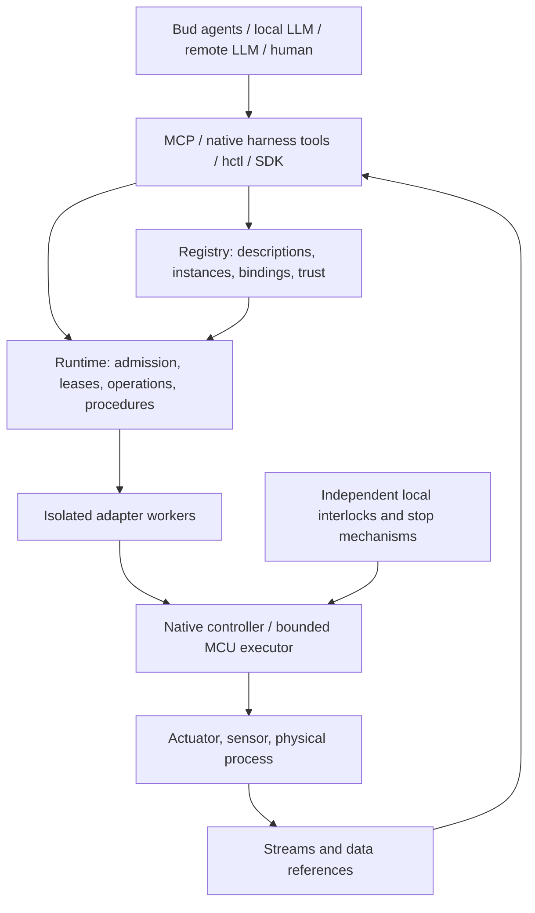

# Architecture and the foundational tool

## Decision

Provide a portable **hardware command interface**, tentatively `hctl`, backed by typed observations, operations, streams and bounded procedures. A [local simulation subset](../docs/local-control.md) now runs as `python3 -m hms`; the broader portable interface remains a design target. It is not an executable already present in most hardware. The ubiquitous foundation is sensing and actuation through device-specific I/O; no single shell, ISA, transport or electrical bus is common to every target.

Bash is useful because programs compose through stable process and I/O conventions. The corresponding hardware abstraction must additionally express physical effect, time, exclusive ownership, partial completion and uncertainty. Raw GPIO or serial access is too low-level to supply these facts. A generic `write` hides the distinction between setting an LED, starting a centrifuge and releasing a held load. Preserve simple ergonomics without erasing those distinctions.

Proposed full human/program surface (illustrative; actual subset and syntax are in the CLI guide):

```text
hctl discover --capability org.bud.positioning.axis --site microscope-bench
hctl describe dev:focus --revision <hash>
hctl observe dev:focus position --max-age-ms 100
hctl invoke dev:focus move_absolute --args-file move.json --key <stable-id>
hctl operation <operation-id>
hctl watch dev:focus --after <cursor>
hctl cancel <operation-id>
hctl procedure check scan.json
hctl procedure run <digest> --bindings-file bench.json
```

`read` can be a convenience alias for observe. `write` can be an alias only for a declared setpoint action with the same operation, authority and verification semantics as invoke. Every mutating surface, including scripts, native SDKs exposed to agents and generated procedures, MUST enter the same authority system, using the distinct normal-operation or bounded-stop admission mode defined in the execution specification. A CLI process exiting, a transport ACK and an observed physical completion are different events.

## Layers and ownership



1. **Description layer:** WoT TD 1.1 host descriptions with versioned HMS physical contracts for units, command schemas, calibration context, effect and evidence semantics; see the [description profile](05-description-profile.md). Descriptions are immutable content addressed artifacts; an instance binds them to a physical device and endpoint session.
2. **Registry:** identity, authenticated enrollment, capabilities, endpoint location, availability and deployment binding. Keep a persistent catalog separate from expiring presence. Offline devices remain historical records but are not dispatch candidates.
3. **Tool manager:** discover relevant capabilities with exact filters, authorize candidates, fetch pinned descriptions, generate model-facing affordances, and invoke through the runtime. Optional semantic search ranks candidates; it cannot establish physical equivalence or grant access.
4. **Runtime:** admission, journal, resource leases, local policy, operation lifecycle, procedure scheduling and recovery. It owns the durable truth of commands, not the agent conversation.
5. **Adapter worker:** translates semantics to vendor SDK, ROS actions, OPC UA, SCPI, Modbus, Matter, MQTT, serial, GPIO, files or UI. Blocking SDKs get separate processes with bounded queues; a stalled worker must not block unrelated devices or their stop paths.
6. **Controller:** maintains local bounded behavior and timing. MCU firmware, RTOS tasks, PLC logic, motor drives and learned policies can all be providers with different guarantees.
7. **Protection:** stop/hold/energy isolation chosen for the installation and implemented where it remains effective when the model, runtime or network fails. Software validation is not a functional safety rating.
8. **Data plane:** sensor streams, images and trajectories flow via suitable transports with schema and timing metadata. Avoid routing every camera frame through an LLM or JSON RPC.

## Deployment profiles

| Profile | Execution placement | Description placement | Required distinctions |
|---|---|---|---|
| P0 passive/legacy | Gateway drives native equipment or retrofit | Gateway | No endpoint identity/auth assumption; inferred vs measured results; exclusive bus owner |
| P1 tiny MCU | Fixed opcodes and bounded sequences in firmware; planner on hub | Full description on hub; compact capability hash on MCU | Fixed buffers, bounded parser, watchdog, boot epoch, no dynamic heap/LLM requirement |
| P2 connected MCU/RTOS | Local scheduled executor, optional tiny learned model | Compact local descriptor + hub projection | Network loss behavior, local authority, finite stream buffers |
| P3 Linux/edge | Adapter runtime and optional local agent/model | Local registry/cache | Process isolation, model scheduling separated from device watchdogs |
| P4 GPU hub/GB10 | Shared inference, planning and multi-device orchestration | Site registry | GPU load must not delay stop handling or deterministic control |
| P5 industrial cell | PLC/drive handles motion; agent supervises recipes | Cell gateway plus asset registry | Native fieldbus deadlines, shared-zone exclusion, commissioning, machine modes |
| P6 distributed fleet | Local cells remain autonomous; remote fleet coordination | Federated catalogs | Partition behavior, no cross-partition double ownership, clock uncertainty |

A profile is an implementation capability declaration, not a safety grade. CPU architecture is not part of core semantics: AVR, ARM, RISC-V, x86, GPU/NPU-assisted systems and FPGA controllers are viable through appropriate implementations. Support is earned by adapter and conformance evidence, never by listing a CPU family.

## Control and model architectures

Support agent-to-vendor-skill, agent-to-workflow, agent-to-bounded-controller, on-robot VLA, local small-model plus hub planner, centralized planning with distributed execution, peer/fleet coordination, digital-twin rehearsal and autonomous experimental optimization. A learned controller advertises model revision, embodiment/action convention, observation requirements, rate/age budgets and termination monitor. Its outputs pass through local admissibility checks; weight provenance alone does not establish action validity.

Compile repeated successful agent plans into versioned procedures only after validation against the exact deployment. “Generated code” is neither deterministic timing nor physical correctness. Reuse the plan representation across interpreters, MCU bytecode and native controllers, with explicit unsupported constructs rather than silent semantic weakening.

The [PAT lifecycle](../docs/prompt-to-pat.md) extends this into a required mode:
prompt-driven application synthesis, evidence-based promotion, deterministic
context routing and explicit escalation of novel scenarios. The reusable PAT
artifact remains separate from each execution's replay identity and live binding.
The [managed resource graph](../docs/io-driver-hub-control.md) includes endpoint
I/O, drivers and hub services, so a composite program can coordinate sensing,
compute and actuation with visible dependency changes.

## Transport strategy

Use an extensible transport binding set. Start with a host JSON control binding and a separate bounded serial binding; do not force full JSON, TLS, MCP or a distributed database onto an 8-bit controller. Existing protocols retain their strengths: ROS for robotic actions/data, OPC UA for industrial information models, Matter for home device semantics, SCPI for instrumentation, Firmata for generic MCU I/O, and vendor SDKs where necessary. These are adapter targets, not evidence of implemented support. The [constrained binding draft](07-constrained-binding.md) now has a native-tested framing component; its operation protocol, endpoint firmware and physical behavior remain unimplemented.

Shared memory is an optional same-host high-throughput binding. Use versioned layouts, sequence counters, buffer ownership and read-only consumer mappings. Commands use authenticated IPC; arbitrary writes to shared state must not bypass admission. Across hosts, explicitly serialize state and report clock uncertainty. A shared dictionary is neither globally coherent memory nor a distributed transaction system.
